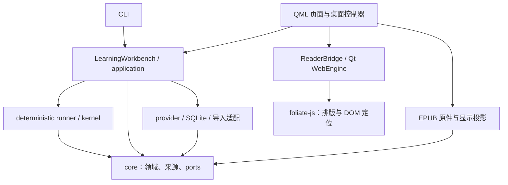

# 系统架构

本文描述当前源码的职责和依赖，是跨模块改动的入口。产品范围以 [Project Brief](../product/PROJECT_BRIEF.md) 和 [MVP](../product/MVP_SPEC.md) 为准；取舍沿革见[技术决策](../decisions/TECH_DECISIONS.md)，实际验证见[验收目录](../validation/README.md)。旧方案中的 web／Android 前端、完整插件平台和新编排引擎均不代表当前实现。

## 当前运行结构

2026-11-08 完整定名迁移：源码与分发包使用 `shinar`，目录和品牌使用 Shinar，配置前缀为 `SHINAR_*`。`configuration.py` 以标准库实现旧变量／用户路径的只读兼容；`desktop/shell/settings.py` 按键回读旧 Qt 偏好并写入新命名空间。此边界不移动真实学习库、不改变数据库结构、缓存身份或来源坐标；具体迁移表见[命名记录](../product/NAMING.md#完整工程迁移)。

默认运行形态是本地 Python 应用：PySide6／QML 桌面与 CLI 复用 `LearningWorkbench`、deterministic runner、领域模型和可替换 provider。SQLite 保存业务状态；长期 asyncio worker 承担后台工作。没有常驻应用服务器、ORM、云数据库或通用前端 JS 框架。

箭头表示当前调用／依赖方向，不表示每层均已通过依赖注入完全隔离。`application/learning_workbench.py` 仍组装部分具体存储与导入适配，桌面工作区仍调用来源适配器；这些现存耦合按下文的触发条件整理，不能让新的具体实现继续进入 core／kernel。

## 模块所有权

| 模块 | 负责什么 | 依赖与限制 |
| --- | --- | --- |
| `core/` | 材料、会话、范围、来源快照、知识上下文、预算与 provider／存储 ports | 标准库及 Pydantic；不导入 Qt、HTTP、数据库或供应商 SDK |
| `kernel/` | 按既定学习流程执行对话、反馈与事件提交 | 依赖 core；不绑定 UI 和具体 provider |
| `application/` | Workbench 用例、材料准备、上下文协作、语音协调；`source_document.py` 提供通用来源操作 | 无 Qt；既有 adapter 组装集中在公开业务入口，避免扩散到通用算法 |
| `providers/`、`infrastructure/` | 模型／语音服务、SQLite、材料导入、EPUB 原件与静态显示投影 | 依赖领域契约；不反向依赖桌面对象 |
| `desktop/` | QML 投影、导航、草稿、Qt 音频、worker、阅读器运行环境 | Qt 对象在主线程；不另造对话／预算／授权业务 |
| `local_speech/` | 可选模型目录、下载、独立运行环境、计算与模型进程 | 重模型按需加载；与 Qt 页面及核心业务隔离 |
| `realtime/` | RTC／DSP 工作进程及通信协议 | `protocol.py` 只依赖标准库；不把 SDK 对象带入 core |
| `engine/` | 独立编排实验路径 | LangGraph 不是当前桌面与 CLI 的默认执行器 |

`desktop/app.py` 是桌面装配入口。`LearningViewModel` 与 `DesktopWorkspaceController` 分别管理业务 UI 投影和页面／来源编辑状态；QML 通过公开属性、槽和信号交互。增加服务依赖时从装配／现有公开用例接入，不能让页面读取数据库、调用模型或复制材料准备流程。

桌面 Python 按以下职责组织，根目录只保留 `__init__.py`、`app.py` 和 `packaged.py`。包入口不批量导入门面，不保留旧平铺模块转发；仓内调用者使用新模块的明确公开类型。QML、翻译、图标、`reader/` 与固定 vendor 的位置不变。

| 包 | 主要对象与状态所有者 |
| --- | --- |
| `desktop.shell` | 窗口、生命周期、退出、身份、语言、偏好和 AI 设置 |
| `desktop.presentation` | `LearningViewModel`；`LearningPropertiesMixin` 与 `ConversationViewMixin` 属于同一 QObject，瞬态展示由 `ConversationPresentation` 写入 |
| `desktop.workspace` | `DesktopWorkspaceController`；`ReaderWorkspaceMixin` 复用该 QObject 的阅读、导航和编辑状态 |
| `desktop.voice` | 分轮录音、预检、Qt 音频和公开 `SpeechRoute`；`continuous/` 保管连续通话协作 |
| `desktop.speech_library` | `SpeechLibraryViewModel`；`SpeechLibraryOperationsMixin` 复用该 QObject 的目录和操作状态；下载任务列表单独管理任务 |
| `desktop.tasks` | 共享 worker、准备进度格式化、语音错误展示；不反向依赖具体语音门面 |

同一 QObject 的具名 Mixin 是职责分组，尚未隔离全部共享状态。ViewModel、Workspace 和语音库的进一步状态拆分保留为债务：出现第二个状态写入者或新增异步状态前，先冻结公开快照与失效规则，再抽出普通协作者，不能继续扩张 Mixin 或增加第二个 QObject 所有者。

桌面入口使用 `QApplication` 承载原有 QML 窗口和 Qt 系统托盘菜单；Qt Widgets 只用于原生托盘边界。
`DesktopWindowController` 保管窗口几何并在原生关闭事件中委托 `DesktopLifecycleController` 判断关闭策略。
后者管理关闭询问、隐藏／恢复和显式退出；策略 `closeBehavior` 属于 QSettings 外观偏好，默认 `ask`。
后台运行只是隐藏同一窗口，既有 worker、下载、语音和业务会话继续；不另建进程、会话或持久化路径。
显式退出由 `ShutdownCoordinator` 保持 Qt 事件循环，依次禁止新工作、停止采集／播放、取消任务并关闭进程／客户端，
确认实际执行器结束后才调用 `app.quit()`。状态为 `running/closing/closed`；15 秒仍未完成时显示错误并允许重试。
阻塞子进程有 5 秒协作取消窗口，随后只终止本应用拥有的进程树。`aboutToQuit` 保留幂等清理兜底。
托盘不可用时仍可显式退出；系统注销不拦截系统关闭。详见 Decision 0041／0043 和[桌面指南](../desktop/WORKSPACE.md#关闭窗口与系统托盘)。

### 治理后的职责模块

- `LearningWorkbench` 保管会话确认、生成、提交和恢复；`MaterialWorkbench` 在同一实例上维护导入、已读范围和参考准备职责，不产生第二个会话或持久化所有者。
- `SemanticPreparation` 保管准备流程与清单；`PreparationRequests` 单独拥有请求锁、预算预留／结算及校验缓存。provider 的配置、prompt／请求包与解析分别在独立职责模块。
- ViewModel、Workspace 与语音库各自保留一个 QObject 门面及明确命名的 Mixin；连续语音使用普通 Python 协作者，事件归约不再由 Presentation 基类承担。
- `ConversationPresentation` 是瞬态对话展示的唯一写入者，对外只暴露递归只读的 `ConversationSnapshot`；QML 读取脱离所有者的普通值。文本、分轮语音和连续语音通过 ViewModel 的 `present_conversation(ConversationEvent)` 更新，`ConversationViewMixin` 普通职责基类统一投影消息、条件清稿和发送相关 Qt 信号。不存在可写字段别名。
- `SourceLoadRequest/Result` 在无 Qt 的来源加载边界交换普通数据。Workspace 在主线程冻结偏好、材料、范围及目录，后台不读取 Qt 对象；缺件／投影失败返回错误码并文本回退。
- `BlockingRequest/run_blocking` 只开放包内具名操作，按事件循环最多两个文件／安装任务子进程。解析、投影、长材料索引、原件保存和运行环境安装等待实际进程清理；父进程安装索引缓存并提交学习数据。

### 连续语音的状态与运行接口

`ContinuousVoiceController` 保留唯一 Qt 门面，`CallCoordinator` 唯一写入通话状态，返回不可变 `CallSnapshot`；`CallPreparation` 独立管理安装任务、进度、容量缓存和资源扫描，返回准备快照。准备成功只改变准备状态，用户仍须显式开通话。

`CallRuntime` 是门面拥有的 Qt 资源适配器，通过 `CallRuntimePort` 提供录音、播放、权限、后台任务和展示等明确能力。协调器与准备协作者不持有完整 ViewModel 或分轮控制器。Qt 设备、桥、信号保留主线程；worker 输入在主线程冻结，`SpeechRoute` 捕获后端后在 worker 绑定语言模型。

`CallEvent` 原样携带通话或准备身份、类别和任务代际，经 queued signal 回主线程后先校验再归约。回复代际、音频身份、麦克风代际和暂停操作身份分别校验，不能混成同一个计数器。准备有独立取消事件与身份；更换资源根目录使旧扫描代际失效；准备结果不能重新激活旧通话。展示 token 继续沿用原任务，经统一对话展示入口处理；确认历史由 Workbench 提交。

退出依次失效准备与通话、关闭采集／播放，再由既有 worker 和受管任务链等待实际进程、客户端和默认执行器结束。取消 future 不代表清理完成。分轮语音通过 `tts_available` 读取通话朗读能力，不读取私有错误字段。AI 设置使用公开 `storage_path`，会话材料通过 `session_material()` 查询，保留当前会话冻结范围。

CLI 与桌面使用相同 Workbench 用例；CLI 导入先保存，显式确认已读范围后才能开始。默认 Mock 支持当前语义主线；旧 topic-bank provider 的兼容测试显式使用 `LegacyMockLearningLLMProvider`。

## 数据事实与显示状态

规范化材料文本及其哈希、Python 字符区间是来源坐标的事实。已读范围由 core／Workbench 验证，在会话中冻结；DOM、EPUB CFI、页码、Qt UTF-16 和滚动位置均是显示定位。显示引擎更新不能重写原文、准备缓存身份或已发消息的来源快照。

| 数据 | 所有者与存储 | 使用规则 |
| --- | --- | --- |
| 原文、材料配置、准备资料、预算、确认消息与复盘 | core／Workbench；本地 SQLite | 按操作连接与事务；WAL；草稿、候选与失败半流不冒充历史 |
| EPUB 原件 | 导入／来源适配；数据库旁 `<数据库名>.assets/sources/` | 原子保存；与数据库共同备份；包含用户内容，不作为临时缓存清理 |
| 已裁剪的显示 EPUB、DOM 与浏览器 profile | 阅读器适配；内存与临时 profile | 可重新生成；正文范围不超过当前授权，不作为学习事实 |
| 当前选段、历史预览、页面、草稿与滚动位置 | 桌面工作区内存；外观偏好另用 QSettings | 历史预览不覆盖当前编辑；草稿不写成确认消息，重启恢复能力以代码为准 |

领域数据结构与默认值须兼容旧 payload。改变规范化或索引语义必须明确版本、迁移／回退方案，不能靠重新导入静默替换既有历史。数据库、WAL／SHM 与原件目录均按敏感数据处理；日志不记录完整材料、对话、录音或凭据。

语音容量展示区分下载资产、安装磁盘准入余量、已存在文件和运行内存。`local_speech/usage.py` 在后台只读统计语音缓存，不跟随外部链接，硬链接去重；桌面共享容量组件只格式化数据，不能把安装估算当作 RAM 或最终占用。连续语音准备事件保留阶段和文件身份，单文件 100% 不表示整项准备完成。口径见[本地语音设置指南](../desktop/LOCAL_SPEECH_SETUP.md#容量与内存显示口径2026-11-07)。

页面展示过某段材料不等于学习者掌握了。反馈与复习项关联真实输出或明确的用户动作；预测、识别猜测和未发送草稿不能成为学习证据。只有转写时不推断发音质量。

## 执行、并发与失效

语音库使用普通 Python 的 CatalogProjection、LibraryOperations 和 ResourceMonitor 分别拥有目录、操作及资源监测状态；SpeechPreparationJobs 保留下载队列。后台 LibraryWork 只接收冻结请求，不读取门面字段；阶段、完成及扫描事件回主线程复核原任务身份。嵌套快照只读，QML 值脱离所有者。Qt 音频、设备、计时器与信号仍由单一语音库 QObject 适配；LocalSpeechService 仍由 ViewModel 清理链关闭。

Qt 控件、WebEngine profile 和音频对象属于主线程。网络与准备任务复用长期 asyncio worker；ZIP／文件及长文本处理进入后台，不在 QML 或 JS 中执行业务。后台结果通过 queued signal 返回，不能在 worker 中直接修改 Qt 控件。

结果生效须核对材料、会话、请求代际和当前路由；取消不是唯一的有效性保障。导航、换线程、新一轮消息与退出时，旧任务即使晚到也不能覆盖当前状态。关闭流程由创建者取消任务并释放资源，重试复用原业务入口。

对话展示事件固定为开始、确认、增量、完成、失败、打断、结算、刷新、失效、转写预览、录音时长、耗时、错误和状态通知；不引入通用事件总线。`PresentationToken` 携带会话、轮次、任务标识、门面单调代际和草稿版本。传输层先校验原任务／通话身份，再在主线程生成展示事件，后台回调不得读取新任务身份来标记旧结果。确认只允许同一任务绑定一次轮次；完成／失败／打断后拒绝继续追加，结算通知幂等。历史切换、重试与退出使旧事件失效；无 token 的刷新只用于门面当前同步状态和恢复轮询。

草稿由普通 Python SessionEditing 独占，材料／话题及准备观察由 MaterialProjection 管理，反馈／复习 DTO 由 ReviewProjection 管理。LearningPropertiesMixin 只读取快照或委托命令；ConversationViewMixin 只适配统一展示入口。LearningOperations 使用原任务 ID 接收业务结果、管理重试并在退出时失效；工作区通过 refresh_learning(ProjectionChange) 请求门面发送投影通知。Workbench 仍独占会话及持久化写入，历史投影仅读摘要。确认事件仅在已发送文本和版本均匹配时清稿。编辑新草稿不使当前有效回复失效。展示入口从 Workbench 会话快照生成历史投影，不提交消息或保存半段流；数据库、来源索引和历史 payload 保持不变。

SQLite 不跨线程共享 connection。重模型和 RTC／DSP 使用既有独立进程边界；阅读器沿用 Qt 管理的 Chromium 进程。新能力不自行添加本地 HTTP 服务、第二套 event loop 或无界任务池。

## AI 与语音主线

推理和对话是两个可独立配置、可替换的角色。默认会话自由讨论，roleplay 自愿；前台回复使用真实线程和统一 `TurnContext`，准备、记忆与按缺口协作由后台推理角色承担。材料确认与准备状态、资料有效期、范围依赖和预算规则集中维护在 [AI 专项架构](./ai/PREPARATION_AND_DIALOGUE.md)，不在阅读器或页面中复制。

桌面连接配置由 `AIServiceSettingsController` 编辑，`infrastructure/ai_configuration.py` 负责校验与原子保存，Windows API Key 使用当前用户 DPAPI 加密。QML 不读取已保存密钥；`providers/service_probe.py` 仅通过独立 worker 任务读取兼容服务的 `/models`，不生成内容。桌面两种模型从返回列表中选择，保存前复核成员身份；连接编辑使列表失效，迟到结果不能恢复旧列表，刷新不自动改选。`desktop/app.py` 启动时优先装配显式保存的界面配置，否则沿用环境配置；保存与恢复环境均在重启后生效，不替换活动会话的 provider。损坏配置不静默回退到另一服务，未配置时进入服务设置页。CLI 仍沿用环境配置，非 Windows 的安全保存另行实现。接口、路径与优先级见 [Windows 分发指南](../desktop/WINDOWS_DISTRIBUTION.md)，取舍见 Decision 0040。

语音识别结果、确认发送、完整回复和复盘进入同一会话。分轮与显式开启的连续语音沿用已有协调器、RTC／DSP 和本地／远程 adapter；设备、回声、打断和真人质量分别验收。具体状态以[语音架构](./voice/SPEECH_INTEGRATION.md)、[Python 语音指南](../desktop/VOICE_PYTHON.md)和[连续语音指南](../desktop/CONTINUOUS_VOICE.md)为准。

既有文本事实质量、一秒目标和真人语音门禁不因 UI 或阅读器更换自动通过。机制、Mock、真实模型和真实设备证据分别记录。

## EPUB 阅读器边界

Decision 0036 接受 foliate-js 与 Qt Quick WebEngine，作为原文对照区的局部显示适配。Python 保存原件、生成与规范化来源完全对应的静态显示副本；专用 `ReaderBridge` 只交换文档身份、字符区间、位置和加载事件。JS 使用成熟引擎布局，不能决定已读授权、读取任意路径或发起模型请求。

Qt／WebEngine 仅留在桌面边界，上游 JS 固定提交并随包携带许可证。其他材料及无法准确对应的 EPUB 使用原生文本回退。协议、生命周期、上游升级与后续拆分门槛以[阅读器架构](./READER_ARCHITECTURE.md)为唯一详细设计，操作和备份见[阅读器指南](../desktop/READER.md)。

## 演进顺序与已知债务

先按实际变化抽取稳定职责，再引入接口；不按行数机械拆文件，也不为假设中的第二种实现提前搭平台。

| 触发条件／优先级 | 改进方向 | 完成条件 |
| --- | --- | --- |
| 下次扩展阅读格式、引擎或阅读状态前 | 沿用无 Qt 来源加载／有类型结果与 ReadingCoordinator 阅读所有者，扩展时继续验证公开入口 | 授权、过期结果、旧资料回退与历史快照契约通过，详见阅读器专项 |
| 下次新增存储后端或资产生命周期功能前 | 将 Workbench 对具体 SQLite／资产目录的访问收敛到明确的存储接口 | 临时库、旧库恢复、重复导入和原件缺失有对应测试；不立即引入 ORM |
| 下次修改大 provider 或 ViewModel 的跨职责功能时 | 沿用已分离的 prompt／解析、投影和操作职责，保持公开接口，避免重新聚集 | 同一轮只迁移一个职责，失败恢复与既有会话保持 |
| 上游 foliate-js／PySide6 升级或正式发行前 | 更新 pin、许可与资源，检查 Chromium 分发并做窗口交互 | 依赖边界、来源映射、可见 Mock 和对应发行产物分别通过 |

完整插件 registry／manifest／权限平台、更多 Pattern、移动端及更换编排引擎是独立规划，不能作为当前阅读器和语音改动的前置。扩展方向见[插件设计](./PLUGIN_ARCHITECTURE.md)、[Pattern 设计](./LEARNING_PATTERNS.md)、[Kernel 设计](./AGENT_CORE_ARCHITECTURE.md)及[路线图](../planning/ROADMAP.md)；它们的目标对象不自动成为已实现能力。

## 可执行约束与变更要求

- `tests/test_architecture.py` 静态检查 core／kernel／RTC 协议、来源处理依赖、WebEngine 适配范围与固定 vendor 文件；不声称能识别任意动态导入或运行时授权缺陷。
- 阅读来源与会话行为由映射／工作区测试验证；QML／JS 交互另用可见 Windows Mock，详见阅读器指南。静态门禁不替代行为测试。
- 源码资源／wheel 用 `scripts/check_wheel_resources.py` 检查；Windows ZIP／安装器另查实际产物。打包检查不等于真实服务或设备验收。
- Windows 私有运行时按 `scripts/windows_runtime.py` 的版本化裁剪策略生成，保留 Python／QML／PE 依赖闭包及发布资源。安装成功后只清理明确退役的文件；升级清理与模型环境 bootstrap 均须独立验证，详见 Windows 分发指南和 Decision 0042。
- 架构变更同步此总览、对应专项契约、AGENTS 和 README；重要取舍写入现有或新的技术决策。验收数字留在日期化报告，避免在多个架构文档重复维护。
- 已知债务须说明位置、触发条件、目标所有者与验收条件。新增功能不得借“以后重构”把领域规则继续堆进 UI、WebChannel 或 vendor。
- `tests/test_maintainability.py` 约束自有生产文件 800 行、Python 函数 100 行和桌面控制器之间的公开协作边界；与行为、可见窗口及 wheel 证据分别验收。

代码风格和小步维护方式见 [CONTRIBUTING](../../CONTRIBUTING.md)，现存维护性问题的历史背景见[维护性检查](../validation/engineering/MAINTAINABILITY_2026-10-28.md)。

三个桌面门面状态所有权遵循 Decision 0046。WorkspaceNavigation、ImportEditor、ReadingCoordinator 分别独占导航／导入／阅读；ReaderPropertiesMixin 只委托，后台任务不携带界面回调。Qt 元对象公开契约、所有者不依赖 Qt／完整门面及共享写入零债务由 tests/desktop/test_facade_contracts.py 固定。
