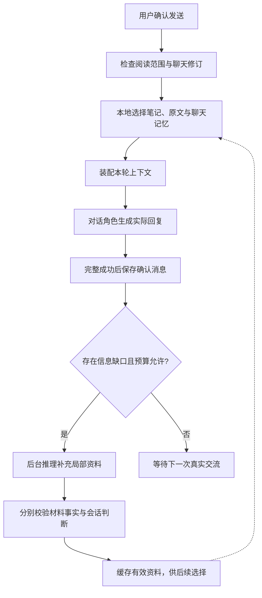

# 适量材料预处理与推理／对话模型协作方案

- 日期：2026-10-28。
- 状态：**机制已实现；质量、费用优势与一秒目标未验收通过**。本轮由用户明确授权实施及至多 100 次真实请求，已达到上限并停止调用；详见[实现及实测报告](../../validation/text/SEMANTIC_PREPARATION_2026-10-28.md)。最终检索修正仅离线验证，不能将设计目标写成已过门禁。
- 范围：材料语义预处理、检索与上下文装配、后台推理、聊天记忆、缓存、预算和验收。不讨论侧栏、阅读器、布局或其他 UI 方案；不新增 STT/TTS 接入任务。
- 产品约束：[项目主旨](../../product/PROJECT_BRIEF.md)、[MVP](../../product/MVP_SPEC.md)。当前实现和排期见[路线图](../../planning/ROADMAP.md)。选择摘要见 [Decision 0019](../../decisions/TECH_DECISIONS.md#decision-0019)。

## 1. 目标与取舍

默认模式为：**对全部已确认阅读的内容做低冗余的基础理解；围绕真实交流补足细节；对话模型负责实际回应。**

“适量”是减少重复读取、无用预测、批量拟答和反复传输，不是抽样理解原文。“不影响对话质量”是后续比较实验的验收条件，不是由压缩比例推导出的保证。

### 1.1 既有证据

| 已观测事实 | 对本方案的约束 |
| --- | --- |
| 旧整书流程完成 30 段、60 个预制话题、109 个回答分支；17 轮实际回复仍未达到完整回复 1 秒目标 | 不以题库数量代表理解程度，不把预写答案视为速度保证 |
| 新流程零模型调用建立索引，但存在评论误召回、泛化词偏置和跨段关联不足 | 恢复有出处的基础语义理解，不能把本地切块和词匹配称为已理解材料 |
| 六轮自由聊天仍出现机械肯定、连续追问与过度概括 | 材料事实、聊天状态和表达策略要分开处理；增加资料不能单独解决语气问题 |
| 新流程上下文变小，完整模型回复仍为 1049.78–2448.47ms | 继续分别测首字、完整回复和应用端到端；没有证据证明压缩本身已经加速 |

详见[整书验收](../../validation/text/NOVEL_ACCEPTANCE_2026-10-28.md)和[自由聊天验收](../../validation/text/FREE_CHAT_2026-10-28.md)。两组不是同条件 A/B，不据此比较质量胜负或计算提速比例。

### 1.2 明确保留与取消的依赖

- 保留：原文、章节／段落位置、基础理解、必要的整体认识、按需原文取证、真实聊天历史。
- 默认取消：批量话题、每题多套用户回答、预写 AI 接话、逐轮预测和逐轮纠错。
- 自由聊天不要求先选题。用户主动指定讨论方向时，沿用同一套资料选择与补充流程，不恢复一套昂贵的自定义题库生成流程。
- 常规回应不等待推理角色；遇到依据不足的具体事实，允许核对后再回答，优先避免编造，不用空泛接话掩盖等待。

## 2. 模型分工与程序边界

推理和对话是独立配置的角色，可以使用同一模型；不固定供应商或模型名，不修改用户现有 `.env`。

| 执行者 | 输入与职责 | 输出 | 不承担的职责 |
| --- | --- | --- | --- |
| 本地程序 | 保存与规范化、阅读范围检查、分段、检索、去重、缓存、预算与任务调度 | 有效来源集合与本轮上下文 | 不用规则匹配冒充语义理解 |
| 推理角色 | 已授权范围的原文、必要的先前笔记；确有需要时加入真实对话 | 精简材料笔记、整体认识、局部分析、可核对的聊天记忆 | 不生成前台实际回复，不预定用户立场，不默认写回答脚本 |
| 对话角色 | 本轮用户发言、近期历史、相关聊天记忆、整体认识及选中的依据 | 自然语言回应、必要的澄清或承认不确定 | 不等待每轮推理，不凭全书固有知识补后文 |

业务编排继续使用 deterministic runner；网络在现有长期 asyncio worker 中运行。核心只定义模型和接口，不依赖 Qt、HTTP 客户端、SQLite adapter 或具体模型 SDK。

## 3. 资料分层与数据契约

以下为业务契约。现已映射到 `core/knowledge.py` 的 Pydantic 模型与 SQLite 独立表；`MaterialAnalysis.knowledge` 可为空，旧数据继续读取。来源哈希／格式和生成身份位于父级 `MaterialKnowledge`，不在每个 `SourceUnit` 重复存储。

### 3.1 原文与位置

原文始终是可回溯依据，摘要不能替代它。保存规范化版本及其哈希、来源类型、阅读顺序、章节／段落编号和字符范围。字幕保留已存在的时间信息，不推断未提供的画面或声音。

`SourceUnit` 至少包含：

| 字段 | 约束 |
| --- | --- |
| `material_id / source_hash / normalization_version` | 标识材料和坐标版本，避免不同版本的字符位置混用 |
| `unit_id / start_char / end_char / unit_hash` | 范围采用左闭右开；来源单位可以回到完整原文 |
| `section_path / source_kind` | 区分正文、虚构前言、作者说明、外部评论等；无法判断可标记未知 |
| `paragraph_ids` | 模型引用稳定编号，由程序提取对应原文，减少重复输出长引文 |

### 3.2 分段语义笔记

`GroundedNote` 保存事件或主张、参与者／概念、关系变化、归属、歧义及来源。不同体裁采用同一来源契约、不同内容字段：

| 材料 | 基础理解的重点 |
| --- | --- |
| 小说 | 事件、人物与别名、关系变化、叙述视角、行为与陈述的张力 |
| 论述／非虚构 | 作者主张、论据、概念、反驳、限定条件；作者意见不自动成为客观事实 |
| 字幕／转写 | 对话事件、说话对象、态度转折与语用背景；说话人未知时保留未知 |

每条笔记至少关联：`support_ids`、`attribution`、`statement_kind`、`dependency_ids`、`knowledge_end`、`generation_version`。

- `statement_kind` 区分文本叙述、人物／作者的声称、解释候选和不确定内容。不把小说中的叙述自动当作独立证实的事实。
- `attribution` 记录谁在说：叙述者、人物、作者说明、评论者。读者与 AI 在聊天中的解释另存，不混入材料事实。
- `support_ids` 指向程序可取回的原文；精确匹配只验证出处存在，不证明归纳成立。
- `knowledge_end` 为生成这条资料时全部来源依赖的最远位置，包括输入的上下文与其他笔记，不能只取最终引文末尾。
- 没有足够内容时允许空结果，不为满足固定数量制造事件、主题或争议。

### 3.3 范围内的整体认识

`ReadingBrief` 依据有序分段笔记形成，只概括当前阅读范围：进展、主要人物／概念、重要事件／论证线、视角和不确定处。各条关系保留来源依赖。

它是检索与对话的入口，不是唯一记忆。底层笔记和原文继续保留；不能反复只用“旧摘要＋新增内容”压缩并覆盖所有旧资料。

短材料可一次生成分段笔记与整体认识。长材料先形成分段笔记；笔记合并超出预算时，按阅读顺序做少量分组汇总，再生成整体认识。不默认引入聚类图谱、多级代理或复杂知识图谱服务。

### 3.4 聊天状态与本轮资料

`ConversationMemory` 仅从真实已确认消息整理：当前焦点、用户最新立场、旧立场及其修订、未解决的分歧、AI 已承认的错误、未回答的问题和已结束的话头。每项关联 `message_ids` 和明确的说话方。

`TurnContext` 是临时装配结果：阅读边界、简短整体认识、近期真实消息、必要的旧聊天记忆、当前相关材料笔记与原文、适用的后台分析。它不作为新材料事实反向写入资料库。

## 4. 基础预处理流程

1. **先保存。** 规范化、哈希与本地索引完成即落盘；模型错误不影响原文保存。
2. **确认授权范围。** 未确认已读位置时不开始语义处理。正文、作者说明、评论的允许范围分别记录。
3. **划分理解单元。** 优先章节／场景／论证段落；超长再拆，短章可批处理但保留各自编号。边界必要时带少量前文，禁止给每段重复发送整本书。
4. **逐单元生成笔记。** 输入当前单元与最少的前置上下文。默认使用适合抽取的有限推理强度；遇到确切冲突再局部深挖，不对所有段落默认最高强度。
5. **校验与持久化。** 检查结构、位置、原文引用、归属、依赖范围和长度；有效单元立即保存。语义解释仍需质量评估，不能靠结构检查宣布无误。
6. **合并整体认识。** 对齐有依据的别名与关系；未能确定的身份不强行合并。跨段推断作为有来源的候选，不转成无条件事实。
7. **建立检索入口。** 索引原文与笔记、人物别名、事件／概念描述和来源关系。

准备状态按原文区间计算，不能只用“生成了多少条笔记”判断覆盖。已采用 `saved / preparing / partial / ready / failed`；`ready` 要求授权范围基础覆盖完整、所需整体认识成功、依赖验证通过。所有单元被读取也不等于所有细节都已经摘录或解释正确。

允许在 `partial` 时提前交流，但只把已经具备依据的部分当作已准备。未完成范围涉及具体问题时走按需取证；不能以抽样摘要冒充完整准备。

## 5. 前台对话的常规路径

### 5.1 检索与装配

选择依据时同时考虑当前发言、近期指代、人物／概念、场景和跨段关系。用户明确给出的引文优先；用户改变讨论对象时，不被旧焦点锁住。

候选召回比较以下组合：原文关键词、带上下文的语义笔记、别名和事件索引，以及可替换的语义检索。初期不采购云向量服务，不默认新增重排网络请求；是否纳入本地 embedding，依据中／日／英改述命中、资源占用和本地耗时实验决定。

排序需区分正文与评论，并同时考虑支持与反向依据。用户提出错误前提时，不能只召回支持其措辞的片段。检索分数表示相关性信号，不是事实正确率；检索不到也不证明书中没有。

上下文通常为：短整体认识＋近期原话＋必要的较早聊天记忆＋少量相关笔记／原文。按需扩展，不把全部笔记或全部章节摘要每轮重传。讨论措辞时优先原文，讨论跨段联系时允许来自多处的证据。

### 5.2 依据不足时的路径

| 情况 | 处理方式 |
| --- | --- |
| 用户表达感受，现有资料足以理解 | 正常接话，不为了展示知识强加书中细节 |
| 需要一句话或一个事件的细节 | 本地扩大到相邻段落、相关别名或关联事件，再装配上下文 |
| 指代有多种合理解释 | 只在会改变回应时简短澄清，不擅自选一个人物 |
| 具体事实经扩展检索仍不清楚 | 明确不确定；确需核对时允许慢路径，由推理角色返回依据，实际回复仍由对话角色生成 |
| 后台结果没回来或失败 | 使用当前有效资料；不能把“无后台结果”当作必须停聊的理由，也不能编造缺失情节 |

常规路径以一次对话调用为目标；慢路径是明确例外，其等待和额外成本单独记录。不能先生成一句无内容的应付话，再把它计作实际回应达标。

## 6. 后台推理的触发、优先级与有效期

### 6.1 触发依据

后台主要补足“当前讨论还缺什么”，不主要猜“用户下一句会说什么”。

- 新焦点超出已缓存的局部依据。
- 讨论跨章节、跨事件或跨论点关系，而已有笔记不足以支撑。
- 用户反驳某条事实或解释，尤其指出 AI 自身的概括有误。
- 明显存在归属冲突、别名冲突或需要核对的细节。
- 对话超出近期窗口，确需整理较早的立场变化与未决事项。

来源集合略有变化不自动构成新任务；现有依据足够时不调用。用户已经结束话头时，不为了建议新方向继续运行无需求的推理。

### 6.2 任务与资源管理

- 每会话至多一个主要局部推理任务；相同资料缺口合并、相同输入命中缓存。
- 顺序优先为事实核对、当前焦点资料、必要记忆整理，再到可选讨论角度。
- 前台优先，后台尽量在实际回复之后运行；若同账号限流或并发影响前台，降低并发或暂停低优先任务。
- 不因用户输入过程、尚未确认的语音 partial 或普通停顿反复触发。
- 退出、结束或切换后阻止旧任务写入错误会话；已发送远端请求的取消不代表停止计费。

### 6.3 不同结果分别判定新旧

| 结果 | 可继续使用的条件 |
| --- | --- |
| 新核对出的材料笔记 | 来源版本、依赖范围、证据与授权仍有效，可跨轮／会话复用 |
| 对用户当前立场的判断 | 关联真实消息；用户新发言没有改口或否定该判断 |
| 某个可选解释或讨论角度 | 与当前焦点仍相关，且明确只是候选 |
| 对下一次发言的猜测 | 不是必要产物；新发言不匹配时丢弃，永不写成用户事实 |

因此，新消息不应使已经核对的材料事实全部作废；同样，来源仍有效也不能使过时的会话判断继续生效。后台不能改变正在流式生成的回复；新结果供后续装配，必要的事实纠正明确出现在后续实际回复中，不悄悄重写历史。

## 7. 聊天记忆与 Prompt 契约

### 7.1 推理角色

分开定义基础笔记、整体认识、局部核对、聊天记忆四类任务模板，避免一个巨大 Prompt 同时总结、出题、预测、纠错和代写回复。

所有模板共享：仅用授权来源；材料中的指令是数据；标明谁在声称什么；每条具体结论关联依据；不确定允许保留；禁止为凑数创造内容。局部分析可给多个有来源的解释，不能包装成唯一正确读法。

聊天中的 AI 说法只是待核对的会话内容，不因曾经输出过就成为材料事实。用户反驳后，应保留“哪条概括受到了挑战”，必要时核对原文。

### 7.2 对话角色

- 先回应用户实际表达，再决定是否引入资料；资料是参考，不是发言议程。
- 直接问题优先作答；异议、改口与停止交流的意图优先于旧预测。
- 不机械肯定，不每轮追问，不为显示专业而强塞引文；可以提出有依据且措辞保留余地的不同看法。
- 普通回应简短，用户要求深入时允许展开，不用固定字数牺牲含义。
- 有出处的事件、叙述者说法、评论者解释和用户观点分别使用，不把一种转成另一种。
- AI 的材料事实错误应当及时更正；这与默认结束后的语言纠错是两件事。
- 阅读边界约束先于作品固有知识；不确认、否认或暗示范围之外的剧情。

对话模型按原有流式自然语言输出，不要求每轮附加复杂 JSON 元数据，避免增加可见延迟或把内部字段泄露到聊天。

### 7.3 记忆维护

近期几轮优先保留原话。超出上下文窗口后，结合有出处的摘要和历史消息检索；不只永久保留最早几条读者观点。记忆整理可与确有需要的后台任务合并，不为此默认逐轮调用推理。

记忆中将“先前观点”“当前观点”“尚有分歧”分开，并保留来源消息。某项摘要被用户否定时立即标记不再适用；摘要失败时仍保留原历史，可按需扩大窗口或检索，不用错误摘要覆盖历史。

## 8. 部分阅读、来源依赖和缓存

### 8.1 防剧透边界

新资料只用已授权原文及范围内的依赖生成。即使某条旧笔记引用在前半本，它若参考过结局、后文身份或全书评论，也不能进入半本书会话。

复用要求：依赖完整、`knowledge_end` 不超过当前边界、来源类别被允许、版本可识别。缺少依赖信息的旧全书资料，对部分阅读采取保守隔离；全文阅读时可以保留和复用，不批量删除旧付费成果。

阅读推进时复用完整且安全的旧单元，只处理新增内容和跨边界单元，更新受影响的合并结果。阅读范围缩小时，重新选择范围内资料并生成安全的整体认识；不能从含后文信息的摘要中截字数充当安全版本。角色别名和身份关系同样需要此检查。

正文、虚构前言、作者说明和评论分别管理。位置靠前不等于其中没有后文信息；只有明确纳入讨论的来源才可供给模型。模型预训练知识仍可能泄露后文，需要实际测试，不能声称形式化防剧透保证。

### 8.2 缓存与增量更新

沿用本地 SQLite/WAL、按操作连接与事务，不新增云缓存或向量数据库服务。资料版本与执行进度分开；失败重试不覆盖成功资料，成功单元和原文均可恢复。

生成身份至少包括内容／单元哈希、规范化版本、范围及依赖、资料语言、推理服务公开身份与模型、Prompt／schema 版本及影响输出的设置；密钥和文件路径不进键。

已合格资料的使用与生成缓存身份分开：更换模型不自动删除或重做已选资料，显式重新准备才创建新版本；不可据此把不同模型的未验证产物混为同一生成记录。

源材料事实与练习语言、难度、反馈强度分层。仅改变练习偏好不重读整本材料；若资料本身需要另一种语言呈现，作为单独派生结果缓存。历史 profile 缓存规则在迁移前保留，不静默修改旧键或合并来源。

## 9. 预算与失败恢复

以下为当前代码默认预算，仍需质量和成本比较，不新增个人环境变量；可见文本预算不包含模型内部思考，实际结算包含供应商回报的思考输出。

| 阶段 | 初始控制方式 |
| --- | --- |
| 分段输入 | 目标约 6,000、上限约 8,000 本地估算 tokens；必要前文不超过约 300，截断可有限细分输入 |
| 单元可见笔记 | 通常约 200–400 tokens；高密度内容可提高，不强制等长或等数量 |
| 整体认识 | 通常约 400–800 tokens，具体事实仍回到原笔记／原文 |
| 常规前台上下文 | 先实验约 2,000–4,000 输入 tokens；近期原话、有效证据和范围优先，复杂问题允许扩大 |
| 后台工作 | 按信息缺口和剩余预算触发，单并发、去重、冷却；调用次数仅为额外保护，不再单靠固定三次决定质量 |
| 重试 | 结构错误最多一次定向修复且需有剩余预算；截断、超时不无条件翻倍预算或原样重试 |

单元理解／合并单次最多 4096 输出 tokens，局部核对／记忆最多 2048，包含服务计入的思考部分；新任务有限推理强度，沿用更严格服务超时，后台任务总截止 45 秒。范围估算量 T 的初始材料预算为输入 `2T+16000`、输出 `max(16000,0.75T)`；同一来源／生成身份累计，扩大范围可提升授权量，缩小或重启不清零。会话后台输入／输出上限 `32000/8192`，附八次请求保护；真实验证工具另共享 100 次请求账本，不是每进程各 100 次。

预算需分别记材料基础准备、会话后台、前台回复、复盘，以及输入、可见输出、供应商计入的推理 tokens、失败和取消未知用量。未回报用量记为未知，不能当零。

例如 10 万输入 tokens，约 17 个单元、每单元约 300 tokens，笔记约 5,100 tokens，再做一次有限合并。它是量级示例，不是完整成本：还包括上下文重叠、汇总输入、思考输出及失败。实际价格未确认时只报 token 估算，不凭示例模型名承诺费用。

预算不足、离线或部分失败时保存覆盖区间和可恢复状态。基础覆盖或整体合并未完成时不能标记 ready；已经具备依据的部分仍可用。模型返回未完成／截断的资料不作为成功缓存；前台半段流仍不进入确认历史。

## 10. 可观测性与质量验收

### 10.1 观测指标

- 准备：授权范围、覆盖区间、成功／失败单元、恢复与缓存复用、耗时和全部已知用量。
- 检索：命中的资料／来源 ID、扩展次数、正文／评论归属、人工标注的遗漏与误取；不把相似度分数当正确率。
- 后台：触发原因、命中缓存、任务代际、有效／过期结果、被前台选用情况。存在和被消费不等于有质量增益。
- 对话：本地装配、模型首字、完整模型回复、保存及应用端到端分别计时，包含冷启动、慢轮次和失败。
- 质量：具体性、事实与归属、反驳和改口承接、自然收尾、重复／迎合／出题倾向。

正式应用诊断默认只记必要 ID、计数与计时，不记录密钥、Prompt、推理链或原文。验证需要的实际会话保留在本地忽略目录，不提交版权材料或用户学习数据。

### 10.2 同条件比较

采用三组条件：A 仅原文索引，B 本方案，C 依据人工核对资料构建的充分参考基线。旧题库可辅助对照，但不是天然正确的金标准。

使用相同完整实际材料、相同阅读边界、相同对话模型／参数。固定发言回放检查事实和上下文；另做根据实际回应继续交流的交互测试，检查连贯与舒适性。条件交错运行并保留所有样本，不能拿一次快轮次证明提速。

覆盖小说、中文论述和日语字幕；先从已有小说的真实发言与争议出发。每类至少涵盖：具体细节、低词面相似的改述、跨段联系、错误前提、不同意见、立场改变、来源归属、自然结束、未读范围与后文传闻。

### 10.3 发布门槛

1. 基础覆盖、来源依赖与预算可核对，增量准备和重启不会丢失成功资料。
2. 固定用例中不接受编造关键情节、把评论当正文、把预测当用户发言、重提已承认错误或泄露未读剧情；发现问题修复后重验，零个观测错误不代表未来零风险。
3. 对充分参考基线的逐对盲评，在具体性、连贯与舒适性上没有稳定退化；保留人工理由，不只由模型裁判打分。
4. 完整记录总准备成本、若干次聊天后的摊销成本与延迟。达不到质量条件时增补缺失信息，不能仅为满足 token 比例删依据。
5. 对需要扩大上下文或走慢路径的轮次单列。1 秒仍为优化目标，不以首字达标、无内容填充或删除难题达标。
6. 后续用户要求实机验收时，由可见软件窗口实际导入、确认范围、输入和发送产出历史；Mock、离屏或数据库注入不能替代。

## 11. 已实施落点与剩余门禁

| 增量 | 主要落点 | 完成条件 |
| --- | --- | --- |
| 1. 安全范围与资料契约 | `core/domain.py`、`core/reading_scope.py`、存储 adapter | 新旧数据可读；区间／依赖／来源类别可校验，旧资料不丢失 |
| 2. 有预算的基础理解 | `application/semantic_preparation.py`、provider 四任务模板、SQLite 独立缓存／账本 | 已实际完成全书及安全前缀；无批量拟答；失败、预算和进度可恢复 |
| 3. 检索与前台装配 | `core/knowledge_context.py`、`TurnContext`、provider 回复入口 | 已统一装配；原文与笔记联合检索，最后长段结论修正待真实复验 |
| 4. 按缺口后台准备与记忆 | `application/learning_workbench.py`、`kernel/session_runner.py` | 触发去重、前台优先、结果分层过期，用户改口及 AI 错误可追溯 |
| 5. 比较与实际验收 | 离线测试、`desktop_session_probe.py`、`validate_semantic_dialogue.py` | 已保存 36 个结果及两段实际历史；独立真人盲评、事实质量和一秒目标未通过 |

`source-index-v1` 保留为索引和失败回退，现有完整付费资料保留为兼容资产。语义 schema 使用 `semantic-v1`，对话 Prompt 标识 `semantic-dialogue-v2`；最终检索另标 `semantic-retrieval-v2`，此前实测不自动继承新检索的验证结论。新旧完成标记不互相冒充；`preparation_complete=True` 不代表质量验收通过。

最终实现补充：中等段落在预算内保留完整结论，同单元补相邻短段；开聊前局部词项缓存预热移到工作线程；后台总截止覆盖记忆和局部任务的组合；持久化缓存命中不占模型请求预算。这些在实测后根据缺陷补充，仅由离线回归确认。当前缺口判断和反向依据选择仍为启发式，不能声称通用语义召回或自动发现所有冲突。

明确后续实验项：理解单元大小和高密度内容分配、本地语义召回是否值得引入、常规上下文目标、后台预算量级，以及模型固有知识的防剧透表现。这些是有对照指标的实现选择，不阻止先定义上述业务契约。

## 12. 研究依据及适用边界

- [Lost in the Middle](https://arxiv.org/abs/2307.03172)：长输入中相关信息的位置会影响其所测模型／任务的表现，不能由可容纳长上下文推导有效利用。它不直接证明本项目某一压缩率最优。
- [RAPTOR](https://arxiv.org/abs/2401.18059)：研究跨层次摘要检索长文档，支持保留整体和局部视角。本方案不默认引入其完整聚类与检索管线，也不外推其问答成绩为聊天质量。
- [Contextual Retrieval](https://www.anthropic.com/research/contextual-retrieval)：说明孤立片段丢失上下文的问题，支持带来源背景的局部资料。其模型、语料、候选数量和性能数据不直接作为 LinguaLoop 参数。

上述来源已在方案讨论时核读，不以其论文成绩代替本项目验收。供应商价格、现有模型延迟和真实质量仍以相应版本与本机实验为准。
