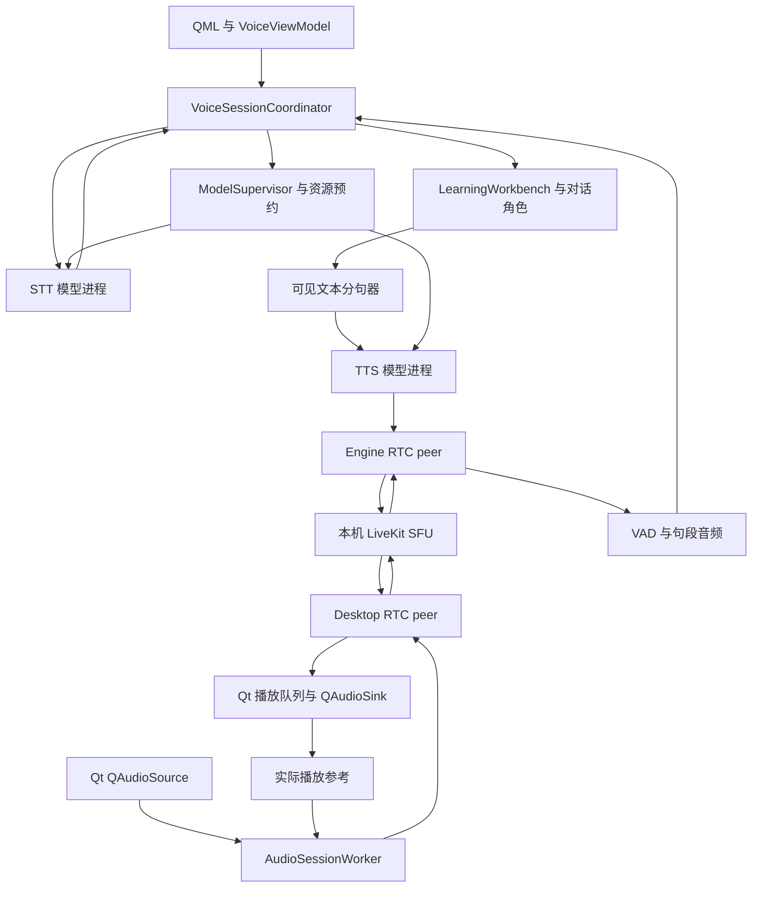

# TTS / STT 实际接入方案

语音存储维护沿用独立资源边界，位置配置、根目录租约、清理与事务迁移契约见 [Decision 0047](../../decisions/TECH_DECISIONS.md#decision-0047) 和[存储管理指南](../../desktop/SPEECH_STORAGE.md)。`SpeechStorageController` 仅拥有维护展示与任务身份，不成为模型配置、会话或推理状态的第二写入者。

受管 Python 安装收据不将非必需 `.pyc/.pyo` 作为不可变文件；读取旧收据采用相同规则，正常字节码更新不能触发 Python 重装。源码、DLL、解释器和模型文件继续校验。迁移只排除修订版本、UUID 格式及安装指纹均匹配的已隔离 `.invalid-*` 副本，原库保留，未知目录不借此跳过校验。

Melo 环境同时保留固定版本 NLTK ZIP 及解压数据，准备探针和推理入口只使用所属环境的离线资料，禁止 NLTK 自动下载或回退个人词典缓存。旧环境缺件时明确标为需修复，迁移保留其环境意图并重建，不因旧 ready 标记跳过修复。

状态：**总体蓝图；2026-10-30 已接入 QML 连续 PCM／RTC、端点自动提交、AEC 参考和插话取消；真人设备门禁待完成**。本轮采用范围与实际接口以[连续语音指南](../../desktop/CONTINUOUS_VOICE.md)为准，下文历史表格不作为当前交付清单。VOICEVOX/Melo 设置入口与独立环境已接线，见第 17 节；原生 partial、完整 ModelSupervisor 和云端部署仍为后续范围。

后续用户选择先实现无 UI 基础链路：确认事务、双角色对话复用、分句合成、冻结的本地后端和真实 RTC WAV/PCM。该阶段证据见 [Python 指南](../../desktop/VOICE_PYTHON.md)和[基础验收](../../validation/speech/VOICE_PYTHON_INTEGRATION_2026-10-29.md)；后续桌面接线与未通过项以[连续语音指南](../../desktop/CONTINUOUS_VOICE.md)、[本地设置指南](../../desktop/LOCAL_SPEECH_SETUP.md)及对应验收记录为准，下文目标设计不能直接当作已交付。

本文件统一说明语音功能的产品行为、模块逻辑、状态、接口、故障恢复、实施顺序和验收。产品主旨沿用 [Project Brief](../../product/PROJECT_BRIEF.md)，范围沿用 [MVP](../../product/MVP_SPEC.md)；模型背景查 [本地语音指南](../../desktop/LOCAL_SPEECH.md)、[设置接入记录](../../validation/speech/LOCAL_SPEECH_COMPUTE_SETTINGS_2026-10-29.md) 和 [完整模型补测](../../validation/speech/SPEECH_GPU_JAPANESE_MELO_FOLLOWUP_2026-10-29.md)。设计形成时未运行模型；后续基础实现的独立结果见上方链接。

## 1. 方案结论与边界

采用“**统一语音会话编排 + 连续 PCM 音频 + 按语言选择模型 + 独立模型进程 + LiveKit 传输**”。对话角色继续负责实际回答，材料理解/推理继续走现有后台路径，不另建语音 Agent 编排框架。

用户点击一次开始语音后，可以连续说话、收听回复、插话、看转写和用文字补充。需要逐句核对时切换“确认后发送”。停止语音会停止收听和当前口头回复、取消当前语音轮次的生成，保留已确认发言和学习会话；“结束对话”才进入复盘。用户如要继续回答，可在文字模式重试该已确认轮次。

主要选择：

1. 默认推荐有实测收益的 GPU 配置。GPU 不可用或预算不足时，寻找**另一份已过线的 CPU 配置**；不把同一大模型切 CPU 后的数秒等待藏起来。
2. 已选模型可以按语言不同。英语默认 Lessac CPU，独立 Melo 英文 GPU 是可选声音；日语与中文分别配置，不追求一个权重覆盖一切。
3. 低延迟识别优先使用已经测过的 SenseVoice 等模型。非原生流式模型在端点后出 final；只有确实支持 partial 的 adapter 才展示实时文字。
4. LLM 可见文本增量进入分句器，达到可说的语言单元就合成并起播；不等待整段 LLM 回复结束。
5. 用户打断时，先停止旧声音进入播放器，再取消生成/计算。麦克风输入不跟着被清空。
6. 进入活动对话页时按既有资源策略加载实际所选的本地模型对；开始语音仍冻结并复核配置，空闲释放偏好继续生效。显存常驻、计算使用率、冷启动和释放状态可见。设备诊断与持续监听分开，见第 20 节。

本轮范围是桌面对话语音、现有按需朗读的引擎复用、模型及加速设置。整本音频转录、视频音轨导入、发音评分、声音克隆、多人会议、移动端和公网部署不混入这次实现。

### 1.1 需要整体评审的产品口径

以下是本方案的推荐决定，还不能倒写成已有 MVP 通过：

- **连续输入不要求所有 STT 都有原生 partial**。推荐把语音目标明确为“连续收音、可靠分轮、及时 final 和可打断的连续播放”；原生 partial 是能力增强。如果“必须边说边出现文字”仍是硬门，就必须补入新的、同时通过质量和速度门禁的原生流式 STT，SenseVoice/VAD 包装不能替代该门禁。
- **连续模式的确认语义**：用户明确开启“停顿后自动发送”，本次会话按公布的端点规则发送 final；另一模式每轮手动发送。没有开启语音模式时，不因收到录音或历史回调而自动发送。
- **已确认用户发言先保存**：推荐将其与 LLM 成功解耦，助手仍只保存完整成功回复。这会改变目前的整轮成对提交逻辑，需要先完成第 10 节的事务改造，不能只在 UI 中提前画一个已保存气泡。

## 2. 当前基础与真实缺口

以下表格保留方案形成时的基线；基础 Python 实现后的接口和通过项见文首链接。

| 板块 | 当前证据 | 本方案的增量 |
| --- | --- | --- |
| Core 语音端口 | `core/voice.py` 只有整段 `transcribe(bytes)`、`synthesize(text)` | 增加带身份/格式/能力的会话契约，保留旧接口兼容 |
| 本地模型 | `local_speech/service.py` 有常驻进程、设备策略和报告门禁 | 增加会话预热、模型级能力、音频分块、取消和统一资源预约 |
| 模型选择 | 已有按语言/场景/STT/TTS 保存与两个设置页 | 增加音色、备用配置、组合准入、实际运行配置快照 |
| Qt 音频 | `desktop/voice/audio.py` 录制/播放临时 WAV | 新增 `QAudioSource/QAudioSink` 连续 PCM 桥；旧路径保留开发回退 |
| 对话流 | LLM delta 能显示，结束后才调用整段朗读 | delta 同时送分句器；文字、合成和播放并行 |
| 后台任务 | `AsyncWorker.submit` 的通用完成信号配单个 `_on_success` | 语音有独立任务注册和事件通道，不能并发复用单回调 |
| 打断 | RTC 有 `TurnRef/generation` 与旧事件门 | 门控扩展到 LLM、模型 IPC、应用音频队列及设备缓冲 |
| 持久化 | `send_message`/runner 在成功后提交用户和完整助手 | 确认用户、生成状态、完整助手分别有幂等事务 |
| 自动朗读 | 部分现有完成回调仍只检查 `_tts` | 所有入口统一走语音路由，不遗漏仅配置本地 TTS 的场景 |
| LiveKit | 现有协议和取消测试；最后真实探针仍停在连接阶段 | 先定向修复并验证真实 PCM/取消/重入，再接入正式连续模式 |
| 完整体验 | 计算、GUI Mock、设备与 RTC 证据分开 | 至少三轮真人语音、耳机/扬声器、延迟和清理共同验收 |

代码与旧文档存在版本差异时，功能实现以当前源码和对应报告为准。研究文档中的“RTC 通过后接入”是条件计划，不是 RTC 已经通过。

## 3. 用户功能与页面行为

### 3.1 对话页

新增语音控制区，但不把设置面板、指标表或模型下载步骤塞进正常对话：

| 操作/状态 | 行为 |
| --- | --- |
| 开始语音 | 检查本会话语言的 STT/TTS、设备、环境和资源；准备成功后才开麦 |
| 正在准备 | 显示缺少项或加载进度；可取消，尚未录音；文本对话继续可用 |
| 正在听 | 麦克风状态、音量与可选转写预览；没有 partial 的模型显示正在听，不造文字 |
| 确认后发送 | final 放入可编辑草稿，用户点击发送；录音不会直接成为已确认消息 |
| 停顿后自动发送 | final 经端点/去重/非空校验后提交，气泡显示来自语音；可暂停自动发送 |
| AI 回复 | 文字继续流入，已形成的短句先播放；可同时收音 |
| 插话/停止本次回复 | 清旧播放队列并取消旧生成；显式“停止回复”不把空音频当新发言 |
| 暂停麦克风 | 暂停采集和自动发送；现有 AI 回复可继续；保留未发送语音，恢复续说或显式发送／丢弃 |
| 停止语音 | 关闭本次语音会话，释放队列、轨和模型预约，保留学习对话 |
| 文字发送 | 先关闭旧回复代际，复用同一用户提交入口；不与语音各发一轮 |
| 更正转写 | 发送前直接改草稿；发送后用明确的“更正刚才转写”追加更正并关联原句 |
| 结束对话 | 先停止语音并处理已确认待答输入，再调用现有结束/复盘路径 |

“停止本次回复”“停止语音”“结束对话”三个操作分开。录音指示以设备实际启动/停止回执为准，不以按钮颜色代替。

### 3.2 语音模型页

按语言显示两张主要选择卡：识别模型、合成模型/音色。展开后才展示其他候选与历史评测。

- 主行显示当前模型、实际 CPU/GPU、是否已加载、下载体积和本机热态/冷态指标。
- 可选模型卡明确质量结论、语言范围、单句/原生增量能力、预计 RAM/显存、当前支持的后端。
- 下载顺序为检查空间 → 展示总下载/展开/临时空间 → 必要声音条款 → 下载/续传 → SHA256/安全解包 → 实际加载 → 本机测速 → 可选用。
- 未测可以下载和试听，不能显示成本机实时推荐。淘汰配置默认隐藏，历史报告保留。
- 切音色不等于换模型。Melo EN 的各 speaker 共享模型/BERT；音色只保存 speaker ID，不重新下载五套权重。
- 选择继续保存到 `selections.json` 的 `language:scenario:task` 键；拟扩展 `profile_id`、`speaker_id`、`device_override` 和用户允许的备用 profile 列表。设备优先级为“该语言/profile 显式覆盖 → STT/TTS 全局策略 → 自动默认”，最终执行结果写入本轮快照；不只保存一个含糊的 GPU 开关。
- 当前语音运行时切换选择，先标为待应用；在安全边界重新准备并确认生效，不让一条回复前后混用两种声音。
- 选用/卸载都经过同一模型注册表；正在加载或使用的包不能删除。请求释放完成后再卸载。

### 3.3 计算与加速页

沿用现有 STT/TTS 自动/CPU/GPU、GPU 编号、预算、预留和空闲释放，补充：

- 当前所选**模型对**的预计占用、实际进程及就绪情况；只显示所选声卡/模型需要的环境。
- 资源优先模式：推荐默认兼顾响应与占用；可选择用完释放。后者明确增加下一轮冷等待。
- 显存预算为软预算，给驱动/其他应用预留空间；不能包装成“整个进程最多用 3 GiB”或“GPU 利用率强制 30%”。
- 整卡显存/使用率、本软件可读取的进程指标分别标注。WDDM 不支持的数值显示未知。
- 准备环境的各阶段、进度/字节数、重试、取消、失败原因可见；不只显示长时间转圈。
- 对话页只显示 GPU/CPU 和简短故障提示，详细指标留在该子页。

## 4. 模型与语言路由

下表是当前证据支持的**推荐产品配置**，不意味着待适配后端已经可用。正式推荐仍要经过本机模型对验收。

| 语言 | STT 推荐 | CPU 备选 | TTS 推荐/选择 | 实施重点 |
| --- | --- | --- | --- | --- |
| 中文 | SenseVoice 2024 FP32 GPU | 原版 2024 INT8 CPU | Melo 中文；优先验证 GPU 路径 | 现有中文 Melo CPU 短应答首 PCM 约 603 ms，全部文本约 1069 ms，不能称已经低延迟 |
| 英语 | SenseVoice 2024 FP32 GPU | 原版 2024 INT8 CPU | Lessac medium CPU 默认；独立 Melo EN/EN-Newest GPU 可选 | Lessac 短应答约 57 ms；Melo GPU约 124–177 ms，须计前导静音和负载慢尾 |
| 日语 | SenseVoice 2024 FP32 GPU | ReazonSpeech k2 v2 INT8 CPU | VOICEVOX ずんだもん 0.17.1 | GPU STT 约 58 ms；Reazon CPU约 323 ms；VOICEVOX 热态首 PCM约 447 ms，预热和连续性仍需验收 |
| 日语质量选项 | Kotoba Whisper v2 FP16 GPU | 不宣称 Kotoba CPU 过线 | 沿用日语声音 | CER 更低的对照，但平均约 346 ms、权重更大，作为明确的准确率偏好选项 |

数值来自已有公开语料/内置文本评测，通常是热态计算，不能当每位用户的端到端保证。

### 4.1 推荐与备用算法

`resolve_profile(language, task, settings, installed_profiles, hardware, reservations)`：

1. 过滤不支持语言、未接受必要声音条款、版本不兼容、明确淘汰或质量不适用的配置。
2. 优先保留用户显式选择；若其不可用，返回原因及允许的备用配置，不偷偷替换音色或改走云端。
3. 自动模式对**已验证显著加速**的配置优先 GPU；显式 CPU 尊重用户选择；显式 GPU 失败直接报告。
4. 检查相同后端/精度/设备的本机报告。STT 热态计算算术平均必须 ≤500 ms；失败/无输出也计入失败率，不能删掉慢样本只算成功样本。
5. 检查 STT/TTS 共同驻留的 RAM、显存预算及可用显存预留；同时验证交替推理和打断后的新 STT 延迟。
6. GPU 不满足时选择用户预先允许、质量和速度均过线的 CPU 配置。例如日语换 Reazon、英文 Melo 换 Lessac；不是把 Melo 英文 CPU 的 2.59–3.64 s 当无感回退。
7. 没有合格备选则进入 `needs_configuration`；提供换模型/准备环境/文字输入。远程语音只有用户已明确选择并允许传音频时才能调用。

SenseVoice 2025 / WSYue 分支已于 2026-11-06 按用户决定从全部语言和用途的产品目录删除，不保留手动备选；历史评测只作淘汰依据。Kokoro/Qwen 继续不进入本轮推荐；Amy 的已确认否定词问题不因其他新样本好听而撤销。

MeloTTS 中英 ONNX（`melo-zhen-onnx`）同日按用户试听结论仅保留中文，英语对话和朗读不再提供或接受旧选择。目录的 `languages` 保留上游能力，`disabled_languages` 表达产品限制，入口统一使用 `available_languages`。语言可用性不改变资产指纹，中文的已安装状态、测速与选择继续有效；独立 Melo English 型号不受影响。

### 4.2 语言边界

- 对话默认取当前学习会话的目标语言；库内筛选语言、界面语言不参与推理语言路由。
- 选中文本朗读可显式指定内容语言，沿用相同 TTS 服务，但不触发对话 STT。
- 不根据“出现汉字”就自动把日语切成中文。混合语言优先沿用目标语言；明确的讲解语言由用户操作/应用语义给出。
- 不通过额外 LLM 调用猜音色或逐句翻译。发音词典替换只作用于 TTS 输入，显示原文及对应关系保留。

## 5. 运行架构与职责



`AudioSessionWorker` 内拥有两个 RTC peer，以及 AEC、重采样、VAD；图中将其内部环节展开。LLM 与业务不放进 RTC worker。两个 peer 是当前本机产品架构，不引入另一台推理服务器。

### 5.1 线程与进程

| 位置 | 拥有的对象 | 不做什么 |
| --- | --- | --- |
| Qt 主线程 | QML、设备枚举、QAudioSource/Sink、轻量 PCM 队列和状态信号 | 不加载权重，不做阻塞推理/下载/AEC |
| 现有长期 asyncio worker | VoiceSessionCoordinator、业务提交、LLM 流、分句、资源调度、子进程监督 | 不持有 Qt 音频对象，不用单个 `_on_success` 分发并行结果 |
| AudioSessionWorker 独立 CPU 进程 | LiveKit native SDK、两 peer、APM、状态重采样、VAD、音轨代际门 | 不拿 LLM 凭据、不写学习历史、不加载 TTS/STT 大模型 |
| 模型独立进程 | 指定后端/精度/设备的 STT 或 TTS，模型与必要共享前端 | 不操作界面、不上传录音、不直接改业务库 |
| 自有 LiveKit server | 仅配置范围内的 RTC 传输 | 不提供模型推理，不默认开放公网 |

RTC native 曾有连接/取消清理的不确定性，因此保留独立进程硬截止和自有进程树退出能力。父进程不靠取消一个 Python task 就宣称 native socket 已释放。

桌面 PCM 经 IPC 到 worker 的 Desktop peer，通过真实 RTC 到 Engine peer 后才进入正式识别链。输出走反向路径。直接内存 transport 只供单元/开发排障，不能在 RTC 不通时无提示替代正式链路并宣称 LiveKit 通过。

### 5.2 音频格式和 AEC

- 内部/RTC 规范为 48kHz、mono、S16LE，按 10 ms（480 个样本）组帧；允许把两帧组合发送，但 APM 调用仍为 10 ms。
- Qt 先查询设备真实支持格式，不能假报 48k/16-bit。设备原生格式不符时明确转换，并保持跨块重采样状态。
- STT/VAD 分支转成 16kHz mono；Silero ONNX 在 16k 输入上按其固定窗口及循环状态运行，窗口不是随每个 Qt 回调重新初始化。[Silero 实现](https://github.com/snakers4/silero-vad/blob/master/src/silero_vad/utils_vad.py)
- Piper/Melo/VOICEVOX 输出可能是不同采样率，依据实际结果重采样到 48k；半个 sample/不足一帧先缓存，结尾 flush，不按 chunk 各自插值或混入 WAV header。
- 复用已安装 `livekit==1.1.21` 中的 `AudioProcessingModule` 和 `AudioResampler`；本次只检查了源码能力，未验证设备效果。APM 接收近端麦克风与远端播放参考，支持回声/噪声处理。[APM 官方接口](https://docs.livekit.io/reference/python/livekit/rtc/apm.html)
- 播放参考来自**实际准备写入设备的帧**，包含音量/静音处理和队列时间，不直接拿刚生成的 TTS 作为已经播放的参考；估计采集/播放延迟，设备切换时重建 AEC 状态。
- 第一轮先用耳机验证完整链路，再用扬声器测回声。未通过扬声器验收时明确推荐耳机；若提供按住说话开发回退，要标注不能代表自然双工通过。

Qt 原始音频接口适合这层桥接；即时丢弃播放缓冲使用 `QAudioSink.reset()`，不能把可能排空缓冲的 `stop()` 当同一行为。[Qt 音频概览](https://doc.qt.io/qtforpython-6/overviews/qtmultimedia-multimediaoverview.html)、[QAudioSink](https://doc.qt.io/qtforpython-6/PySide6/QtMultimedia/QAudioSink.html)

## 6. 会话状态和任务身份

避免用一个 `voiceState` 或全局 `busy` 表达全部并发活动。分成三个正交状态：

| 状态域 | 状态 |
| --- | --- |
| 语音连接 | `off → preparing → ready → active → reconnecting/stopping → off`，故障为 `failed` |
| 用户输入 | `idle → speech_candidate → speaking → end_pending → recognizing → draft/confirmed`，可 `discarded/failed` |
| AI 输出 | `idle → generating → buffering/playing → draining → completed`，可 `interrupting/cancelled/failed` |

`playing` 与 `speaking` 可以同时存在；`generating` 不锁麦克风、停止按钮或打断按钮。文本业务提交仍串行。

所有事件带：

```text
voice_session_id   每次开始语音新建，旧连接回调不能进入新会话
session_id         已有学习会话 ID
utterance_id       一次用户发言；partial/final/retry 共用
revision           partial 的修订，较新覆盖较旧
turn_id            一次已确认输入对应的业务轮次
generation         助手输出代际；打断后永久关闭旧代际
segment_id         本轮 TTS 的分句编号
seq                该事件/音频流的单调序号
config_revision    本轮使用的模型、音色、设备配置快照
```

输入 utterance 与输出 generation 分开。关闭旧 assistant 不能清空用户正在说的新 utterance；换学习材料/会话则关闭整个 `voice_session_id`。

任务注册表分别保存 `rtc_task`、`input_task`、`llm_task`、`tts_task`、`playout_task` 和模型 job ID，提供单轮取消/等待结束。旧文本任务接口可保留，语音通过专用事件总线向 `VoiceViewModel` 更新。

## 7. STT：从连续收音到一次可靠提交

### 7.1 收音、VAD 和端点

1. 准备完成后，Qt 开启输入设备，持续输出有序 PCM；麦克风轨持续存在，不随助手 generation 重建。轨绑定本次 `voice_session_id`，不能复用助手音轨的取消标识。
2. AudioSessionWorker 在 AEC 后维护近端短环形缓冲。近端轻量 VAD 只负责快速发现插话候选；正式 utterance 的起止由 Engine peer 收到的音频/VAD 决定，**只有一个组件产出 final**。
3. 语音起点保留约 250 ms 前滚，避免丢失起始辅音。连续语音窗口满足起点条件后进入 `speaking`，短停顿进入 `end_pending`；用户续说则回到同一 utterance，不立即提交半句。
4. 正常端点默认 650 ms，学习者长停顿档 1000 ms；高级设置可提供约 400 ms 的快速档。以上是**待真人调优的初始参数**，不是已测最优值。不能为凑一秒目标自动缩短所有人的思考停顿。
5. Silero 16k 输入采用 512 samples/32 ms 窗口。可从连续约 3 个语音窗口作为起点候选，但短答“no / はい / 嗯”不能只因长度短就被过滤；结合实际语音概率、后续识别及空输出判定。
6. RTC 丢帧、输入设备停止与正常静音是不同事件。缺帧不能简单当作正常停顿提交；超过连续音频时钟容忍范围时标记本句不完整并提示重说，保留已收到内容用于草稿核对。

正常模式仅在端点后将整句交给离线 STT。将来原生 streaming adapter 可以持续返回 partial，但 final、确认和去重仍走相同管线。对 SenseVoice 反复滑窗重识别会增加 GPU 计算和修订复杂度，本期不默认采用。

### 7.2 识别任务

端点确定后冻结 `UtteranceAudio`，包含 ID、16k PCM、起止时钟、语言提示、配置快照；提交模型任务，记录排队/开始/结束时间。一个模型实例先串行推理，新用户 STT 的优先级高于旧 TTS 和预热。

- 有效输出返回 `TranscriptFinal`：原文、语言、可选时间戳、可选可信度、配置指纹。后端没有校准可信度就返回 `None`，不编造一个分数。
- 空输出、纯静音或失败不进入 LLM；转写可用但用户未确认时只进入内存草稿。
- 更新以 `(voice_session_id, utterance_id, revision)` 覆盖；final 的幂等源键不因重试变化，同一句不能因多次回调发送两轮。
- 大小写、标点、数字规范化规则分别记录；保留识别原文用于草稿核对，不调用 LLM 猜测和改写用户原意，不删改否定词。
- 默认普通句任务 wall deadline 可先取 5 s，长句另设有界档位。**500 ms 是推荐配置的热态平均计算筛选线，不是每个任务到 500 ms 就强杀的超时线**。

音频缓冲同时限制时长和总字节数：首期最大 60 s/24 MiB，按先达到者处理；这些是保护边界，正常对话按 3/10/20 s 分桶评估。达到上限时停止本句采集并提示提交当前内容或重录，不静默截掉结尾、也不把长句慢尾从报告删除。失败重试仅在本会话内短暂保留有界音频；退出/丢弃后清理，不自动落盘。

### 7.3 自动发送与核对

`confirm_input` 是语音与文本唯一提交入口：

```text
final 到达
  → 校验 session、utterance、配置和是否已提交
  → 确认后发送模式：替换草稿，等待用户发送
  → 自动发送模式：检查本会话的显式自动发送选择
  → 建立 source_key 和 turn_id，事务保存已确认用户消息
  → 等旧输出取消清理完成，启动本轮对话角色
```

自动模式也显示转写和明确的更正入口。发送后的“更正转写”生成关联 `corrects_message_id` 的确认消息，不悄悄改写已参与推理的历史。原条目标记识别更正，复盘不将已更正的 STT 错误当作学习者的语法/表达错误。

如果识别期间用户续说，且当前 final 还未确认，取消旧识别版本并合并缓冲、重新识别；若已经确认，续说形成新 utterance 和新轮，不重开已提交事务。手动发送草稿期间可继续编辑，准备发送时冻结最终文字。

## 8. LLM、TTS 和连续播放

### 8.1 复用对话业务，增量进入分句器

已确认输入仍调用 `LearningWorkbench` 的对话路径，保留材料范围、来源快照、真实历史和现有语义核验规则。后台准备不改成语音专用 Agent，也不把预测当用户说过的话。现有可能慢的语义核验单列计时，不能直接绕开以得到漂亮延迟。

LLM 的可见 `delta` 同时投影到聊天文本和 `SpeechTextBuffer`，不把 reasoning、工具参数、准备信息送给 TTS。分句器维护“已发音字符范围”和未完成尾部：

1. 收到 `。！？?!` 等完整句边界即可提交，短小但完整的“Yes.”也能立即发出。
2. 英文缩写、姓名首字母、十进制小数不是直接断句点；引号/括号及 Unicode 组合字符不能从中间切开。
3. 长句可以在逗号/分号等安全从句边界切分。初始目标约 12–40 个中日字符或 8–20 个英语单词，实际以 2–4 s 的可自然朗读单元调优，不强行凑固定字数。
4. 超过约 600 ms 没有句末时寻找已形成的安全边界；定时器不是把半个词、金额或否定结构立即读出的理由。没有安全边界则继续等待并记录分句等待时间。
5. 正常 `done` 时 flush 最后完整尾部；失败/取消不再 flush。单个合成段设置文本上限，过长文本沿安全边界继续切，不一次将 4096 字符塞给实时合成。

Markdown 走确定性的口语投影：正文保留，链接读显示文字，代码块/引用元信息不自动逐符号朗读；需要读原代码时由用户显式触发。UI 原文不被覆盖。每段记录原文 span 与合成文本关系，数字/词典替换不能改变事实。

### 8.2 模型能力与分句任务

能力分别声明 `stt_partial`、`tts_pcm_chunks`、`tts_incremental_text`，不能合并成一个模糊的“流式”。非原生流式模型也可作为**分句合成**适配器：

| 后端 | 接入方式 | 需验证 |
| --- | --- | --- |
| Piper / sherpa | 一句一任务，真实 callback 有 PCM 才向外产出；没有增量时整句返回 | 前端/字典、callback 时机、否定词及首段能量 |
| Melo 中文 sherpa | 先复用现有 CPU 单句；GPU 分支独立验证，不能仅改 provider 字符串 | GPU native 兼容、字典、中文音质和热态首音 |
| Melo 独立英文 | 使用已测官方路径及固定英文前端/BERT；整句波形包装成 PCM 流 | GPU 环境、前导静音、各 speaker 与共享权重 |
| VOICEVOX | core/模型预加载，按固定 style 合成；有可用回调才逐块返回 | 首段延迟、块间连续性、实际设备听感 |

每轮最多一个 TTS job 在算、一个后续段待算，播放缓冲按**秒数**限制。建议目标约 2 s、上限 3 s，待真实连贯性调优。LLM 文本流不因慢 TTS 阻塞其网络读取；未合成尾文本放入有界缓冲。待合成文本达到总上限时保持文本回复、暂停后续自动朗读并给出“继续朗读”，不能无限排队、悄悄漏读或再调用一次 LLM。现有回复长度预算继续生效。

上述 3 s 是可播放/传输队列水位。整句波形后端可能一次产出更长音频，worker 内按段长度另限内存，再按 credit 分块送出；不能把整句全塞进设备队列，也不能将正常的播放水位等待误报为缓冲耗尽。只有未合成文本的总上限达到时，才暂停后续自动朗读并提示。

说话速度、音量和音色由任务配置快照固定，切换选择从下一次明确应用的轮次生效。Melo EN 切 speaker 不重载同一声学模型/BERT；不同后端或设备才换实例。

### 8.3 起播、连续性与结束

TTS PCM 经状态重采样、序号/代际校验后进入 Engine 的 RTC 音轨；Desktop 接收后再校验，送 Qt 播放。一个助手 generation 内维持连续音轨，segment 不各建一条轨。

- `AudioSource.queue_size_ms` 从 100 ms 起，避免 SDK 默认 1000 ms 队列增加打断尾音；`clear_queue` 和 `wait_for_playout` 只代表该层队列，不是用户实际听到了。[LiveKit AudioSource](https://docs.livekit.io/reference/python/livekit/rtc/audio_source.html)
- Qt 目标输出队列从 40–80 ms、首次预缓冲从 80–120 ms 试起；按真实设备支持值和欠载统计调整，不能只写一个配置就宣称达标。
- 块间自然停顿保留，持续生成慢于播放时统计 underrun 和 gap。必要时小幅增大预缓冲；持续 RTF >1 的模型不能靠累积数秒缓冲伪装实时可用。
- 先收到 PCM 不等于已出人声。分别记录首 PCM、首有效能量和设备提交时间；不通过激进裁掉低音量辅音来优化数字。已有 Melo EN-US 前导低能量约 489 ms，必须进入实际首音分析。
- 只有合成结束、RTC 收完和本机播放排空后才进入 `completed`；不能在 LLM `done` 时就显示播完。
- LLM 成功、TTS 失败：完整文字保留，重试只合成文字。恢复可从下一个完整未播 segment 开始；半句播放失败不自动从音素中间续播，也不自动重放已听内容。

按需“朗读此消息/选区”复用同一 TTS 与播放器，不调用对话 LLM、不产生用户消息。首期只允许一个输出；语音对话进行中请求朗读先暂停当前自动回复播放，明确由用户选择是否替代，不能两路叠音。

## 9. 打断、取消与连接恢复

### 9.1 插话的执行顺序

```text
近端疑似人声
  → 短暂压低/暂停当前播放，保留新输入前滚
  → AEC 后连续近端人声确认（初值约 160 ms，待真人调优）
  → 立即永久关闭旧 generation 的呈现门
  → 清应用/RTC 队列，Qt reset 输出设备缓冲
  → 向 LLM 和 TTS 发取消，撤销后续 segment
  → 等旧业务任务 finally 解锁，再提交新用户轮次
```

误触发尚未关门时可以恢复原播放；一旦旧 generation 关闭就不能重新启用。关闭的代际在 LLM delta、模型 IPC、RTC 接收和 Qt 实际写设备前四处拦截。已进入声卡硬件的少量尾音无法撤回，需测量真实消退时间。

点击“停止回复”直接执行关门/清队列，不等待 VAD/STT 或全局 `busy`。打断只取消旧输出，新麦克风 utterance、前滚和已确认新输入必须保留。用户真的说话后 STT 为空也不自动恢复旧模型生成；提供重新说或手动继续朗读。

### 9.2 native 推理不可及时取消

异步 task 取消不等于正在运行的 CUDA/CPU kernel 已停止。先逻辑关门保证不漏音，再取消 backend；若旧 TTS 占用 GPU 导致新 STT 无法开始，可设短的协作退出期限，超期终止**本应用该模型进程树**，释放其预约，按需重新加载。初始退出观察窗口可取约 200 ms，需以实际后端调优，不保证内核被硬实时抢占。

因此不同重模型默认独立进程、默认不把 STT/TTS 放进同一不可取消进程；控制通道不排在大波形后。不得关闭其他软件进程、修改驱动或假装取消后显存立即归零。热重载代价与打断速度一起验收。

### 9.3 输出状态与历史

- LLM 未完整完成就取消：已有可见/可听片段标记“已停止”，不写入成功助手历史；同会话可保留有界的临时已呈现前缀，下一轮明确告知上一回复被中断，不能把它当用户已听完的事实。
- LLM 已完整保存但声音中断：保留完整文本，单独记录语音 `delivery_state=interrupted` 与最后完整 segment。新轮上下文能够区分文本存在和音频是否播完。
- 取消和完成提交冲突：以持久化提交的代际校验/CAS 顺序为准；取消先获胜则不得再保存完整助手，提交先获胜则只更新播放中断状态。

### 9.4 断线、设备变化和退出

RTC 断线立即关闭当前播放/自动发送，取消旧输出，UI 显示“语音连接中断”。同一个用户开启意图内最多做一次有界重连；新建 `voice_session_id`，所有旧回调失效，不自动重播旧音频或重发未确认输入。再次失败需要显式重试，文字对话保持可用。

拔掉耳机/麦克风、设备采样率改变时暂停语音并提示选择，不静默将私密回复改为扬声器外放。设备恢复重建 AEC/重采样器。应用休眠/恢复按断线处理，不在恢复后悄悄开麦。

停止语音/退出顺序：关闭呈现门和确认入口 → 停设备 → 取消各任务 → 清本句内存 → 退房/关 RTC → 释放模型和自有 server。每步有截止；最后兜底清理登记过的自有 PID 树，确认占用/端口释放。UI 不靠无限等待 native 退出；下次启动不自动开麦、不重放未完成任务。

## 10. 已确认输入与事务持久化

### 10.1 改造边界

目前 runner 在完整回复后一次生成/提交用户与助手，`LearningWorkbench.send_message` 负责保存。语音确认后若 LLM 失败，这种成对提交会丢掉已确认用户内容。推荐文本与语音统一改成以下接口流程，保留原 `send_message` 作为顺序调用的兼容包装：

1. `confirm_user_input(source_key, content, snapshot) -> turn_id`：事务 A 去重，保存用户消息与待答 turn；返回现有 turn 时不得再次生成或重复保存。
2. `generate_reply(turn_id, on_delta, cancellation) -> result`：从已存在的用户消息构造本轮输入，冻结原文/已读范围和配置；runner 不再追加第二份用户消息。
3. `complete_reply(turn_id, generation, full_text)`：事务 B 先校验 turn 仍在生成且 generation 当前有效，再保存完整助手并将 turn 设为完成。
4. `cancel/fail_turn`：已确认用户保留，turn 标为取消/失败，没有助手半消息。重试引用同一用户消息，开新 generation，不重复用户内容。

一个学习会话同时只允许一个正在生成的业务 turn。用户连说第二轮时先取消旧轮，等待旧 `finally` 清理，不能用并发 `send_message` 绕过 `_sending`。首期只保留一个“下一条待答”任务；更晚的已确认发言将先前待答任务标记为 `cancelled/superseded`，但所有已确认用户消息都按顺序保留。最新轮上下文包含这些尚未得到回答的用户消息，让 AI 统一回应最新意图，不为每个短补充都排出一段过期回答。历史显示“已被后续发言接续”，不能默默丢掉发言或伪造助手轮次。

### 10.2 最小存储增量

建议在现有 SQLite 增加窄表 `conversation_turns`，不引入新数据库：

| 字段 | 用途 |
| --- | --- |
| `turn_id`, `session_id`, `user_message_id` | 关联既有学习历史；用户消息唯一 |
| `source_key` | `(session_id, source_key)` 唯一；文本发送 UUID 或 voice session + utterance |
| `state`, `active_generation` | pending/generating/completed/cancelled/failed；CAS 校验 |
| `confirmation_kind` | manual_text/manual_transcript/auto_endpoint |
| `assistant_message_id` | 完整成功回复才有值 |
| `created_at`, `updated_at`, `error_code` | 恢复与界面状态；不存原始异常日志 |

助手播放状态可在已有消息 metadata/类型化事件中记录 `delivery_state`、最后完整 segment，无需保存音频。旧会话没有 turn 记录仍能读取；不伪造旧轮的播放/确认信息。启动后把中断的 generating 显示为待重试，不自动调用付费服务。

事务所有权必须集中到 application/repository 边界，避免 runner event 与整个 session 保存各写一次覆盖并发结果；同步检查现有 session snapshot 保存对新 turn 的覆盖风险。core/kernel 只依赖端口和领域结果，SQLite 实现在 adapter 内；按操作连接/WAL 约定不变。

每个 turn 保存确认时的材料/章节/选区、阅读边界、目标语言和角色配置快照；界面在生成期间改变选区不影响已经发送的轮次。构造历史以该轮确认序列为界，不把更晚的已确认输入意外加入较早的生成。连续用户补充可以保留相邻 user 消息，不能补造助手消息凑角色交替。

临时录音、STT partial、失败助手半流不进入学习历史或常规诊断文件；日志默认只留匿名任务 ID、时间、数值和错误枚举。更正后的转写与用户确认为学习内容，其余识别差错不能混入复盘证据。

## 11. 模型、运行时和资源生命周期

### 11.1 可复用实例与能力清单

把“模型包”“后端配置”“常驻实例”“运行中的 job”分开：

```text
ModelPackage       权重/词典/声音资产、版本、大小、SHA256、条款
BackendProfile     模型包 + adapter revision + 运行时 ABI + 精度 + 设备支持
ModelInstanceKey   权重指纹 + 后端/精度 + runtime ABI + device/index + 静态加载参数
ModelInstance      PID、状态、预约、最近使用、实际资源、当前 job
SpeechJob          utterance/turn/generation、语言、speaker、文本/音频、截止
```

同一个 SenseVoice 实例可以处理它支持的多个语言；同一个 Melo EN 实例可以切 speaker。语言/speaker 若是该后端的动态参数，就不能把整份 job spec 比较为“模型变化”而重新加载。后端确实需按语言加载不同前端时，把前端资产指纹列入静态 key。每个实际实例只预约一份资源。

能力清单至少含支持语言、STT partial/时间戳、TTS chunk/文本增量、原生采样率、CPU/GPU/精度组合、是否支持协作取消、最大输入、共享资产、许可版本和测量指纹。目录能力来自已验证 adapter，不来自模型名字或营销说明。

### 11.2 运行时隔离与安装

不向 GUI 主环境塞入所有推理库。按实际后端准备独立且固定版本的运行时，只有选中时才安装：

| 运行时族 | 用途 | 隔离原因 |
| --- | --- | --- |
| audio CPU | LiveKit/APM、VAD 和必要重采样 | 不引入 CUDA/Torch；native 清理可整体退出 |
| sherpa CPU | 已验证 Piper、Reazon、中文 Melo CPU | 绑定实际 1.13.8 native 前端，防止仅 wrapper 版本相同但 core 不同 |
| SenseVoice ORT GPU | 固定 ORT GPU、fbank 与匹配 NVIDIA DLL | 不被 CPU ORT 包覆盖；保留真实 CUDA kernel 检查 |
| Melo EN GPU | 固定 Torch CUDA、英文前端、BERT/G2P/NLTK 资产 | 与 ONNX 路径分离，避免首次使用隐式联网补资源 |
| Kotoba GPU（可选） | faster-whisper/CTranslate2 和固定转换权重 | 自己的 ABI/运行库；不影响默认 SenseVoice/Piper |
| VOICEVOX | core DLL、字典与固定 vvm | 原生加载、样式和条款独立 |

可以共享相同版本的内容寻址下载资产，但不能在运行中的环境原地混装互斥包。不是每位用户都需要安装表内全部运行时。模型包中的 Python 不执行；确需引入官方前端代码时，作为经过版本固定和审阅的 adapter 依赖纳入分发清单，不在用户首次运行时任意 `trust_remote_code`。

GPU 安装流程：检测所选 NVIDIA 驱动/架构 → 展示该配置需要下载的运行库/模型与磁盘占用 → 在应用缓存准备 → 校验 → DLL/ABI 检查 → 真实 kernel → 真实模型 → 数值报告。用户通常只需匹配驱动，运行库由应用按需管理，不要求完整 CUDA Toolkit；显卡存在、provider 列表或 wrapper 版本均不能代替执行验证。[ORT CUDA 官方说明](https://onnxruntime.ai/docs/execution-providers/CUDA-ExecutionProvider.html)

当前仅把 NVIDIA CUDA 列为已验证 GPU 后端；AMD/Intel/其他平台按已支持 CPU 配置展示，不用统一“GPU”按钮暗示全覆盖。驱动缺失给出清晰原因，应用不自动管理员安装驱动或改系统 PATH。现有 GPU 新环境下载停滞的记录保留，不能把旧环境 kernel 通过写成全新下载已验收。

**发行方案**：开发/wheel 安装先沿用现有 Python 3.11–3.13 支持范围；Windows 冻结安装包建议随基础安装器提供一个固定、可再分发的 CPython 3.12 runtime，模型依赖通过匹配 wheel 集合安装到版本化环境，启动前只为模型子进程配置路径。冻结主程序的 `sys.executable` 不能直接当作可执行 `-m venv` 的 Python。该发行路径必须先做最小 clean-machine spike，验证 DLL、证书、路径、离线资产与许可；未通过不能宣传“一键安装已支持安装包”。

### 11.3 显存/RAM 预约与调度

由单个 `ModelSupervisor` 维护所有子进程的预约，不让每个 CUDA allocator 各自拿到整份 3 GiB。沿用初始 3072 MiB 预算、1024 MiB 其他应用预留，运行时根据当前可用量进一步收紧；两者是不同检查，不能当成用户显卡总容量必须相加的固定最低配置。

```text
检查已驻留实例 + 待加载实例的保守峰值是否 <= 语音预算
检查当前可用显存是否 >= 本次增量峰值 + 给其他应用的预留
检查 RAM、磁盘 staging/运行库/权重展开空间
预约 → 加载 → warmup → 实测校验 → ready
失败/退出 → 释放预约；占用异常仍显示并继续监督退出
```

峰值优先来自相同配置的实测组合报告，再加安全余量；无报告时仅作保守估算，不从权重文件大小推显存。SenseVoice 的 1536 MiB 仍是准入估算，WDDM 下整卡差值也不是精确进程显存。若实测超预算，取消新任务并卸载自己空闲的实例，重新选已允许的配对，不持续 OOM 重试。

初期一块 GPU 上重推理默认串行，优先级为：**新用户 STT → 当前回复第一段 TTS → 后续 TTS → 预热/测速**。两模型可以同时驻留，但不等于同时运行 CUDA job；原生 kernel 的取消限制按第 9 节处理。CPU 同样限制线程/并行，给 GUI、AEC 和音轨处理保留余量，不为每个 worker 默认占满所有核心。

配对优先选择 GPU STT + 轻量 CPU TTS（例如英语 Lessac），将显卡收益用在最有价值处；Melo EN GPU 是用户选音色后的独立配对。中文 Melo GPU 若过线，可共驻留但须测试交替推理；若资源不够，明确展示 CPU 声音/慢首音选择，避免每个短句反复换入换出大模型。

GPU 使用率只是观测值。资源页可说明当前忙碌及可能延迟；要做“资源优先”应通过停止预取、降低并发和提前释放控制工作量，不能承诺固定使用率百分比。真实其他应用负载下重新评估慢尾，不把空闲卡均值当运行保证。

### 11.4 预热与释放

- 应用启动只读选择/报告/轻量硬件信息，不加载 GPU 模型。点击开始语音才加载所选实例，并用内置固定短输入做本地 warmup；TTS 预热输出丢弃，不播放、不调用 LLM。
- 预热完成、RTC 和设备均 ready 后才开麦；冷启动时间在“准备语音”中可见，不能从完整体验统计抹掉。
- 活跃语音里默认空闲 120 s 释放重模型，VAD/音轨保持轻量运行。有语音起点时可提前重新加载，让加载与用户发言重叠；短句仍可能承担冷等待，要如实展示。
- “用完释放”模式每轮后释放，UI 提示下一轮可能重新加载。“停止语音”默认释放这次语音持有的实例预约；共享的其他真实任务未结束前不强杀其实例。
- 测速、试听、正常对话共用监督器/模型锁，避免后台测速又加载一份。正常语音活跃时不自动运行压力测速。
- 卸载/切运行时先结束引用与释放锁，下载取消只处理自己的 staging/进程；已安装可用版本不被半成品覆盖。

### 11.5 三个必须先验证的产品适配

1. **中文 Melo GPU**：先在独立环境验证当前 ONNX 声学权重能否通过匹配的 sherpa CUDA native 与原词典运行，记录真实 kernel、前端版本、首音和中文音质。历史 GPU wheel 的 wrapper/core 不一致曾影响 Piper 前端，不能只换 `provider=cuda`。若不适用，再对固定官方 Melo 中文 Torch 路径做有界 spike；二者都未通过时保留现有 CPU 作为明确慢路径，不宣称中文速度问题已解决。
2. **独立 Melo EN**：将实验中的可信英文前端、BERT/G2P 资产做离线可复现适配，默认 EN-Newest 或已选声音；各 speaker 的前导静音单列。已测英文 CPU 数秒，不当正常实时回退。不得把旧 Melo ZH/EN 切 speaker 当独立英文模型。
3. **VOICEVOX**：预加载 core、字典、vvm 和 style 3，验证 warm、首 PCM、实际首声、块间 gap、取消后重用。显示“VOICEVOX:ずんだもん”署名和声音许可记录；既有用户同意范围是本地评测，正式再分发需按所用版本另做确认，不能沿用为所有最终用户的接受记录。

Kotoba 是可选质量路径，排在三语默认链路之后。SenseVoice 2025 INT8 已退出产品目录，不因 GPU 可用而重新纳入。

## 12. 模块、接口和 IPC 契约

### 12.1 代码落点

以下均为**拟新增/拟改造**，不是已有 API；保持现有 Python/QML 分层，不引入新总框架：

| 位置 | 职责及公开入口 |
| --- | --- |
| `core/voice.py`、拟增 `core/voice_events.py` | 无 Qt/SDK 的 AudioFormat、输入/输出身份、Transcript、能力与状态类型 |
| `application/voice_session.py` | VoiceSessionCoordinator：start/mute/confirm/interrupt/stop；调度业务和语音任务 |
| `application/speech_text.py` | 流式文本安全分句、可说文本投影、字符 span 与 segment |
| `application/learning_workbench.py`、`kernel/session_runner.py` | 已确认输入/生成分离、取消、幂等；保留原文与阅读范围规则 |
| 持久化 repository 端口及 SQLite adapter | turn 状态、事务 A/B、代际 CAS、兼容迁移 |
| `desktop/voice/pcm_audio.py` | QAudioSource/Sink、设备时钟、短队列、reset、播放参考 |
| `desktop/voice_viewmodel.py` | 多状态展示与用户操作，不加载模型；复用当前 ViewModel 的会话选择 |
| `desktop/tasks/worker.py` | 每任务句柄/取消与独立语音事件信号，消除通用回调串扰 |
| `realtime/audio_session_worker.py` | 两 peer、APM、重采样、VAD、音轨绑定与 IPC；实际 LiveKit 实现在此边界 |
| `realtime/protocol.py`、`livekit_transport.py` | 扩展 utterance/segment 与设备播放确认；保留既有代际门和严格配置 |
| `local_speech/supervisor.py`、`service.py` | 实例复用、任务优先级、总资源预约、预热、取消、进程树回收 |
| `local_speech/worker_protocol.py` 与各 adapter | 有界输入、PCM chunk、控制回执、后端实际能力、错误码 |
| `local_speech/runtime.py`、`catalog.py/json` | 固定运行时族、前端资产、模型/声音条款和测量指纹 |
| 现有 QML 设置页与对话组件 | 按既有 MD3 tokens 展示新增语音行为，避免再造一套设置 |

拟增文件名可在实现时按当前结构合并，但职责/依赖方向必须保留。原 WAV `transcribe/synthesize` 通过兼容 adapter 接到同一服务，已有 CLI/远程 provider 不因此失效。

### 12.2 会话与模型端口

```text
VoiceSession.start(config) -> readiness/events
VoiceSession.push_input(AudioFrame) -> 非阻塞入队
VoiceSession.confirm(utterance_id, revision, edited_text?) -> turn_id
VoiceSession.interrupt(reason) -> gate_closed + cleanup_handle
VoiceSession.stop(reason) -> bounded_cleanup_result

SttBackend.prepare(instance_key) -> Ready/Failure
SttBackend.transcribe(UtteranceAudio, JobContext) -> TranscriptFinal
StreamingSttBackend.feed/finish(...) -> partial/final events（仅能力支持时）
TtsBackend.synthesize(SpeechSegment, JobContext) -> AsyncIterator[PCMChunk]
ModelSupervisor.cancel(job_id), release(instance_key), snapshot()

AudioFrame/PCMChunk: stream_id, generation?, seq, sample_rate, channels,
                    sample_format, sample_count, monotonic_time, payload
JobEvent: job_id, voice_session_id, turn_id?, generation?, stage, error_code?
```

明确长度、采样点数和结束事件；EOF 不能和空 PCM 混为一谈。`TtsBackend` 的异步迭代可只产生一块整句波形，这是兼容能力，不能由类型名推断原生流式。

### 12.3 控制与音频通道

保留现有 JSON 控制语义，音频改为带长度头的二进制帧，不逐个 10 ms 波形转 base64/整段 WAV。首期使用本机受控 pipe/socketpair 和专用 I/O 调度即可，不先引入共享内存管理框架。

- 控制/取消与大音频数据独立队列；主线程只作非阻塞入队，阻塞 pipe 写入留在专用 I/O 上下文。Windows 不能假定任意 pipe 都支持同一种 asyncio selector。
- 有协议版本、任务 ID、最大帧长、格式校验、超时/心跳；未知/超长消息拒收，旧 PID 的回调不能复用到新 worker。
- 音频通道按毫秒/字节限额做 credit/backpressure。TTS 积压暂停生产；麦克风溢出标记该句不完整并提示恢复，不能静默丢掉中间几百毫秒后继续宣称完整转写。
- 局部日志无原始 PCM/文字/LLM 密钥。模型 worker 只获得本任务必要数据；本地 RTC token 仍沿现有受控传递方式，不进命令行和结果文件。
- 只有首期实测 IPC 本身成为瓶颈，才重新评估共享内存；音频延迟的主要假设应通过时间戳验证。

## 13. 错误处理矩阵

| 情况 | 程序动作 | 用户可见与恢复 |
| --- | --- | --- |
| 没有模型/声音/必要前端 | 不开麦，不启动付费 LLM | 指向该语言的缺少项；文字仍可用 |
| 驱动/运行库不匹配 | GPU profile 不 ready；仅自动模式可使用已允许的合格 CPU 备份 | 显示实际 CPU 配置与原因；手动 GPU 则等待修复 |
| 预算不足/OOM | 停新任务，回收自己空闲实例，最多一次重新准入 | 推荐合格组合；没有就配置或文字回退，不无限重试 |
| 无麦克风/权限失败 | 不生成空用户消息 | 选择设备/权限提示；可直接文字输入 |
| 录音/IPC/RTC 丢帧超限 | 本句标不完整，不自动发送 | 核对草稿/重录；不掩盖丢音 |
| STT 空输出/超时 | 不触发 LLM；保留本会话有界可重试输入 | 重识别或编辑；同 utterance 幂等 |
| LLM 超时/中断 | 保留已确认用户，停止下游，不存助手半流 | 重试同一 turn；不重复用户消息 |
| TTS 失败 | 停该轮音频，完整 LLM 文字仍可完成/保存 | 只重试朗读；不重新生成回答 |
| Qt 播放失败/耳机拔出 | 清音频并暂停；不突然改外放 | 选择设备后明确继续 |
| 打断后旧进程仍产出 | 关闭的代际全链路丢弃；必要时退出自己的 worker | 显示新输入；旧声音不能重新出现 |
| RTC/native 卡住 | 有界重连/进程树回收，失败关闭连续模式 | 明确连接失败；开发直连不冒充正式通过 |
| 退出/休眠/历史切换 | 关旧会话门、取消/释放，保留确认历史 | 重新开启语音；不自动补发/开麦 |
| 条款/模型版本变化 | 失效对应许可/能力/报告指纹，不自动用旧接受记录盖过新版 | 展示必要变更；学习历史不受影响 |

临时降低到文字只是一条恢复路径，验收记录仍判本次语音失败。云端 STT/TTS 不作为隐藏救场；已有远程 provider 可独立选择，并说明音频数据会发给该服务。

## 14. 延迟、质量和资源验收

### 14.1 必须记录的时间线

所有本机模块使用同一单调时钟域；跨进程启动时核对偏差。实际说完/声卡出声需要外部录音或可复核设备测量，不能用模型 API 返回时间代替。

| 阶段 | 时间点与计算 |
| --- | --- |
| 冷准备 | runtime/model load、warmup、RTC/device ready；含首次启动失败 |
| 真实发言结束 | `speech_end_reference`，真人/回放标注；与 VAD 端点分开 |
| 端点等待 | `endpoint_confirmed - speech_end_reference` |
| STT | enqueue/start/final；排队和模型计算分开；计算平均/p50/p95/max/失败率 |
| 可见转写 | `transcript_visible - speech_end_reference`；Qt 信号与实际呈现另核对 |
| 提交/LLM | user_committed、llm_start、first_delta、first_speakable、full_reply |
| TTS | start、first_pcm、first_energy、full_pcm；分句等待与 GPU 排队另记 |
| RTC/设备 | first_received、sink_submit、估计/实测 render、drained；不能把提交当听见 |
| 真正响应 | `first_audible - speech_end_reference`，报告各语言/冷暖/模式 |
| 打断 | detect、gate_closed、最后旧帧写入、实际旧声停止、cancel ack、process_exit |
| 连贯性 | 段间 gap、underrun、RTF、播放速率/丢帧、首辅音截断 |
| 资源 | 稳态/峰值 RAM、GPU 进程与整卡指标、CPU、加载/释放时长与残留 PID |

首音近似预算为：

```text
端点等待 + STT 排队/计算 + 业务/LLM 首个可说短句
         + TTS 排队/首有效声音 + RTC/IPC/播放缓冲
```

例如 **650 + 55 + 300 + 150 + 100 = 1255 ms**，只是一组假设预算，已经超过一秒且尚未计所有开销。中文 Melo CPU 若首 PCM 为 603 ms，等待还会更长。这说明 GPU 大幅加速有价值，但**不等于产品必然一秒内出声**；先消除冷加载、整段等待和积压，再根据真人停顿优化端点。完整 LLM 回复仍单独计时，不能用首声音替代其指标。

### 14.2 推荐门禁

1. **STT 速度**：遵守用户要求，热态模型计算算术平均 ≤500 ms；报告相同配置的全部慢轮、p95/max 和失败。按各正常时长桶测，不能用大量极短样本稀释长句；长句保护档另列。启动与端点到可见文字单列，不能藏在均值外就不展示。
2. **STT 内容**：固定公共语料逐语种对齐，中文/日语 CER、英语 WER；原文与明确的大小写/标点/数字规范化口径并列，不能只报最有利一列。重点人工检查否定、数字/年份、专名、问句与学习者口音；通过速度不代替质量准入。
3. **TTS**：用户已经认可的声音作为当前基线；每个实际 backend/精度/speaker 重新验证前端正确性、首声、完整速度和句间连续性。既有 p95 300 ms 是早期推荐预算，Melo 中文/VOICEVOX 有已知超标，不能临时改阈值使其变绿。可标“声音可选、首音较慢”，正式低延迟推荐需补测/优化。
4. **打断**：逻辑关门之后旧代际接收/设备新提交数必须为 0；真实按键/确认插话到旧声消退初步以 p95 ≤200 ms 为调优目标，超标如实报告。这里不承诺 kernel/模型进程能在同样时间退出。
5. **资源**：模型对共同驻留、STT/TTS 交替、旧 TTS 取消后新 STT、其他应用 GPU 负载均测。没有 OOM/无限队列/孤儿进程；释放后以实际驱动可见性说明残留，不能只看父 PID 消失。
6. **正式语音**：三语真人连续至少三轮，覆盖插话/长停顿/更正/文字补充/错误恢复/历史切换；必须经过可见 Qt 窗口、实际设备和真实 LiveKit 路径。模型计算、离屏 GUI 和 Mock 各自单列。

建议每个候选正常时长桶至少 30 次热态任务，至少三次独立启动测冷态，配对做 30 分钟稳定性验证；这是实施验收规模，不是本次已运行结果。真实 LLM 验收需要后续任务明确范围和调用预算，普通回归始终 `RUN_REAL_AI_TESTS=0`，不借文档工作运行付费请求。

### 14.3 自动化和人工测试分层

| 层 | 重点 | 不代替什么 |
| --- | --- | --- |
| 纯单元/Mock | 分句、normalization、状态转移、幂等、代际和取消竞态、短否定答复、队列上限 | 不证明音质/设备/模型速度 |
| 存储/任务集成 | 事务 A/B、旧 session 兼容、失败/重试、superseded、单回调串扰和任务清理 | 不证明模型/RTC 可用 |
| 后端实测 | 固定权重/前端、真实 CPU/GPU kernel、数值/文本/波形、资源和取消 | 不证明真人完整链路 |
| RTC 实测 | 两 peer 连通、持续上下行帧/序号、文本、取消、退房/重入、截止后清理 | 不证明扬声器回声和会话质量 |
| 可见窗口真人 | 三语、耳机/扬声器、长停顿、交错打断、热拔插、停止/重启 | 不能用录入数据库或自动播放脚本替代 |
| 发行验证 | 无系统 Python/无 Toolkit 的干净机器，按需运行库、下载失败恢复、DLL/许可证/资源 | 不以开发机已有环境代替 |

新增核心业务/协议/状态逻辑补必要测试，界面验证明暗主题、窄窗口、中文/日语长文和可点击取消。构建改动使用现有 wheel 资源检查，确保 QML/SVG/许可证随包分发。

## 15. 实施顺序与逐项出口

不先堆完整 UI，也不等所有模型和 RTC 问题都解决后才写可测逻辑。建议按以下工作包推进；可独立开发的部分通过接口解耦，并不意味着自动启用多 agent：

| 工作包 | 具体实现 | 出口/依赖 |
| --- | --- | --- |
| A：契约与事务 | 输入/输出身份、任务句柄、确认/生成分离、turn 表迁移、完成 CAS | 文字路径回归；失败不丢确认发言、不存助手半流、不重复用户 |
| B：RTC 真实连通 | 固定版本核对→native 创建/加载诊断→最小双 peer→有界 PCM/文本/取消/重入 | 必须产出真实结果，未通过不能打开正式连续模式 |
| C：默认模型可用 | 当前 SenseVoice GPU/Reazon/Piper 复用；VOICEVOX 正式 adapter；中文 Melo GPU spike；独立英文 Melo 按需 | 三语后端的实际能力、许可、数值和前端验收；GPU 全新安装另测 |
| D：音频基础 | Qt PCM、APM/重采样、VAD/前滚/端点、二进制 IPC、设备/队列清理 | 耳机本地往返、长停顿和短答不丢；可用 Mock transport 单测，不能记正式 RTC 通过 |
| E：完整编排 | A+C+D 的 confirm→LLM delta→分句→TTS→播放器；模型预热/总预约/空闲释放 | Mock LLM 完整链和真实本地模型先通过；实际语言/设备状态正确 |
| F：打断/恢复 | 近端插话、四层代际门、native 退出、待答接续、转写更正、重连/休眠/切会话 | 各竞态无旧音/旧文本复活，无确认输入丢失，无孤儿进程 |
| G：正式连线与交付 | B 通过后将 E/F 接实际 RTC；可见真人三语与压力/发行验证 | 各类证据独立；一秒与质量未达标项明确标出 |

关键依赖：`A + C + D → E → F`；`B + E + F → G`。C 中可选 Kotoba/Melo 英文不阻塞默认 Lessac 等路径，但中文和日语的实际合成后端必须可用。发行运行时 spike 提前与 C 对齐，避免最后发现开发环境能跑、安装包不能启动模型进程。

### 15.1 RTC 故障的有界推进方式

现有连接失败不能靠纸面架构消失。下一轮先确认 Python/native DLL 实际版本和加载路径、事件循环/子进程启动与 native 创建事件；每次只改变一个有依据的变量，保留 wall deadline、PID/socket 清理和严格 loopback 配置。确认 native 对象创建后再诊断 ICE/收发，不能从当前 `not_observed` 推断具体网络层故障。

若仍不通，输出可复现最小失败与下一待验证假设；A/C/D/E 的独立开发可继续，但 G 保持阻塞。变更 SDK/传输方式或网络范围属于新的有证据技术评审，不默认切云、不放宽公网监听，也不让开发内存 transport 冒名交付。

### 15.2 功能开关与完成条件

内部就绪分别记录 `backend_ready`、`audio_ready`、`rtc_ready`、`voice_ready`，不能只用“已安装”一个状态：

- 仅后端 ready：允许模型测速/试听，不宣称连续对话可用。
- 只有 STT 或 TTS：可分别提供确认转写/按需朗读，不能自动标完整语音 ready。
- 模型对、设备、连接和本会话准备均 ready：才开放完整开始语音流程。
- 新版本/设备/权重/adapter 改变导致相关证据失配，重新准备必要项；不删除用户历史，不自动重跑全部付费验收。

交付应包含：源码与必要测试、配置/运行时清单、用户操作与故障说明、默认模型对推荐、逐阶段延迟/质量/资源报告、真人附件和未通过项。完整文字回复、模型计算通过及正式语音通过分别签收。

## 16. 本方案的评审点与重新选择条件

当前给出可实施的默认方案，不要求用户先逐条补齐技术细节。进入实现前，作为整体评审确认第 1.1 节的三个产品语义：非原生 partial 的准入、自动发送的确认方式、确认用户先保存。若任一选择改变，对应契约/测试一并调整，不能边实现边悄悄改口径。

以下条件需要重新选择局部方案：中文 Melo GPU 无法保持质量或没有收益；VOICEVOX 连续性/声音许可不满足产品；目标机没有任何通过速度与质量门的 CPU STT；严格本机 RTC 无法通过；冻结发行的运行时无法可复现安装；或真人长停顿表明默认端点频繁误切。重新选择应围绕该问题补证据，不回到“一个大模型覆盖所有语言”或把慢/失败样本删掉。

本方案保留目标设计与分层验收；已接线范围及证据以对应验证记录为准，不将目标状态当作已交付。

## 17. 本地设置闭环接口（2026-10-30）

`local_speech.installation` 提供冻结的 `RuntimeSpec`、`InstallationPlan`，以及 `make_plan()` / `runtime_plan()` / `prepare_managed_runtime()` / `managed_status()`。准备入口显式下载固定版本资源，使用独立候选目录，成功探针后原子更新就绪指针；失败不替换旧指针。推理与修复共享模型锁，其他实例正在使用模型时也不能替换关联环境。新增准备错误使用 `speech_*` 码，由桌面翻译。

安装计划描述当前请求仍需准备的资源：已安装模型与已就绪环境不因下载缓存被清理而重新计入下载量；显式环境修复使用 `runtime_plan(..., repair=True)`。未就绪环境可复用已安装共享资源、原包指纹对应的 wheelhouse，以及绑定原 UV 包 SHA 与可执行文件 SHA 的安装收据。计划只读取轻量安装清单和文件大小，实际复用 wheel 或 UV 前重新校验内容 SHA；取消校验不会发布候选环境。删除下载缓存不隐式取消安装就绪状态，修复缺少的原始资源仍按固定身份重新下载。

`model_profile.VoiceOption` 定义 `id`、标签、可选 `speaker_id` / `style_id` / 署名。`build_profile()` 是测速、分轮与连续语音共同的冻结入口。`voices.json` 保存候选，`selections.json` 的既有选择项增加可选 `voice_id`；旧条目与 Lessac 保留。VOICEVOX 的 `voice-terms.json` 按包指纹记录确认。声音只切换 profile，不重复下载共享权重，也不修改已经绑定的会话。

新报告的 `model_identities` 绑定冻结声音、运行环境与前端身份，模型指纹及实际设备继续单独记录；原生整句合成不标成流式首音。不同解释器的配对测速使用各自常驻进程，仍受同一 RAM/VRAM 准入、取消和清理规则约束。

`ContinuousVoiceController.prepare()` 准备独立 RTC/APM 解释器、Silero 与 SFU；`environmentReady` 依实际探针，`assetsReady` 依资产校验，不能用开发环境 SDK import 代替。SFU 下载也经过固定长度/SHA、续传、取消和缓存；`AudioSessionProcess(python=...)` 显式使用该解释器。公开验证入口可读取普通设置选择，不必注册评测 profile。操作方式和未通过项见[设置指南](../../desktop/LOCAL_SPEECH_SETUP.md)及[实施记录](../../validation/engineering/LOCAL_SPEECH_SETUP_2026-10-30.md)。

桌面音频帧不充当 UI 状态通知。组件就绪与体积使用 `componentsChanged`；设置的 `runtimes` 属性只返回后台 `_runtime_snapshot()` 的结果，由 `runtimesChanged` 更新。`inferenceStatus` 仅更新 `statusChanged`，避免隐藏计算页每个绑定重新验证全部运行环境并阻塞 QAudioSource/Sink。准备、配置与显式刷新仍重查资源，不把缓存读数用于推理准入。

开麦授权属于用户开始／恢复意图，携带当前语音会话身份；停止或关闭后拒绝迟到授权。设备清单变化先检查已选 ID 与实际格式支持，不自动切换默认外放。故障记录仅保留有界的安全错误码与阶段；可见合成 PCM／真实播放探针和真人声学验收分开。

自然朗读结束时，`AudioSessionWorker` 等待发送队列排空后关闭该输出的接收入口，调用 `LiveKitTransport.finish_audio()` 撤销音轨发布，再依序送完已经接收的 PCM。桌面设备排空后清除输出代际，拒绝后续旧回调；自然完成不写成用户中断。`AudioSource.wait_for_playout()` 只等待该 source 的排队音频，并不撤销已发布轨道，参见 [AudioSource](https://docs.livekit.io/reference/python/livekit/rtc/audio_source.html)及 [LocalParticipant](https://docs.livekit.io/reference/python/livekit/rtc/participant.html)。失效 reader 的请求立即失败；退出中即使语音清理失败，也继续释放模型和 Workbench，避免等待不存在的 IPC 回包后提前关闭事件循环。


## 18. 下载任务与前台错误（2026-11-06）

`SpeechPreparationJobs` 为同步资产准备提供最多 3 个有界后台任务，身份独立，固定创建时的模型、语言和计算配置。Qt 音频与 QML 仍在主线程，推理与业务仍在原 asyncio worker；本次不增加服务框架。任务队列通过 `QAbstractListModel.dataChanged` 更新文件级进度，候选模型只在相关状态变化后刷新。`busy` 保留汇总兼容，`operationBusy` 与下载状态分开，取消单项不会取消其他任务。

`ModelStore` 的 `TransferEvent` 只传组件名、阶段和字节数。`package_lock(wait=True, cancel=...)` 为下载等待共享组件，默认调用继续保持原来的快速拒绝语义；`prepare_managed_runtime(wait_for_locks=True, on_transfer=...)` 沿用固定 hash、候选环境和计算探针。模型文件先行下载，环境与共享 blob 的安装串行互斥。卸载也尊重 blob 锁，不删除另一个任务正在写入的下载。后台进度不拼接凭据、URL 查询或 HTTP 响应正文。

本地语音未选择、选择过期、环境未准备、测速缺失和未通过速度筛选使用 `speech_model_not_selected`、`speech_model_selection_stale`、`speech_runtime_not_ready`、`speech_model_benchmark_required`、`speech_model_too_slow`。协调器保留安全错误码，桌面结合真实会话语言与 STT/TTS 翻译；RTC 连接失败不再掩盖识别模型的准备失败。可选 TTS 预热失败只关闭本次朗读，不阻断识别和文字回复。

设置页采用固定筛选与任务区、STT/TTS 标签、紧凑可展开的模型行和原生 ListView/ScrollView。实现依据见 [Qt ScrollView](https://doc.qt.io/qt-6.11/qml-qtquick-controls-scrollview.html)、[ListView](https://doc.qt.io/qt-6.11/qml-qtquick-listview.html)与 [ScrollBar](https://doc.qt.io/qt-6.11/qml-qtquick-controls-scrollbar.html)；验证边界见[本次记录](../../validation/engineering/SPEECH_DOWNLOAD_UX_2026-11-06.md)。

`local_speech.samples.benchmark_audio(language, custom_path=None)` 在资源上下文中校验并提供内置公开示例；不将 Qt 引入本地语音层。桌面 `runBenchmark(id, wav)`／`runPairBenchmark(wav)` 的空字符串表示使用内置示例，显式文件 URL 继续兼容。新增 `benchmarkAndSelect(id)` 冻结语言、用途和计算配置，后台测速返回后在 GUI 线程执行原 `select` 准入及持久化；失败、取消和超出识别预算不保存选择。普通重测不隐式替换当前模型。STT 配对与单测均使用相同来源的示例，示例不是实时通话或学习历史数据。


## 19. 手动暂停与保留输入（2026-11-06）

`muteMicrophone()` 改为非破坏性暂停；主线程先关闭 `runner.input_allowed`、转发 Qt 已缓存的有界采集字节并停止设备。worker 取消未提交识别，保留 `ContinuousConversation.pending_input`，经 `pause` 控制消息等待已接收捕获队列和 RTC 轨排空，再冻结 Engine PCM。原 claim 与暂停竞争但尚未提交时，从业务 worker 保留的 PCM 恢复句段；用户事务提交后立即清掉该副本，不能把已发语音当作待发草稿。

音频进程发送带暂停身份的 `input_paused` 事件，PCM 走既有有界二进制 payload，不塞进 JSON 头。`EndpointDetector.pause()` 保留句段 ID、提高版本、重置起音／停顿计数。`resume(preserve_input=True)` 使用新麦克风代际和同一句段，等待新的起音，避免一恢复就把旧半句误判为自然停顿。旧轨帧和过期暂停快照被拒绝。原 `mute` 默认仍是破坏性清理，供故障／旧调用兼容；`discard_input` 要求已闭麦。

桌面新增 `microphoneBusy`、`hasPendingInput`、`canSendPausedInput`，以及 `sendPausedInput()`、`discardInput()`。暂停切换期间按钮防重；显式发送复用原录音请求 ID、来源和事务，不开麦。文字提交不清除另一份保留语音，语音提交也不清除后续文字草稿；识别失败仍可重试，已有回复继续。临时音频不新增持久化字段，停止／退出清理。

验证命令与边界见[连续语音指南](../../desktop/CONTINUOUS_VOICE.md)和[本轮记录](../../validation/engineering/VOICE_PAUSE_2026-11-06.md)。

## 20. 页面预检查与有界语音预取（2026-11-07）

`LocalSpeechProvider.verify()` 及 `LocalSpeechService.verify(profile)` 对已加载模型实际执行丢弃式自检：STT 使用校验过的内置对应语言示例，TTS 使用固定短句并验证 PCM16 WAV。检查内容不走 Workbench，不确认消息，不播放、不保存音频。通过结果仅按当前 worker PID 与完整冻结 profile 在内存复用；释放／退出／换声音或语言即失效，不写就绪文件，也不替代测速报告。错误码 `speech_model_verification_failed` 由桌面翻译。页面分别记录 `stt_load_ms`／`tts_load_ms` 与对应 `_self_test_ms`，不把整体检查时间等同 STT 热态计算。

`DesktopVoiceController.readiness` 暴露独立的 `VoiceReadinessController`，QML 以 `setPageVisible(bool)` 驱动。`checks` 分别返回 microphone／stt／tts／components 状态及安全错误；`busy` 不并入业务锁，文字草稿与浏览可继续。`retry()` 重新检查，设置变更按 revision 失效，消息／主题轮询不重复加载。页面离开、换线程、权限迟到和退出通过请求身份拒绝旧结果；在用语音不能被检查取消或重新配置。设备对象仍在 Qt 主线程，模型及资产检查在原 asyncio worker。

麦克风检查在授权后用独立 `QAudioSource` 验证确实收到帧，随后关闭，最长 1.5 秒；不发布 RTC、不转写、不持久化。检查不会证明人声质量或 AEC。系统拒绝与实际打开失败均显示恢复入口。本地模型走现有冻结 profile 的 `prepare()`，不执行安装或额外模型选择；远程 adapter 只声明 configured，不能冒充实测就绪。后台内存／设备准入仍是唯一加载门禁，手动 GPU 不静默回退。空闲或主动释放后显示 released，不靠轮询重新保活。

`VoiceSessionCoordinator` 将 TTS 合成与 `on_audio` 交付分为可取消的生产／消费任务。`SpeechPlayoutBuffer` 预算覆盖正在交付的一段，最多 3 段、24 MiB；构造中波形另受单段上限约束。保持一个冻结后端顺序推理，不并发争抢 GPU，不阻塞 LLM 流。首句立即处理，后续合并已经完成的句子；停朗读、插话、失败和关闭均取消预取。边界静音裁剪与计时口径见[Python 指南](../../desktop/VOICE_PYTHON.md)。

RTC 和 Qt 音频源在同一输出代际内持续使用，句子之间不新建播放器或改为 WAV 轮询。下一段的合成不再等上一段走完有界 RTC 队列；模型 RTF 过高或 LLM 停顿仍可能造成供给不足，不将本机制宣称为原生流式 TTS 或真人听感通过。验证见[本轮记录](../../validation/engineering/VOICE_READINESS_AND_PLAYOUT_2026-11-07.md)。
