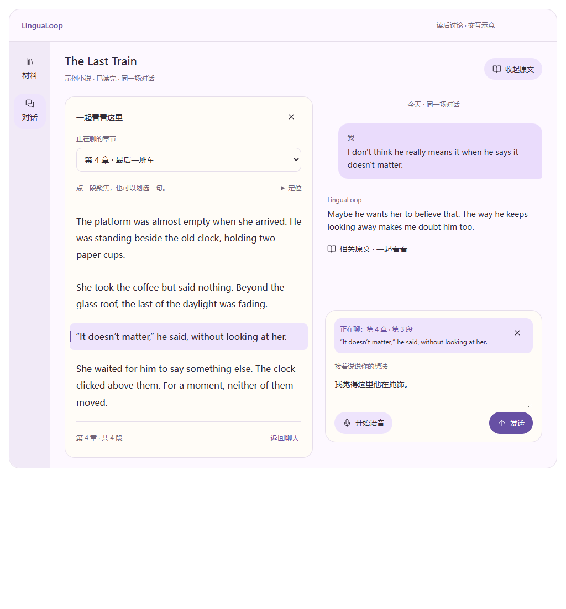
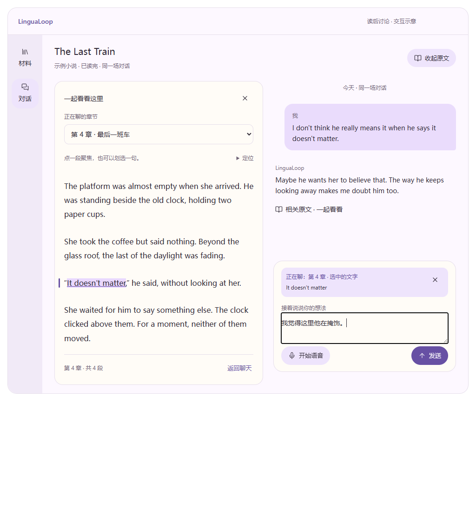

# 读后对照聊天功能设计

功能标识：`discussion_compare`。更新日期：2026-10-28。

**状态：核心功能交互已由用户认可，作为总 UI 设计输入；应用实现与实机验收尚未完成。** 用户认可的交互包括选章节即讨论整章、单击段落或完成选区直接聚焦、无需二次确认，以及清除细选回到整章。本文将这些行为写成可引用的功能约束；其余补充细节采用明确的设计默认值，不代表用户逐项确认了像素、尺寸或工程实现。

本文是本功能的统一规格。产品定位以 [PROJECT_BRIEF](./PROJECT_BRIEF.md) 为准，模型理解、预算与上下文装配对接 [AI 专项方案](../architecture/ai/PREPARATION_AND_DIALOGUE.md)，交付状态以代码和 [ROADMAP](../planning/ROADMAP.md) 为准。本文不改变其他任务的执行范围或优先级。

采用背景与影响记录于 [Decision 0020](../decisions/TECH_DECISIONS.md#decision-0020)。已认可交互之外的菜单、错误恢复、可访问性和时序细节为本文的设计默认值，供总 UI 与实现评审逐项检查；如需改变功能语义，应在这里修订，不能把视觉稿或原型脚本变成新的隐含权威。

总 UI 设计优先读 [组件契约](#component-contracts)、[状态与事件](#state-contracts)和[总 UI 交接清单](#ui-handoff)；交互评审使用 [验收矩阵](#acceptance-matrix)。总 UI 文档引用这些章节及 `DC-*`、`UI-DC-*`、`AC-DC-*` 编号，不再平行维护一份行为规格。

## 1. 已确认的功能方向

**用户明确的边界**：

- 主要在自己读完小说后使用，保持轻量，不把 LinguaLoop 做成小说阅读器。
- 想借鉴侧栏聊天和圈点，但侧栏不只是阅读笔记：体验应像与朋友一起指着书的某一章、某一段或某一句，围绕它表达、争论、联想。
- 选择章节后默认讨论这一章，不再另点“聊这一章”确认；每段旁常驻“指这段”按钮的方案需重做。
- 用户已认可重做后的交互：直接点正文段落或完成文字选区即聚焦，输入区同步显示范围；清除细选回到整章，换章保留草稿。
- 语音输出仍是项目主线；无需先标注、摘录、复述或完成题目才能开聊。

**采用的功能方向**：一个统一的对话工作区，默认以聊天为主；需要共同指向内容时展开作品片段。已认可的演示采用“原文在左、同一段聊天在右”的临时布局。侧栏是现有对话的一种呈现方式，不新增独立聊天类型，也不在每个页面常驻通用 AI 助手。具体外壳、比例、断点和视觉样式由总 UI 设计统筹，第 20 节明确哪些可调整、哪些行为必须保留。

这项能力面向所有有可核对原文的材料对话，默认收起。小说可定位到可靠的章/段/句；文章使用段落，字幕仅在保留真实 cue 时显示时间位置。缺少定位信息时诚实降级，不为统一外观伪造章节、页码或时间戳，也不宣称理解视频画面或音轨。

关键假设：共同看着某处内容，可以降低“我要先把情节和原句解释清楚”的表达负担。是否更愿意开口、是否分心，需要实际使用判断。

## 2. 为什么不把所有页面都改成侧栏聊天

| 方案 | 对体验的影响 | 本轮判断 |
| --- | --- | --- |
| 全应用常驻聊天侧栏 | 必须决定中央一直放什么；容易让材料、批注或分析占主场，聊天长期受窄栏限制；切换页面还可能混淆正在聊的材料 | 不推荐作为默认 |
| 独立增加“批注聊天”功能与线程 | 能处理局部问题，但用户必须在自由聊天与局部问答之间选择，讨论易被切碎 | 不推荐另建一套会话 |
| 同一对话按需展开原文 | 平时直接聊，需要时共同指向某处；一次收起回到聊天，保留草稿、历史和语音状态 | 采用的功能方向 |

统一应体现在会话、输入和材料边界上。位置可以随当前活动改变。第一版无需提供左右互换、自由停靠、多窗口和任意面板管理。

## 3. 信息架构

- **材料**：导入、选择、确认已读范围、进入或继续讨论；材料库服务于选择共同语境，不扩展成阅读书架与日常阅读入口。
- **对话**：主要使用空间，包含聊天、按需展开的作品内容、历史和结束后的复盘入口。
- **复盘、设置**：沿用辅助入口；不增加“批注”“阅读”“AI 助手”三个顶层页面。

有活动会话时默认恢复对话；无会话时进入材料选择。开始讨论不要求选章节。材料页点击另一份材料仅改变浏览选择，不能暗中替换正在进行的会话材料；返回时始终能看到“正在聊哪本书”。布局切换不结束会话、不生成复盘、不发起模型调用。

## 4. 默认状态：直接聊天

演示参考现有 80px 导航 rail、约 720–800px 的主区阅读宽度和居中留白。这些数值供总 UI 设计参考，不是本功能必须锁定的外壳尺寸；不因为窗口变宽就自动出现固定语境卡。

材料身份由侧栏层级与选中态说明，侧栏收起或窄窗口时才补充一个必要的材料名称；已确认阅读范围可从材料控件按需访问。顶部保留原文与更多等操作，不重复页面标题和 `xxx / xxx` 面包屑。阅读范围与当前讨论位置分开，不把当前讨论章冒充已读进度。

中间显示真实消息与临时流式回复。空状态直接提供输入，不另用引导短句占行，不铺设章节分析、选题卡或理解测验。既有可忽略方向仍在真实交流后按需出现。

底部只有一套输入区：文字草稿、可移除的当前指向、发送，以及配置可用时的“开始语音”。未配置语音时正常使用文字，不以大面积未配置状态占据聊天区。延迟与后台准备详情放入按需展开的信息，不占据主要内容层级。

## 5. 对照状态：把书中的某处放到桌面上

用户点击“看看原文”或某条消息的来源入口，可展开同一工作区：

```text
材料与对话导航  │  侧栏开关                              原文 · 更多
               ├──────────────────────┬────────────────────────┤
               │ 目录 · 搜索（图标）  │ 已有消息               │
               │ 原文正文             │                        │
               │                      │ 当前指向提示           │
               │                      │ 同一套文字/语音输入    │
               └──────────────────────┴────────────────────────┘
```

初始左右约 52% / 48%，聊天区至少 420px；后续可在不压缩输入的范围内调整。第一版可固定比例。原文和聊天各自滚动，新消息不移动原文，找原文不把聊天拉到底。流式回复、后台准备或新参考出现时不自动展开面板，也不改变当前指向。

原文默认直接显示当前章／片段与必要的附近上下文。目录、段落定位与原句搜索按需打开浮层，收起后不留下筛选框、查找输入、独立标签行或说明页脚；浮层不压缩阅读高度。章选择仍在用户完成选择后立即更新讨论范围，不增加“聊这一章”确认按钮；控件以可访问名称表达用途，不常驻“正在聊的章节”标签。可以回看一章的纯文本；不要求先把它切成一句才能讨论。长章按需显示或展开，不能把摘要伪装为完整章节。

“看原文”服务于共同指向、回忆、表达和核对，不能只设计为检查 AI 答案的证据抽屉。两个人也可以从一句话聊到个人经历，无需持续围着文本做分析。

### 原文查看的轻量边界

提供必要的纯文本浏览、局部搜索、真实章节定位和圈选。暂不建设 EPUB 原版排版、分页引擎、阅读主题与字体管理、阅读时长统计、书签和阅读进度同步、手写涂鸦、跨设备阅读、批注管理系统。

章节标签必须来自可靠的导入索引。没有可靠章节边界时显示“原文片段”和可核对的位置，不把字符百分比或模型猜测包装成章名。章节回看是本轮方案新增要求，当前代码是否支持须另行实现和验收。

## 6. 核心交互：共同指向，而非先写笔记

当前范围有整本书/全部已读内容、章节、段落、连续文字选区四种尺度。每次至多一个明确的当前指向，细选保留所属章/段路径；一段场景通过段落或选区表达，第一版不另建模型猜测的“场景”类型。

1. **选章即讨论整章（用户明确）**：选择第 4 章后，聊天范围同步显示“第 4 章 · 整章”。这一步不发送消息、不自动生成分析，也不要求第二次确认。滚动同一章、悬停或打开查找结果预览，不偷偷换章。
2. **在正文直接缩小范围（已认可的交互）**：单击段落即聚焦整段；拖选、双击选词或用键盘完成文本选区，即聚焦选中文字。移除每段旁的操作按钮，也不在完成选区后再要求点“就这句”。悬停只显示很淡的页边标记，不变更讨论范围；选定后留下轻高亮和页边标记。
3. **说自己的话**：输入区同步显示“正在聊：第 4 章 · 第 3 段”或“第 4 章 · 选中的文字”，附简短原文。用户可以输入“我觉得这里他在撒谎”，也可以开始语音。“这里”有明确对象，用户不必把选段再粘贴一遍。
4. **继续同一段聊天**：当前指向继续可见，直到用户更换或移除；它是参考，不是强制议程。用户明确换话题时，AI 应跟随真实发言，不机械地拉回该章。

选择层级为“整本书 → 整章 → 段落/选中文字”。细选卡的关闭操作明确回到本章，关闭整章范围则回到整本书；章节改变时清掉旧章的细选，保留输入文字。收起原文不清空当前范围。单击正文和拖选仅改变下一轮可见参考，不自动发送、不另开线程。

段落的键盘替代操作放在按需展开的“定位”菜单中，选择后直接生效，不给每段正文塞入按钮或伪装成可编辑文字。触屏滚动不能被识别为点选；双击选词、拖动跨段选区、复制后保留指向和取消细选需分别验证。

划选本身不调用模型、不自动问“这是什么意思”，不要求用户给高亮起标题。第一版不把它保存成独立阅读笔记。只有发送确认后的发言和关联原文指向进入会话记录，单纯查看或未发送的圈选保留在当前界面内存。失去原生蓝色选区时，原文仍用应用自己的轻高亮指明已选文字，不把整段高亮冒充精确选区。

每条已经发送的用户消息可附一个低强调度的位置标记；点击可回到当时所指的版本和范围。当前指向后来变化，也不能把历史消息的“这里”改指到新位置。作品原文、用户评论与 AI 解释须有明确视觉和数据区别。

### 指向与模型可见内容

- 当前作品与已读范围仍是会话边界；当前指向只帮助确定本轮关注，不允许越过已读范围。
- 用户选择另一章即变更下一轮的默认讨论范围，并在输入区同步可见；不要求重复指定。单纯滚动、悬停和回看旧消息预览不变更范围。发送时冻结该轮的指向。
- 选择整章不意味着每轮把整章无上限送给模型。完整章节可在本机回看，模型只拿有预算的相关片段；依据不够时承认不确定，不能假装已经掌握全部细节。
- 当前生成中的回复使用发出该轮时的指向。之后更换位置只影响下一轮，不重启或污染正在生成的回复。
- AI 可以提出值得一起看的地方，但不能擅自抢走用户指向或移动原文；用户点击后再定位。

## 7. 怎样进入共同指向

| 用户当下的动作 | 界面承接 | 不应发生的事 |
| --- | --- | --- |
| 读完直接聊人物或感受 | 默认聊天，材料在标题中明确 | 强迫先定位原文 |
| 选择第 4 章 | 立即将讨论范围改为该章，保留草稿 | 再要求点“聊这一章”，或自动发起分析 |
| 说“想聊第 4 章” | 有可靠章索引时提供可直接选择的章节入口 | 凭模型猜章名，假装已定位 |
| 想起某句话但记不清原句 | 允许在当前作品中找原句、关键词或人物 | 承诺模糊描述一定能精确找回 |
| 点开可能相关片段 | 原文区显示候选，允许选择“不是这段”或继续找 | 把候选称为已确认依据 |
| 单击段落或划选文字 | 直接更新高亮与输入区范围，待用户表达 | 每段常驻“指这段”按钮，或再弹一次确认 |
| 收起原文 | 恢复主区聊天，当前指向仍可见、可移除 | 丢失草稿、停止语音或清空指向 |

第一版可以依靠已有片段索引、原句/关键词搜索和手动选择。自然语言回忆情节属于后续质量增强，不作为第一版界面的必备承诺。

## 8. 语音时如何工作

语音与文字共用同一会话、同一材料、同一指向。进入语音不新建“语音讨论”，不切成另一套课程；连续语音能力仍按现有 LiveKit 验收目标另行交付。

语音启用必须明确点击。输入区展示可理解的状态与必要控制：连接中、可以说话、正在识别、对方正在说；静音、停止当前播放/打断、结束语音。结束语音保留对话，和“结束并复盘”区分。

点开或收起原文不自动静音、不终止音轨、不重新连接。用户可以先指一段，再说“这里让我想到……”。本次发言开始时冻结该次指向；发言过程中新增圈选标为下次发言的指向，不能偷偷改变已开始的一轮。当前播放可被用户打断，旧音频不在新回复中继续播放。

实时识别的 partial 只作预览；确认后的完整文本才进入历史。原文默认不自动朗读，防止点选一句就打断正在聊的内容。语音失败保留对话和指向，允许重试或文字继续。

## 9. 窗口尺寸、导航与状态连续性

| 窗口宽度（Qt 逻辑像素） | 推荐表现 |
| --- | --- |
| ≥1200 | 默认主区聊天；主动展开后原文在左、聊天在右，两栏均保留可读宽度 |
| 800–1199 | 默认聊天；原文用覆盖式详情页承接，顶部明确“返回聊天”，不强行压出两条窄栏 |
| 600–799 | 保留 rail，单列聊天或单列原文详情；当前指向卡可返回对应位置 |
| <600 | 现有材料/对话底部导航；原文全页查看，选好后返回同一输入区，语音状态和关闭入口仍可达 |

缩窄窗口时：保留所有状态，优先保持当前键盘焦点所在任务；正在操作原文则转为原文详情，正在输入则回到聊天。再放宽也不自动弹出面板抢焦点，可由用户展开。

必须保留会话身份、消息、未发送草稿、当前指向、原文位置、聊天滚动位置、焦点/光标和语音状态。原文与聊天不能各有一个互不同步的输入框。第一版不跨重启保存未发送草稿或未确认指向；恢复最后确认的历史时，不冒充未发送内容已经说过。

历史对话显示当前材料内的线程，用户显式选择后才切换。生成中、录音中或播放中禁止直接切线程，提供停止当前操作再切换的明确路径。完成线程只读，允许查看旧指向；“再聊一次”才创建新会话。

## 10. 视觉与可交互细节

视觉沿用已暂定的[暖纸与墨迹规范](./VISUAL_STYLE_GUIDE.md)，具体外壳见[总体布局与逐页稿](./UI_LAYOUT_DESIGN.md)（首轮提案，待评审）。新风格图标由 AI 原创生成并整理；当前应用仍为 MD3 / Material Symbols 实现。明暗主题和字体需后续实测；主内容保持低强调度，正文与对话分层但不使用文档编辑器式密集工具栏。上述视觉修订不改变本功能的指向与会话契约。

- 顶部：作品与阅读边界；次级操作使用低强调度按钮，结束与删除不放在高频误触位置。
- 消息：阅读宽度受约束，角色易辨；不在每条回复旁常驻纠错、评分和整排分析按钮。
- 原文：舒适的正文间距，章/段定位信息低强调度；只高亮当前指向，不给每种标记发明一套颜色含义。
- 输入：当前指向位于草稿上方，默认最多两行；可查看全文和移除，不能挤掉发送与语音控制。
- 动效：仅用户主动展开/收起时做短过渡，尊重减少动效；后台更新不移动按钮，不让输入区跳动。
- 键盘：保留 Ctrl+Enter 发送；Esc 按层级先关闭临时菜单/历史预览，再收起原文并恢复先前焦点，不清除当前讨论范围，不能隐式结束会话或停止语音；其他快捷键实现前核对冲突。
- 可访问性：核心按钮命中区域至少 48px；不能只靠颜色区分指向，触屏不依赖悬停；中日长文、键盘选择与屏幕阅读需覆盖。

## 11. 空状态、失败和可信度

- 尚无材料：给出选择或导入入口，不展示空侧栏。
- 当前没有指向：正常自由聊天，不提示“缺少引用”。
- 找不到片段：明确“没找到这段”，保留表达，允许换关键词、手动定位或继续聊印象。
- 候选不唯一：显示少量可区分的上下文，允许用户选择；不强行跳到第一条。
- 原文版本或锚点失效：保留已确认的历史引文并说明无法定位，禁止把它链接到新版本同一字符位置。
- 只检索到可能相关片段：标为“相关原文”；只有具有精确位置、材料版本并经过核对的引文才展示为该轮的确切原文指向。提供过参考不等于 AI 的解释正确。
- 一轮回复失败：不持久化失败的半段助手回复；保留本轮可重试的文本和指向，用户可以更换后重试。
- 切换书本、扩大已读范围与布局变化是不同动作；收起面板不能隐式切换书本或扩大已读范围。

## 12. 第一版与后续边界

**本功能的首个实现增量（尚未排期）**：默认自由聊天 → 主动打开原文 → 以真实位置选择章/段/句 → 输入区显示一个当前指向 → 发送真实想法 → 收起原文继续同一会话。先以文本完成闭环，语音接入复用同一交互约定。功能设计被认可不代表当前 AI 机制任务增加实现前置条件，也不代表本增量已交付。

实现需补齐：可靠的章/段边界（缺失则诚实降级）、原文定位与搜索、可见当前指向、每轮发送时的指向快照、重启后可核对的历史关联、宽窄布局切换。可先使用纯文本，不增加阅读引擎、云服务或向量数据库。

**后续再评估**：模糊情节检索、AI 提议共同查看的位置、已有阅读器摘录导入、多处对比指向。永久批注、读书笔记系统、跨书研究和设置页通用 AI 助手不纳入这次方案。

现有能力与新增要求须分开：当前代码已经有材料导入、已读范围、本地片段索引、自由聊天、流式回复和历史；当前语境面板主要展示材料信息。统一对照布局、可靠章节指向、用户选段与逐轮来源关联、本文所述语音连续性均不能据此视为已实现。

代码核对入口：[WorkbenchScaffold](../../src/lingualoop/desktop/qml/WorkbenchScaffold.qml)、[ConversationPage](../../src/lingualoop/desktop/qml/pages/ConversationPage.qml)、[source_index](../../src/lingualoop/application/source_index.py)、[material_context](../../src/lingualoop/core/material_context.py)。现有检索结果中片段范围与展示摘录不一定是同一精确范围；新增指向需计算并核对实际选段位置，不能直接复用粗粒度 chunk 边界冒充句子位置。

## 13. 验收场景

1. 完整材料导入、确认已读后，不选章节、不划线也能自由开聊。
2. 聊过两轮后打开原文，对话、草稿和光标保留，不额外调用模型或创建线程。
3. 换章节即更新整章范围，并清除旧章细选，草稿保留；只有滚动或悬停时不改变范围。
4. 选择一章，说“这里的节奏让我很难受”，模型拿到可识别范围且不把整章无限加入每轮。
5. 选择一句只发送“这句我不信”，引用与用户评论分开，回复针对正确指向；用户可反驳 AI 的解释。
6. 指向从 A 换成 B 后，历史消息的来源仍指向 A；关闭再打开不会重置成错误位置。
7. 流式中更换指向，只影响下一轮；失败重试仍保留本轮原始指向，用户可以明确修改。
8. 原文选取不能越过已读边界；后台全书资料和候选也不能泄漏后文。
9. 未找到或多处匹配时有可用路径，不伪装精确引用，不要求重述整本小说。
10. 在 1440/1200/1180/800/600/360px、明暗主题、中日长文及长草稿下切换，控件可操作、不溢出。
11. 真人连续语音中查看和收起原文，连接、识别和播放行为符合约定；明确测试发言中换指向、打断、重入和失败。这一项不能由静态或 mock 界面替代。
12. 只有已确认发言与完整成功回复进入历史；关闭软件不把未发送圈选保存成用户输出。
13. 已结束对话仍可回看原文；布局切换不生成新复盘。切线程须显式操作，不串书、不串引用。
14. 正文中没有常驻的“指这段”按钮。单击段落、拖选句子、双击选词、键盘定位均能直接聚焦，不自动发送。拖动与触屏滚动不能误触成段落选择。
15. 将焦点移到输入框后，精确选中的文字仍有稳定高亮；清除细选回到本章，清除整章回到整本书。预览旧消息有明确提示，不把预览章节冒充当前章节选择。

## 14. 参考、局限与需实测事项

- [Readwise Global Ghostreader](https://docs.readwise.io/reader/guides/ghostreader/global)：官方明确同一个聊天可以从侧栏展开到全屏，支持布局与会话身份分开；本方案不引入其跨库研究、skills 和工具平台。
- [Google 来源引用交互说明](https://support.google.com/gemininotebook/answer/16179559)：引用可预览并进入原文核对上下文，支持按需回看机制；本方案进一步保留用户主动指向与自由表达，不限定为查证答案。
- [VS Code Chat View](https://code.visualstudio.com/docs/agents/run/chat-view)：侧栏、编辑器与独立窗口是可切换的呈现位置；不据此推断用户需要整套工作台。

以上为官方能力说明，不能证明轻松感、表达意愿或学习收益。它们也不保证我们的草稿、焦点、滚动和语音状态能连续，这些需要本项目自己验证。

用户已认可选章即讨论该章、直接点段落/完成选区聚焦的新版交互；此前“选章后再点一次指定”和每段常驻按钮的方案被替代。仍需实测单击与拖动的误触、复制选区后的范围可见性，以及长章查找的负担。总 UI 可以调整视觉与布局来降低误触，不能未经说明恢复二次确认或常驻段落按钮。实际学习收益、完整语音和生产实现仍须独立验证。

<a id="component-contracts"></a>

## 15. 组件级契约

本节给总 UI 设计提供可检查的组件清单。编号用于引用功能，不要求实现采用同名 QML 类型。文案是设计默认值，可由总 UI 统一措辞，但不能模糊所指范围或行为。

| 编号 | 组件与默认文案 | 显示、操作与反馈 | 隐藏、禁用和边界 |
| --- | --- | --- | --- |
| UI-DC-01 | 作品与阅读边界 | 由侧栏或收起时必要上下文识别作品；通过材料控件可直接查看“已读完”或可核对的已读位置 | 不重复标题／面包屑，不把当前章当阅读进度；完整标题与边界仍可访问 |
| UI-DC-02 | 原文开关：“看看原文 / 收起原文” | 用户点击才展开或收起；开关反映实际状态；关闭后回到同一场对话 | 尚无材料时改为选择材料入口，不展示不可用的空栏；后台结果不能代用户打开 |
| UI-DC-03 | 按需目录中的章节选择 | 选项包含整本书/全部已读内容及可靠章名；用户完成选择即更新范围，重复选择当前章也回到整章 | 默认收起；菜单悬停不改变范围；缺少章索引的原因只在相关操作时说明，保留搜索；历史使用只读浏览，不改活动范围 |
| UI-DC-04 | 可指向的原文正文 | 纯文本只读；悬停为淡页边提示，单击聚焦段落，完成选区聚焦文字；选中状态与悬停状态可区分 | 不在每段旁常驻操作按钮；不把正文伪装成编辑器或按钮列表；滚动不选择、不发送 |
| UI-DC-05 | 按需“定位”菜单 | 提供整章、段落等可用位置的键盘替代路径，选择即生效 | 不增加“应用/确认”；不存在或未读位置不可选；收起菜单不清除已选范围 |
| UI-DC-06 | 输入区范围卡：“正在聊：…” | 整章显示一行位置；段落/选区附最多两行原文预览。位置卡可返回原文，清除控件按层级返回父范围 | 预览折叠只影响展示，不截断真实选区；清除细选的可访问名称为“回到本章”，清除章范围为“回到整本书/全部已读内容” |
| UI-DC-07 | 旧消息/候选预览提示条 | 明确写“回看旧消息”或“相关原文”，注明位置；提供“返回当前讨论” | 不能把预览章显示成正在聊的章节；当前范围卡保留实际范围。用户直接点段落/选中文字后才成为当前指向 |
| UI-DC-08 | 已发送消息的位置标记 | 如“第 4 章 · 第 3 段”；点击预览当时的原文位置，独立于当前范围 | 没有可靠历史锚点时不伪造跳转；AI 的相关片段入口不能冒充已证明该解释正确的引用 |
| UI-DC-09 | 统一文字输入与发送 | 只有一份草稿、一套发送入口；Ctrl+Enter 发送，正常 Enter 换行；选择原文不改写用户草稿 | 只有选区但无用户发言时不能发送空消息；输入法组合期间不误发；生成中禁止重复提交 |
| UI-DC-10 | 语音状态与控制 | 显式开始；状态、静音/打断、结束语音始终可达；必要时显示当前发言范围与下次范围 | 不因收起原文或缩窗断开；窄屏原文详情仍提供必要语音控制；未配置时不占据主体 |
| UI-DC-11 | 按需原文查找与结果 | 点击搜索或 Ctrl+F 打开浮层；在当前材料、已读边界内搜索；结果显示可区分的前后文，激活结果才指向该处 | 关闭后不留空框或解释行，浮层不减少正文高度；输入／悬停不改范围；不暗中调用模型，丢弃过期结果 |
| UI-DC-12 | 原文加载/失败区域 | 局部展示加载中、无结果、索引不可用或重试；聊天区继续存在 | 原文不可用不能把整场对话变为全屏错误，也不能清空草稿、会话或范围快照 |

范围卡默认放在草稿上方，原文标题保留章节信息即可。不要在聊天顶部、输入底部、通知条、页脚重复四次播报同一范围；只在状态变化确实影响用户理解时额外说明。

<a id="state-contracts"></a>

## 16. 状态与事件规则

### 16.1 相互独立的状态

以下是功能语义，不是要求新增的数据库表或枚举类：

| 状态 | 取值 | 含义 |
| --- | --- | --- |
| 会话材料与授权边界 | 材料 ID、规范化版本、会话已读末尾 | 决定可查看和可发送给模型的最大范围；选择章/段不得扩大它 |
| 基础讨论范围 | 全部已读内容 / 一个有效章节 | 默认全部已读；选择章节后为该章与授权边界的交集 |
| 细选 | 无 / 一个段落 / 一个连续文字范围 | 对基础范围的细化；同时最多一个。跨多个段落的连续选区仍是一处细选 |
| 原文视图 | 收起 / 当前范围原文 / 旧消息预览 / 候选预览 | 决定用户正在看什么，与实际讨论范围分开 |
| 本轮请求 | 空闲 / 已提交 / 流式中 / 失败 / 已完成 | 已提交请求持有自己的范围快照，不随当前界面变化 |
| 会话生命周期 | 活动 / 已结束 | 已结束会话只读，不将浏览动作包装成新发言 |
| 语音 | 关闭 / 连接中 / 可说话 / 收音中 / 识别中 / 播放中 / 失败 | 独立于原文展开状态；实际转移沿用实时语音契约 |

有效指向由“细选优先，否则基础范围”确定；没有细选是正常的整章/整体讨论，不是缺少上下文的错误。细选移除后回到它所属的基础范围，不回到上一条任意历史选区。

### 16.2 事件转移表

| 事件 | 范围变化 | 保留内容 | 用户反馈与禁止行为 |
| --- | --- | --- | --- |
| 首次打开原文，尚未选章 | 仍为全部已读内容 | 会话、草稿和聊天位置 | 不自动选第一章，不把演示中的第 4 章当产品默认值 |
| 完成选择一个新章节 | 基础范围改为该章，细选清空 | 草稿、历史、语音连接 | 范围卡立即同步；不再点一次指定，不发起回复 |
| 再次选择当前章节 | 基础范围不变，细选清空 | 草稿与会话 | 明确回到整章；不能只监听索引变化而漏掉这一动作 |
| 打开章节菜单、临时高亮其他章、按 Esc 取消 | 无变化 | 当前范围 | 以用户最终选择为准，不跟随菜单悬停换题 |
| 单击有效正文段落 | 基础范围为所属章，细选改为该段 | 草稿、历史 | 轻高亮和范围卡同步；不把鼠标按下当完成选择 |
| 完成有效文字选区 | 基础范围为所属章，细选改为精确范围 | 草稿、历史 | 精确文字高亮；不要求点浮动确认，不改写草稿 |
| 拖动进行中、滚动、悬停 | 无已提交的范围变化 | 原有指向 | 允许原生选择预览，手势完成后才提交细选 |
| 点击正文空白、聊天或输入框 | 无变化 | 当前细选 | 原生选区消失后，功能高亮仍保留 |
| 清除段落/文字细选 | 细选清空，回到本章 | 草稿、原文位置 | 显示“整章”或“已读部分”；不是删除历史引用 |
| 清除章节范围、选择整体 | 基础范围回到全部已读，细选清空 | 草稿、历史 | 全部已读完成时才可写“整本书” |
| 激活搜索结果 | 指向结果的真实章/段/选区 | 草稿、会话 | 一次激活生效；没有可靠章时保留真实来源位置，不编造章名 |
| 打开旧消息或 AI 相关片段 | 只改变预览位置 | 当前实际范围及草稿 | 预览提示条可见，章选择器不能冒充当前讨论章 |
| 在预览正文直接选章/段/文字 | 转为用户选择的新范围，退出预览 | 草稿、历史 | 不再要求“使用此引用”；章入口须明确属于选择动作 |
| 返回当前讨论 | 关闭预览，展示当前范围 | 所有活动状态 | 不能把旧预览位置反写到当前范围 |
| 收起/再展开原文 | 无变化 | 草稿、光标、范围、两侧位置和语音 | 返回原先查看的位置；不额外调用模型 |
| 调整尺寸/明暗主题/系统 DPI | 无变化 | 会话和交互状态 | 只重排或重绘，不重置范围、不重复发送 |
| 用户发送有效发言 | 该轮冻结有效指向 | 当前范围继续可见 | 历史位置标记对应本轮快照；未完成助手流不保存为完整回复 |
| 发出请求后又换章/细选 | 更新下一轮范围 | 已发请求原快照 | 不取消或重写已发回复；下一轮生效应可辨认 |
| 结束会话 | 进入只读 | 已确认消息和来源关联 | 原文控件标为“查看章节”，不再声称正在改变活动对话范围 |

已结束会话中允许浏览和复制；不显示可发送的范围卡，也不持久化新的讨论指向。只有明确“再聊一次”才创建新会话。只读状态与活动状态的控件文案必须区分。

## 17. 鼠标、文字选区、触屏与键盘细节

### 17.1 段落单击（DC-03）

- 只有主按钮完成一次有效单击，且未形成文字选区、未超过系统拖动阈值、未发生滚动时，才聚焦段落。鼠标按下只进入手势判断，不调用模型。
- 点击段落正文或其轻页边命中区均可聚焦；段间空白不自动清除范围。不能用覆盖整段的不可见按钮挡住原生文字选择。
- 多次单击的原生选词/选句行为优先；最终有效选区覆盖首次单击的段落细选，不留下两个当前指向。
- 悬停只作轻提示，移动鼠标经过多段不连续切换范围。点选后不强行将焦点移到输入框，也不自动唤起触屏键盘。
- 若正文呈现链接或辅助控件，激活该控件不能同时触发段落选择。复制、右键菜单和滚动不得被绑定为发送动作。

### 17.2 文字选择（DC-04）

- 允许拖动选句、选词和同一章内跨段选择；反向拖选与正向拖选结果相同。首个实现增量只维护一个连续范围，不做多处拼接或跨章拖选。
- 指向在手势结束后生效；键盘选区在一次选区操作完成后生效。原文中空选区、仅空白选区、起止超出原文区域的跨界选择不覆盖已有有效细选。
- 输入框内选词、Ctrl+A 和复制属于草稿编辑，绝不能被误认为原文选区。不能靠整个窗口当前选中文字推断原文指向。
- 完成的选区以真实位置保存，重复原句按所在位置区分。失焦后仍准确高亮选中的文字，不把包含它的整段冒充精确范围。
- 显示预览可折叠为两行，但实际引用范围不截断。若模型预算不足，只能在上下文装配中明确取舍，不能在 UI 中悄悄更改用户所选范围。
- 用户为了复制而选中文字时，同样会出现清晰的范围卡；清除细选立即回到本章。此语义已采用，不增加强制确认；误触风险在真实使用中继续观察。

### 17.3 触屏与键盘替代

- 单次点击可聚焦段落，拖动滚动不能落成段落点击；系统取消手势时撤销临时判断。长按与原生选区手柄优先，不能被自定义点击捕获打断。
- “定位”菜单提供整章与有效段落的可访问选择；完成选择立即生效。打开、浏览、取消菜单不改范围。
- 保留浏览器/Qt 的原生文字复制与输入法行为；中文、日语、emoji 和组合字符的选区必须匹配规范化原文，不直接把界面文本单元偏移当成后端字符位置。
- Esc 优先关闭最上层菜单或临时浮层，其次退出来源预览，再收起原文；不会清除已选范围、结束录音、结束语音或生成复盘。
- 返回聊天时恢复之前草稿的光标/选择位置。切换章或点段落时保留原操作焦点；键盘焦点可见，控件按视觉顺序可达，不依赖 hover。

### 17.4 章节与已读范围（DC-02、DC-09）

- 章节项使用稳定来源标识，不能只靠显示名称区分；重名章可显示真实的部/章路径。章节顺序来自可靠导入结构，不由模型凭内容猜测。
- 章节选择器只列当前会话授权范围内可用的章节；未读章节不暴露可能剧透的标题。已读到半章时，该项明确标为“已读部分”，范围截到会话已读末尾，不写成完整整章。
- 没有章索引时，原文仍可按可靠片段位置搜索与选择；仅在打开目录时提示“暂无章节定位”，不常驻说明，也不用字符百分比伪造章名/页码。
- 新增阅读进度不自动扩大正在进行的会话。切章、清除细选和“全部已读内容”始终受本次会话边界约束。
- 完成选择章节是一次直接操作，但不等于要求模型自动开场、总结整章、分析人物或朗读原文。

## 18. 生成、查找、失败与语音的时间顺序

### 18.1 发送与范围快照（DC-08）

1. 用户选择章/段/文字，只更新界面内的当前范围。范围变化不启动材料准备、后台推理或聊天请求。
2. 点击发送或按 Ctrl+Enter 时，一次性取得本轮文本、材料版本、会话已读边界和有效范围。通过校验后，作为本轮不可变快照；不能在网络任务真正开始时才重新读取界面当前范围。
3. 消息中的用户发言与原文引用分开呈现；不能把原文拼成用户声称自己说过的话。纯引用、空白输入不替代用户实际表达。
4. 已提交后可继续查看或选择原文，新的范围供下一轮使用。若 UI 允许准备下一轮草稿，要保留这份草稿，不能被上轮完成信号清空。
5. 本轮回复完成时，只确认本轮内容和本轮来源关联；不把后来选择的 B 写进原先以 A 为依据的一轮。
6. 实际回应、参考检索、取证慢路径和预算由 AI 专项契约处理。选择整章是关注信号，不是发送整章的无限预算，也不是“AI 已读懂整章”的状态证明。

### 18.2 本轮失败而用户已经换范围

例如：用户发出文本 T、范围 A；等待中改选 B 并准备了下一条草稿 U；随后 T 的请求失败。

- 保留 T+A 的失败记录/重试信息，明确与 U+B 区分。失败的半段助手流不作为成功消息进入历史。
- “重试本轮”重试 T+A，保留正在编辑的 U+B；按钮附近能查看所重试的原发言与范围，不暗中改成 T+B。
- “编辑后重试”将失败轮作为可编辑内容；若已有不同草稿，先明确提示会替换草稿并提供保留路径，不能无提示覆盖 U。本规则是交互默认值，不要求为普通范围选择增加确认框。
- 改范围后重新发送属于用户的新选择；重试与新发言要有可区分身份，避免重复保存用户消息或重复消费流。
- 重试旧来源前检查版本和已读边界；失效时明确说明、允许重新定位，不把旧字符位置套到新文本上。

### 18.3 原文与查找任务

- 原文加载、章节定位与搜索的错误在原文区局部显示。已有聊天、草稿与输入控制保持可用，不切到不可返回的全屏错误。
- 每次查找结果关联当前材料、源文版本、会话已读边界和查询修订。用户已经换材料/版本/查询后，迟到结果丢弃或标为旧结果，不重置当前位置。
- 默认使用本地可用索引与来源定位；搜索本身不触发付费语义分析。未来若提供有成本的增强查找，须另定义触发与费用行为，不能借本功能默许。
- 搜索候选只表示“可能是这一处”。悬停/临时高亮可预览；激活有效结果直接选中对应范围，不再问一次是否使用。
- 用户找不到原文仍可回到整体或当前章继续聊印象。没有搜索结果不说明用户记忆错误，也不能作为纠错证据。

### 18.4 语音发言中的范围（DC-10）

1. 用户显式开始语音，连接本身不等于一条用户发言，也不提交当前原文。
2. 在一次实际发言开始时冻结当前范围 A；识别 partial、final 与该次发言身份关联。
3. 收音/识别期间用户选 B，界面显示“本次发言：A；下次发言：B”。两个状态只在不一致时同时出现，避免平时重复播报。
4. 该次 final 被端点策略确认后，用 A 驱动该轮，不因最后一刻的点击切成 B。下一次新的实际发言才使用 B。
5. 播放期间点原文、切章和收起面板不自动打断声音。用户开始新发言或明确按停止/打断时，才按语音契约取消旧代际、清旧帧。
6. 结束语音回到文字，保持会话、草稿与当前范围；结束并复盘是另一个明确动作。关闭原文、Esc、切主题或缩窗均不等价于任何结束动作。
7. 识别/播放/设备失败不丢本次确认内容；partial 不冒充历史消息。重连不重发已经确认的 final，也不把新的范围覆盖到旧语音轮。

## 19. UI 与业务对接信息、生命周期

本节定义必须能表达的信息，不选择数据库迁移、字段命名、检索库或 QML 实现。工程落地时另行对接现有业务模型，保持 core 与 UI 的依赖边界。

| 信息 | 必须表达的内容 | 保留时机 |
| --- | --- | --- |
| 材料身份 | 会话材料 ID、规范化原文版本/哈希 | 沿用已保存材料与会话，不因浏览另一材料卡改变 |
| 授权边界 | 当前会话冻结的已读范围 | 沿用会话快照；始终裁剪章、段、选区、候选与送入模型的资料 |
| 基础范围 | 整体或可靠章节 ID/路径、合法起止位置 | 未发送时只作当前界面状态；确认发送时纳入该轮快照 |
| 细选 | 段落或连续文字范围、所属范围、精确起止位置 | 未发送时不保存成读书笔记；确认发送后关联实际用户消息 |
| 引文预览 | 供范围卡折叠展示的原文摘录 | 是来源内容，不能计为用户发言；折叠长度不改变真实范围 |
| 本轮来源关联 | 用户消息/轮次身份、材料版本、已读边界、范围快照 | 用户确认发送后才有资格持久化；助手失败流不能借此变成完整成功回复 |
| 原文视图 | 是否展开、当前预览来源、两侧滚动位置 | 当前运行时保留；不要求跨启动保存未发送视图状态 |
| 草稿与光标 | 未发送文本、编辑选区 | 当前运行时与布局切换保留；不作为确认消息，不默认跨重启写入学习历史 |
| 语音轮关联 | 发言身份、冻结范围、确认/播放代际 | 依现有语音规则去重与取消；不要求保存原始音频 |

### 19.1 位置的正确性

- 引文锚点必须同时核对材料身份、规范化版本和范围，不能只存选中文字后在全文找第一处匹配。
- 原文范围采用统一且可验证的位置约定；界面文本单元、Python 字符位置、段落与章节位置之间的转换须在实现中明确。至少覆盖 emoji、组合字符、中日标点、相同句子重复出现和跨段换行。
- 原文规范化改变或索引版本不匹配时，旧消息保留其原确认引文，位置跳转标为不可用；只有经过重新核对才能重新定位，不自动迁移到同一数值偏移。
- 没有可靠章归属的段落仍可选择。清除细选时回到可确定的基础范围，文案使用“回到全部已读内容”，不能凭空补出一个“本章”。

### 19.2 恢复、切换与敏感数据

- 应用内展开/收起、导航回来、窗口缩放保留当前未发送范围和草稿。切线程只由用户明确操作，生成/收音/播放状态按第 9 节处理，不自动串到另一本书。
- 重启只恢复已保存线程和可验证的已确认范围；未发送选区、未发送草稿、仅浏览过的段落不成为已确认历史。恢复缺少来源关联的旧线程时正常聊天，不伪造历史指向。
- 若恢复最后确认的范围，界面必须可见地显示该范围；原文默认不因此自动弹出。已经扩大材料进度也不放大旧会话授权边界。
- 选择原文、hover、复制、打开预览不计为学习掌握或完成练习，不生成复习项。只有实际用户输出才能用于反馈。
- 按现有敏感数据规则处理源文、摘录、评论和语音转写；不为此新增全文遥测，不在诊断中输出原文、路径、密钥或整段发言。

<a id="ui-handoff"></a>

## 20. 总 UI 设计交接清单

### 20.1 必须保留与可统筹的部分

| 层面 | 必须保留的功能语义 | 总 UI 可统筹的设计 |
| --- | --- | --- |
| 信息架构 | 同一段聊天可展开/收起原文，不新增独立批注线程；直接聊天无需先选章 | 导航外壳、入口归位、历史的呈现形式 |
| 共同指向 | 选章即生效；点段落/完成文字选区直接聚焦；每次一个当前范围 | 页边标记、背景/下划线、范围卡的视觉样式 |
| 回退 | 清除细选回到本章，清除章范围回到全部已读；关面板不清范围 | 清除图标或短文案、层级面包屑的具体形式 |
| 预览 | 旧消息/候选预览与正在聊的范围可辨，不静默改范围 | 提示条、抽屉、覆盖层或其他可返回呈现 |
| 布局 | 一份会话、一套输入；足够宽时可同时看原文和聊天；窄时有清楚返回路径 | 左右宽度、断点、是否在部分尺寸采用详情覆盖；演示的 52/48 与 1200px 仅为参考 |
| 连续性 | 草稿、光标、来源位置、历史和语音状态不随布局变化丢失 | 过渡动效、分隔线、容器留白 |
| 可访问性 | 原生文字选择、键盘替代、清楚焦点、至少 48px 主要命中区；不能仅靠颜色 | MD3 token 的具体组合、图标、明暗主题层级 |
| 状态表达 | 当前范围只需少量清楚提示，不重复占满界面；失败和确认状态真实 | 次级文案、详情位置、加载反馈形式 |

总 UI 修改业务语义（例如恢复二次确认、改为多个并行指向、永久常驻侧栏、全局跨书聊天）时，先回到本功能规格修订并注明原因，不能只在视觉稿中悄悄改变。

### 20.2 至少应交付的界面状态

| 状态编号 | 总 UI 图稿/原型应覆盖的场景 | 必须能观察到的差别 |
| --- | --- | --- |
| VIEW-DC-01 | 直接聊天，整体范围，无细选 | 不要求原文、章或批注，输入可用 |
| VIEW-DC-02 | 已选章节，尚无细选 | “整章/已读部分”已生效，没有额外“聊这一章”按钮 |
| VIEW-DC-03 | 段落 hover 与段落已聚焦 | 悬停不换范围；点选后有稳定标记，正文无常驻按钮 |
| VIEW-DC-04 | 正在拖选、完成选区、焦点回到输入框 | 临时选择与已确定范围不同；失焦后仍有精确高亮 |
| VIEW-DC-05 | 已选 A，换到 B，已有草稿 | A 的细选清掉，B 范围明确，草稿不丢 |
| VIEW-DC-06 | 正在聊 B，回看旧消息 A | 预览 A 的标题明确，当前 B 不被冒充；可以返回 B |
| VIEW-DC-07 | 无可靠章索引、未找到原句、多个候选、部分阅读 | 均有明确降级或恢复路径，不伪装章名或唯一结果 |
| VIEW-DC-08 | 宽窗口双栏、窄窗口原文详情、切换过程中 | 同一输入和状态连续，不挤成不可读窄栏，不自动结束语音 |
| VIEW-DC-09 | 已发 T+A，下一轮 U+B，T 失败 | 旧轮重试对象与新草稿可区分，不串范围 |
| VIEW-DC-10 | 语音发言 A 中，选了下次 B | 本次与下次范围必要时同时可见，结束语音与结束会话区分 |
| VIEW-DC-11 | 已结束线程及旧引文位置失效 | 浏览只读，不能误认为继续发送；失效引文不跳到错误位置 |

至少将主要活动状态应用到浅/深主题、中文/日语长标题与长正文、长草稿、键盘焦点和 360/600/800/1180/1440px 参考尺寸。以上是设计与后续验证覆盖要求，不是本轮已经完成的实机结果。

### 20.3 已认可交互的仓库内参考图

下面是使用虚构示例小说的交互原型截图，供总 UI 理解选中层级。它们不是现有 QML 的运行截图，不冻结当前字体、颜色、外壳、比例或像素。原型语音只作布局示意，没有麦克风、STT/TTS 或模型调用。

段落直接聚焦（对应 VIEW-DC-03）：



精确文字选区在输入框获得焦点后继续高亮（对应 VIEW-DC-04）：



设计接手者不必找回原聊天或临时 HTML 才能理解功能；以本文的文字契约、状态编号和验收条件为准，截图只辅助说明。

<a id="acceptance-matrix"></a>

## 21. 可追踪的功能与验收矩阵

本节是细节验收入口，第 13 节保留为场景概览。`DC-*` 是功能要求，`AC-DC-*` 是后续验收条目；全部仍需在实际应用中实现和验证，不能把原型通过记作生产通过。

| 功能编号 | 不可丢失的行为 | 主要说明 |
| --- | --- | --- |
| DC-01 | 默认直接聊天，按需展开作品，同一线程与输入 | 第 3–5 节 |
| DC-02 | 选择章节即讨论该章，重复选择回到整章 | 第 16、17.4 节 |
| DC-03 | 单击段落直接聚焦，滚动/拖动/hover 不误触 | 第 17.1 节 |
| DC-04 | 完成精确选区直接聚焦，失焦高亮和原生操作保留 | 第 17.2、17.3 节 |
| DC-05 | 细选、整章、整体的明确回退，草稿不受损 | 第 6、16 节 |
| DC-06 | 预览旧来源与当前实际范围分开，历史位置不变 | 第 7、16、19 节 |
| DC-07 | 布局、尺寸和导航不破坏会话/输入/语音连续性 | 第 9、20 节 |
| DC-08 | 本轮范围冻结，异步、失败与重试不串轮 | 第 18.1、18.2 节 |
| DC-09 | 只使用可靠位置和会话已读范围，不伪造章/句 | 第 17.4、19.1 节 |
| DC-10 | 语音本次与下次范围区分，结束动作不混淆 | 第 8、18.4 节 |
| DC-11 | 查找和原文失败局部可恢复，不阻断自由表达 | 第 11、18.3 节 |
| DC-12 | 总 UI 保留交互语义并区分规划、原型和交付 | 第 20、21 节 |

| 验收编号 | 场景/动作 | 可检查的预期 | 类型 |
| --- | --- | --- | --- |
| AC-DC-01 | 不选章直接开聊，再展开/收起原文 | 同线程、同草稿；无额外请求/分析 | Qt 交互＋provider mock |
| AC-DC-02 | 有细选时重选当前章，再换另一章 | 两种动作均直接进入正确整章范围，旧细选清空，草稿保留 | Qt 交互 |
| AC-DC-03 | 章节菜单临时高亮、键盘浏览、Esc 取消 | 取消前后范围不变，完成选择才改变 | Qt 键盘交互 |
| AC-DC-04 | 单击段落、悬停多段、拖动与触屏滚动 | 仅有效单击聚焦段落；无自动发送或焦点跳转 | Qt 交互＋目标设备 |
| AC-DC-05 | 正反向拖选、双击选词、跨段选择后点击输入框 | 精确范围一致，只有一个细选，失焦标记保留 | Qt 交互 |
| AC-DC-06 | 中文/日语、emoji、组合字符、重复原句 | UI 标记、快照与规范化原文位置一致，重复句不跳错 | 范围逻辑＋Qt 交互 |
| AC-DC-07 | 在草稿中选字、复制、Ctrl+A、输入法组合 | 草稿编辑不改变原文范围，组合期间 Ctrl+Enter 不误发 | Qt 键盘交互 |
| AC-DC-08 | 清除细选，再清除章范围；关闭原文 | 按层级回退；关闭仅改变视图，范围不丢 | Qt 交互 |
| AC-DC-09 | 部分阅读、半章、无章索引、未读标题 | 模型与可视内容都不越界，文案与实际范围一致 | 范围逻辑＋provider mock＋Qt |
| AC-DC-10 | 当前 B 下打开历史 A / 候选 A，再返回 | 当前 B 保留，预览有明确提示，不把 A 冒充选择器当前值 | Qt 交互 |
| AC-DC-11 | 在预览中直接点段落/划选 | 一次直接操作转为正确新范围，无二次确认 | Qt 交互 |
| AC-DC-12 | 已发 T+A 后换 B，等待回复完成 | 发送 payload 与历史关联仍为 A，下一轮才用 B | runner/provider mock＋Qt |
| AC-DC-13 | T+A 失败时已有 U+B，重试原轮 | 重试 T+A，U+B 不被覆盖；无重复历史或失败助手半流 | 失败注入＋Qt |
| AC-DC-14 | 原文加载失败、查询改动后旧结果晚到 | 错误局部可恢复；旧结果不覆盖新查询；仍可聊天 | 异步 mock＋Qt |
| AC-DC-15 | 更新源文/索引后查看旧引文 | 保留旧引文并明确无法定位，不套用旧数值偏移 | 数据版本逻辑＋Qt |
| AC-DC-16 | 360/600/800/1180/1440px、明暗、长文长草稿 | 无溢出；范围、草稿/光标、原文与聊天位置可恢复 | Qt 渲染＋核心交互 |
| AC-DC-17 | 运行时切线程、切材料浏览卡、返回对话 | 实际会话材料不被浏览动作暗中更换，不串书/引用 | Qt 工作流 |
| AC-DC-18 | 重启恢复与查看没有来源字段的旧线程 | 只恢复已确认合法状态，不把未发送范围写成历史；旧线程可用 | 临时库恢复测试 |
| AC-DC-19 | 语音发言 A 中选 B、final 到达、继续发言 | 本次 A、下次 B，不被迟到回调串换 | 语音 mock＋真人连续语音 |
| AC-DC-20 | 语音中查看/收起原文、缩窗、结束语音、打断 | 音轨与控制符合约定，停止旧播放，无隐式结束会话 | 真人设备与连续链路 |
| AC-DC-21 | 语音 partial/final 重复、识别失败和重连 | partial 不持久化，确认发言不重复提交，范围关联不变 | 语音失败注入＋实机 |
| AC-DC-22 | 结束会话后浏览章节与复制，再点“再聊一次” | 原线程只读；只有显式开始才新建线程，不重复复盘 | Qt 工作流 |
| AC-DC-23 | 只选择章节/文字，未发送就退出 | 无模型调用、无新用户输出、无独立笔记/复习项 | 持久化断言＋provider mock |
| AC-DC-24 | 总 UI 图稿覆盖 VIEW-DC-01…11 并引用 DC 编号 | 保留功能语义；视觉默认值与已确认行为不混淆 | 设计评审 |

后续若新增或修改 QML/SVG/许可资源，再按仓库要求检查 wheel 分发资源。本轮仅是功能文档与参考图，不运行应用、调用模型或把原型检查写成实机验收。
