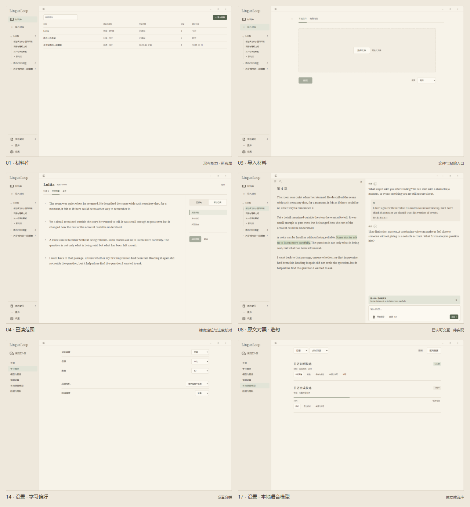

# 总体布局与逐页 UI 稿

更新日期：2026-10-29。版本：`ui-layout-v1`，修订 3。

浅色实现已进一步按本稿逐页复核并修正控件、设置、侧栏、表单与对照页的视觉差距，过程和证据见[视觉复核记录](../validation/engineering/UI_VISUAL_REVIEW_2026-10-29.md)。该记录区分“与视觉基线达成一致”与用户个人审美确认；深色及连续语音仍不属于本轮定稿。

本次实施按用户的 0–6 增量核对已有实现，补齐状态边界与中文先行的国际化入口。页面和接口现状、可见 QML／离屏／合成音频证据，以及明确未验收的真人输入法和连续语音见 [UI 实施记录](../validation/engineering/UI_IMPLEMENTATION_2026-10-29.md)。下方逐页清单保留出稿时的状态描述，当前交付状态以该记录及代码为准，不能据原型图推断功能已交付。

2026-10-30 连续语音增量沿用暖纸聊天页，在输入区提供固定位置的开始／停止语音、静音及停止回复，独立呈现监听、识别、生成和播放。保留分轮入口，不展示模拟波形或 partial；Mock 对话明确标明测试语料。实现与仍待完成的真人耳机／扬声器门禁见[连续语音记录](../validation/engineering/CONTINUOUS_VOICE_2026-10-30.md)，本稿原连续语音图仍是视觉目标，不能替代声学验收。

**状态：设计稿；首批 QML 工作区已实现并通过离线交互与安装包检查。** 实现覆盖及限制见[工作区指南](../desktop/WORKSPACE.md)，本稿其余像素与扩展细节仍按提案评审。 用户已明确材料下组织多段对话、侧栏应紧凑、设置参考所附截图的分类与行式结构，以及删除抒情短句、节约页面空间。本稿的像素、分组细节与控件安排仍为提案，不能视为全部已获确认。

本次修订参考官方设计规范和真实产品示例，将导入、已读范围和“更多”改为主区页面，取消这些流程的自定义遮罩弹窗。已读范围在材料内边看原文边核对，输入控件保留适当间距；此前删除重复标题、面包屑、说明行与材料树图标的原则继续保留。调研依据与取舍见[外部设计参考](./UI_DESIGN_REFERENCES.md)。原文对照仍默认只展示正文与 34px 工具行，导航／搜索按需出现；具体布局仍待评审。

## 1. 看稿入口

- [全部页面画廊](./assets/ui-layout-v1/index.html)：30 个视图，可按分类查看、点击放大。
- [可切换页面的交互稿](./assets/ui-layout-v1/prototype.html)：顶部选择页面；可演示导航、原文指向、草稿保留、复盘与复习。
- [主要页面总览](./assets/ui-layout-v1/overview.png)。
- [逐页图片与状态清单](./assets/ui-layout-v1/screens.json)、[原型验证记录](./assets/ui-layout-v1/validation.json)。
- [原创图标生成记录](./assets/ui-layout-v1/icon-generation.json)：6 个透明 PNG 母版及可复用提示词。
- [输入与流程的外部设计参考](./UI_DESIGN_REFERENCES.md)：官方链接、观察依据、适用部分和未核验范围。

HTML 可直接从本地打开，无需应用、业务模型或数据库。它是实现参考，采用 HTML 仅为方便逐页评审，不改变项目 PySide6/QML 技术栈。



## 2. 本轮约束

1. **材料是组织源。** Lolita 下可以有多段对话，另一份材料也有自己的对话；不是一个全局“对话”页下面再堆混合来源的“最近对话”。
2. **当前功能和将来扩展分开。** 材料、对话、已有表达复习与设置有明确入口；练习、自制语音场景和声音工具只示意扩展位置。
3. **空间优先给内容。** 删除页面标题、面包屑、眉题／副标题与重复说明；低频控件按需打开。每行文字都必须承担实际内容、可执行操作或当前必要状态。
4. **风格继续使用暖纸与墨迹。** 以浅暖纸、深褐与少量灰绿为主；不用大封面陈列、花边或文案填补空白。
5. **结合现有能力。** 设置项来自现有页面和本地语音库；未实现的原文对照和连续语音明确标为设计／目标状态。

视觉规范见 [VISUAL_STYLE_GUIDE](./VISUAL_STYLE_GUIDE.md)，功能语义见 [CONVERSATION_WORKSPACE_DESIGN](./CONVERSATION_WORKSPACE_DESIGN.md)。本稿引用这些文档，不另维护一套原文选择规则。

## 3. 信息组织

```text
材料库
├─ Lolita
│  ├─ 叙述者为什么值得怀疑（对话）
│  ├─ 同情与理解之间（已结束的对话，可看复盘）
│  └─ 新对话
├─ 雨の日の本屋
│  └─ 该材料自己的对话
└─ 关于城市的一段播客
   └─ 该材料自己的对话

表达复习（已有复习队列的辅助入口）
更多（未来功能扩展位置）
设置
```

材料库主区用列表汇总材料；进入某材料后，主区显示该材料的对话列表，侧栏可展开同一层级。对话不是与材料脱离的第二套信息架构。全库搜索、跨材料筛选等额外机制如需增加，应单独明确，不让“最近”成为会话归属。

原型的完整交互演示集中在 Lolita 示例。其余两份材料用于呈现列表与层级密度，尚未构建独立的完整示例历史。生产实现必须按材料 ID、会话 ID 区分，不能复用样例脚本中的固定文本当业务数据。

## 4. 外壳与空间

### 4.1 侧栏

- 宽窗口建议 208px；较小桌面可压至约 192px；用户可收起为 56px 图标栏。
- 品牌、材料库、导入、材料树及辅助入口共用同一栏，不叠加永久全局 rail 与另一条宽上下文栏。
- 只展开需要看的材料及其少量对话；多余历史进入该材料的主区列表，不无限拉长侧栏。
- 品牌使用字标，材料库保留一个入口图标；材料树靠展开标记、缩进与选中态表达层级，材料行与对话列表不重复铺设书本／气泡图标。收起后只保留主要入口，不留一排无法区分的材料图标。
- 对话标题保持单行截断，完整标题通过悬停／可访问名称读取；不因标题长而扩大整个栏。
- 导入与材料库操作可在相应页面出现，但不新增一个“新对话”全局入口，让用户随后再找来源材料。
- “表达复习”“更多”“设置”放在辅助区，不把未来每个功能都变成一个宽大常驻按钮。
- 设置时同一宽度的侧栏承接分类，提供返回工作区；不同时保留材料树和第二条设置目录。

这些尺寸是设计稿默认值；真实触控热区、缩放和字体仍须在 QML 中检查，不能按 PNG 的视觉尺寸推断可点击范围。

### 4.2 顶部与主区

| 场景 | 方案 |
| --- | --- |
| 材料库 | 搜索、导入后直接进入材料表格，不重复“材料库”标题与数量 |
| 材料空间 | 一行材料名称、语言／范围与新对话入口；无面包屑、封面和装饰标题区 |
| 对话 | 约 36px 工具栏只承接侧栏开关、原文与更多；归属由侧栏显示，收起时只补必要上下文 |
| 设置 | 侧栏选中分类后直接排设置行；不重复分类标题，每项说明按需访问 |
| 复盘 | 用对话／复盘切换和导出承接操作，随后直接呈现实际反馈 |

常规内容边距约 20–28px，设置正文可受最大宽度约束。正文行高、可读行长与焦点空间仍保留；不通过缩小所有字和点击热区来凑密度。

少量示例材料或少量消息会自然留下空白。空白可以承接未来列表与聊天内容，不应再加标语、无关插画或信息卡填满。

### 4.3 输入区和低频信息

文字输入固定在对话底部，默认紧凑、需要时增高。原文当前指向只在确有选择时显示，并且可清除；语音控制只在开始或进入语音时出现相应状态。

“本轮信息”进入对话更多菜单，不在输入框下方常驻占行。快捷键可通过输入区提示／帮助访问，不与状态文案一起铺成长页脚。侧栏底部不常驻“材料与历史保存在本机”等重复句子，数据说明集中于设置。

原文区没有常驻的“正在聊的章节”“定位段落…”标签行、章筛选框、查找输入和说明页脚。34px 工具行的目录按钮打开章／段定位浮层；搜索按钮或 Ctrl+F 打开查找浮层，Esc 先关闭浮层，再返回聊天。浮层不改变正文高度、草稿与当前讨论范围。正文中的真实章名只出现一次，精确指向继续在输入区的可移除范围卡中表达。

### 4.4 页面内完成输入与核对

普通导入、内容编辑、阅读范围设置和扩展入口不使用遮罩弹窗，也不把原表单放大后原样搬到页面中央。系统文件选择器保留；目录、搜索和操作菜单只承接轻量操作，不成为嵌套表单。

导入主区提供本地文件／粘贴切换。文件可直接拖入，选择后显示文件信息与可改名称；粘贴以大块正文编辑区为主，标题可留空。语言与继续操作邻近当前内容，返回材料库与浏览器返回保留本轮输入。原型只读取文件对象的名称／大小，不解析文件；固定正文是设计示例，不能冒充解析结果。

已读范围成为材料内标签页：主面积显示原文，旁侧承接已读完／部分已读、定位方式与保存。默认点选末段，标记在正文边界处；末句和百分比输入按需出现，成功定位后核对真实末句，不把百分比映射成虚构章名。窄窗口将控件与正文顺序排列，仍在同一页面，不换成弹窗。直接点选末段是本轮待评审入口；它与聊天中的“当前讨论片段”是不同状态，尚未确认的阅读边界不改变活动会话。

字段名称简短、可见，字段间约 20–24px、分组约 28–32px；保存只在已有有效选择时可用。取消或返回不提交；切换文件／粘贴、定位方式和浏览器返回不清空已输入内容。格式支持、视频缺字幕等说明仅在相关操作发生时提示，不常驻开发约束或流程解释。

## 5. 逐页清单

下面分别给出每个页面或关键状态的独立 PNG。多数桌面稿为 1440 × 960；窄窗口稿为 390 × 844。

| 编号 | 页面／状态 | 本稿重点与现状 |
| --- | --- | --- |
| [01](./assets/ui-layout-v1/screens/01-library.png) | 材料库 | 紧凑列表替代大幅封面陈列；导入、材料存储已有，列表重组与搜索 UI 待实现 |
| [02](./assets/ui-layout-v1/screens/02-material.png) | 材料空间与对话列表 | 同一材料汇总多段会话；已有材料与历史数据，新入口组织待实现 |
| [03](./assets/ui-layout-v1/screens/03-import.png) | 导入材料 | 主区文件选择与拖入，切换粘贴；无背景遮罩 |
| [04](./assets/ui-layout-v1/screens/04-scope.png) | 已读范围 | 材料内原文与旁侧定位，默认点选末段；新入口为提案 |
| [05](./assets/ui-layout-v1/screens/05-new.png) | 新对话 | 可留空的开场想法，默认自然讨论，可选 roleplay；不开题库 |
| [06](./assets/ui-layout-v1/screens/06-chat.png) | 自由聊天 | 单行顶部栏、受约束的正文宽度和紧凑输入；沿用现有流式聊天能力 |
| [07](./assets/ui-layout-v1/screens/07-paragraph.png) | 原文对照：选段 | 原文左、同一会话右；点击段落直接聚焦，属于已认可但待实现的功能 |
| [08](./assets/ui-layout-v1/screens/08-selection.png) | 原文对照：选句 | 精确选区与输入范围卡同步，不增加“指这句”确认按钮 |
| [09](./assets/ui-layout-v1/screens/09-voice.png) | 连续语音进行中 | 目标状态稿；显示静音、打断、结束语音与未确认识别预览，不代表语音已验收 |
| [10](./assets/ui-layout-v1/screens/10-completed.png) | 已结束的历史对话 | 只读，保留回看原文和复盘入口；新对话才重新开聊 |
| [11](./assets/ui-layout-v1/screens/11-review.png) | 本次复盘 | 摘要、可用表达、少量有证据的调整和复习建议；可导出会话 |
| [12](./assets/ui-layout-v1/screens/12-queue.png) | 表达复习 | 从真实会话来源回想，再看参考，保留现有四档评级 |
| [13](./assets/ui-layout-v1/screens/13-settings-appearance.png) | 设置：外观 | 浅／深／系统、减少动效；本轮只细化浅色视觉 |
| [14](./assets/ui-layout-v1/screens/14-settings-learning.png) | 设置：学习偏好 | 目标语言、母语、难度、反馈时机与强度 |
| [15](./assets/ui-layout-v1/screens/15-settings-services.png) | 设置：模型与服务 | 对话／推理角色、识别／合成状态；只读环境配置，不新增密钥编辑表单 |
| [16](./assets/ui-layout-v1/screens/16-settings-audio.png) | 设置：音频设备 | 麦克风、播放设备；相关语音服务和本地模型有明确跳转 |
| [17](./assets/ui-layout-v1/screens/17-settings-local.png) | 设置：本地语音模型 | 独立模型库重排为设置子页：筛选、下载／取消、测速、试听、候选、校验、卸载、来源 |
| [18](./assets/ui-layout-v1/screens/18-settings-data.png) | 设置：数据与隐私 | 本地保存、未确认内容、临时录音、云服务使用与已有导出／重置入口 |
| [19](./assets/ui-layout-v1/screens/19-empty.png) | 空材料库 | 简短空状态与导入／粘贴操作，不用欢迎口号占大块空间 |
| [20](./assets/ui-layout-v1/screens/20-error.png) | 回复失败与恢复 | 失败提示局部出现，保留发言、草稿与重试入口 |
| [21](./assets/ui-layout-v1/screens/21-extensions.png) | 后续功能扩展位置 | “更多”中展示规划位置；练习、自制语音场景、声音工具不是已交付页面 |
| [22](./assets/ui-layout-v1/screens/22-chat-narrow.png) | 窄窗口聊天 | 隐藏宽侧栏，保留顶部、消息与输入 |
| [23](./assets/ui-layout-v1/screens/23-source-narrow.png) | 窄窗口原文 | 原文全页承接，返回同一聊天；不把两栏同时挤窄 |
| [24](./assets/ui-layout-v1/screens/24-settings-narrow.png) | 窄窗口设置 | 分类经抽屉访问，设置项按需要换行 |
| [25](./assets/ui-layout-v1/screens/25-chat-focus.png) | 专注聊天 | 用户主动收起侧栏至 56px；不自动折叠抢焦点 |
| [26](./assets/ui-layout-v1/screens/26-import-paste.png) | 粘贴导入 | 名称可留空、正文为主，方式切换保留内容 |
| [27](./assets/ui-layout-v1/screens/27-import-file.png) | 已选择文件 | 文件信息、可改名称与语言，不要求重复录入已有信息 |
| [28](./assets/ui-layout-v1/screens/28-scope-sentence.png) | 末句定位 | 在原文旁输入，精确标出末句终点，核对后保存 |
| [29](./assets/ui-layout-v1/screens/29-scope-progress.png) | 进度定位 | 定位后核对正文中的真实末句，不伪造章节 |
| [30](./assets/ui-layout-v1/screens/30-scope-narrow.png) | 窄窗口已读范围 | 控件、原文在同一页顺序排布；不回退为遮罩表单 |

画廊单独展示文件／粘贴与三种范围定位的重要状态，方便评审；原文对照仍提供按需目录／定位与查找浮层；复习稿可展开答案与评级。不把每个菜单另算成一张产品页面。

## 6. 设置的内容映射

参考所附截图的是**分类导航、主区行式排列，以及右侧对齐的控件**。设置名称与控件足以说明的内容不另加说明行；必要解释可按需访问。不复制账号、账单、权限、插件等无关设置，也不要求复制边框。

| 新分类 | 现有代码来源 | 处理原则 |
| --- | --- | --- |
| 外观 | `SettingsPage.qml` 的主题与减少动效 | 保留能力，移除大框卡片 |
| 学习偏好 | 同文件中的语言、难度、反馈配置 | 默认影响新对话，避免暗改当前会话 |
| 模型与服务 | 当前 provider label、speech status 与只读配置说明 | 仅把可得状态集中呈现；分别暴露两个角色的细节可能需补充状态投影 |
| 音频设备 | 当前 input/output devices 与选择操作 | 不新增未经实现的设备测试或一键修复承诺 |
| 本地语音模型 | `LocalSpeechLibrary.qml`、`speech_library.py` | 从独立 Dialog 改为可容纳长列表的设置子页是布局提案；业务边界继续独立 |
| 计算与加速 | `SpeechComputePage.qml`、`SpeechLibraryViewModel` 的计算／资源接口 | 本地语音分类下的二级页；保留 STT/TTS 独立设备、显存预算／预留、驻留／释放、运行库准备与取消、资源监测 |
| 数据与隐私 | 当前本地数据说明、resetSession 和复盘导出 | 重置选择不等于删除数据；不新增删除全部学习历史按钮 |

## 7. 必须延续的交互契约

- 选章即讨论整章，点段落或完成选区即聚焦，不自动发送或调用模型；对应 `UI-DC-03/04/05/06/09`。
- 清除选段／选句回到本章，清除章回到全部已读范围；预览旧消息与当前指向分开，历史定位不能反改当前范围。
- 展开／收起原文保留同一会话、草稿与语音状态；原文和聊天各自滚动；对应 `UI-DC-02/07/08/10/11`。
- ≥1200px 可并排对照；较窄窗口用原文详情承接并返回同一输入。具体断点需跟真实字体与窗口共同验证。
- 结束语音与结束并复盘是不同操作；partial 不进入已确认历史。原型只模拟视觉状态，不启用麦克风、连接或播放。
- 已结束历史只读；原文回看不能恢复一个可编辑聊天输入框。
- 失败半段回复不作为成功消息出现。数据不足时原文搜索、模型状态、模型测量须诚实显示，不填造结果。

完整规则以[功能设计的组件契约](./CONVERSATION_WORKSPACE_DESIGN.md#component-contracts)、[状态契约](./CONVERSATION_WORKSPACE_DESIGN.md#state-contracts)与验收矩阵为准。原型没有实现持久化、精确来源版本、完整 IME／触控／无障碍行为，也没有证明真人连续语音可用。

## 8. 原创图标

本轮使用内置 imagegen 分别生成书本、对话、麦克风、设置、复盘和音频共 6 个独立透明 PNG 母版，按需用于页面稿，未使用现有 Material Symbols 充作新风格图标。母版齐全不意味着所有页面必须使用全部图形；本次删掉品牌、材料树、表格与对话列表的重复装饰图标。

| 语义 | 文件 |
| --- | --- |
| 材料 | [book.png](./assets/ui-layout-v1/icons/book.png) |
| 对话 | [chat.png](./assets/ui-layout-v1/icons/chat.png) |
| 语音 | [mic.png](./assets/ui-layout-v1/icons/mic.png) |
| 设置 | [settings.png](./assets/ui-layout-v1/icons/settings.png) |
| 复盘／复习 | [review.png](./assets/ui-layout-v1/icons/review.png) |
| 音频 | [audio.png](./assets/ui-layout-v1/icons/audio.png) |

生成模板及原始提示词见 [icon-generation.json](./assets/ui-layout-v1/icon-generation.json)。箭头、加号、关闭与菜单等基础几何符号在参考稿中以文字／CSS 表达。正式图标库仍需统一小尺寸轮廓、线宽、状态色、可访问名称与资源打包；这 6 个母版不等于全量生产图标已完成。

## 9. 当前验证与未决事项

本轮采用本地 Headless Edge 渲染和原型交互检查：导出 30 个视图，在 5 档宽度检查 21 个基本视图与 5 个额外流程状态；验证普通产品页面无阻塞弹窗、原文浮层不减少正文高度，并检查导入方式切换／取消／浏览器返回保留内容与语言、范围直接选择与精确末句标记，以及草稿、只读历史、模拟语音、复习与画廊操作。文件选择使用内存中的虚构文件，仅证明选择状态，不证明文件解析。细节以 [validation.json](./assets/ui-layout-v1/validation.json) 为准。这是浏览器原型证据，不是应用实机／QML 验收。

仍待逐页讨论：材料库默认排序和字段、侧栏尺寸与展开策略、收起后的上下文处理、具体字号、会话内偏好入口、原文搜索结果的细节、不同语音阶段与失败状态、深色主题，以及未来功能到底叫什么和如何使用。

后续实现先按组件和业务边界分增量，不直接把原型固定数据复制进 QML；不启动正在运行的应用、不变更 `.env`、不触发业务服务调用、不向实际库注入演示历史。

2026-10-29 实施补充：应用已采用浅色纸墨布局；系统／深色偏好保留原有基础兼容，深色未定稿。设置新增独立的显示语言入口，本版本中文，预留系统语言与母语建议；不以显示语言替代学习目标语言或学习母语。完整语言包及连续语音另列后续。

### 2026-11-06 使用体验修订

用户要求优先提高效率、流畅与舒适，并以 Codex 对话界面作为交互参考。本增量覆盖以下实现默认值，优先于上文原型中对应的旧排布：

EPUB 原文区随后按用户授权更换为 foliate-js／Qt WebEngine：保留真实段落与目录，正文限制行宽，使用一致行高／段间距和中日文字体；聊天与范围页共用阅读区，宽窗可调整分栏，窄窗回到同一会话。该实现服务原有选段讨论，不能以更换引擎宣称所有格式或完整阅读应用已实现。回退条件与证据见[阅读器指南](../desktop/READER.md)。

- 对话正文改用清晰的系统无衬线 16px；原文阅读仍保留宋体／明朝体。用户消息右对齐并随文字收缩，伙伴直接展示正文，去掉逐条重复身份标签。消息可选择与复制，复制操作悬停或键盘聚焦时出现。
- 输入框使用单一圆角容器；语音对话、分轮录音、朗读和发送集中在底部工具栏。语音状态只在相关阶段展开，错误和可重试输入继续保留。Enter 发送、Shift+Enter 换行，兼容 Ctrl+Enter，并避开输入法组词过程。
- 侧栏底部只保留设置。表达复习从材料库工具栏、对话复盘和对话菜单进入；不再常驻左下角，也不再保留独立“更多”入口。材料与多线程结构保持。
- 侧栏开关显示展开／收起方向，窄窗明确为打开导航。按钮采用 110ms 的颜色／按压反馈、指针光标和延迟提示；侧栏宽度使用 180ms 过渡。“减少动效”会关闭这些动画，命中区域不随按压缩放。
- 设置内容收敛到 720px，增加当前分类标题，统一分类导航、选择框、开关与外观选项的悬停和键盘焦点。深色基础配色改为中性墨绿，不再继承旧紫色；不据此宣称深色最终设计已获用户确认。

参考入口：[Codex 官方介绍](https://openai.com/index/introducing-the-codex-app/)。这是针对本产品的设计归纳，不复制 Codex 品牌或其业务功能。语音业务、线程锁、来源快照、失败恢复和用户数据约束保持。
