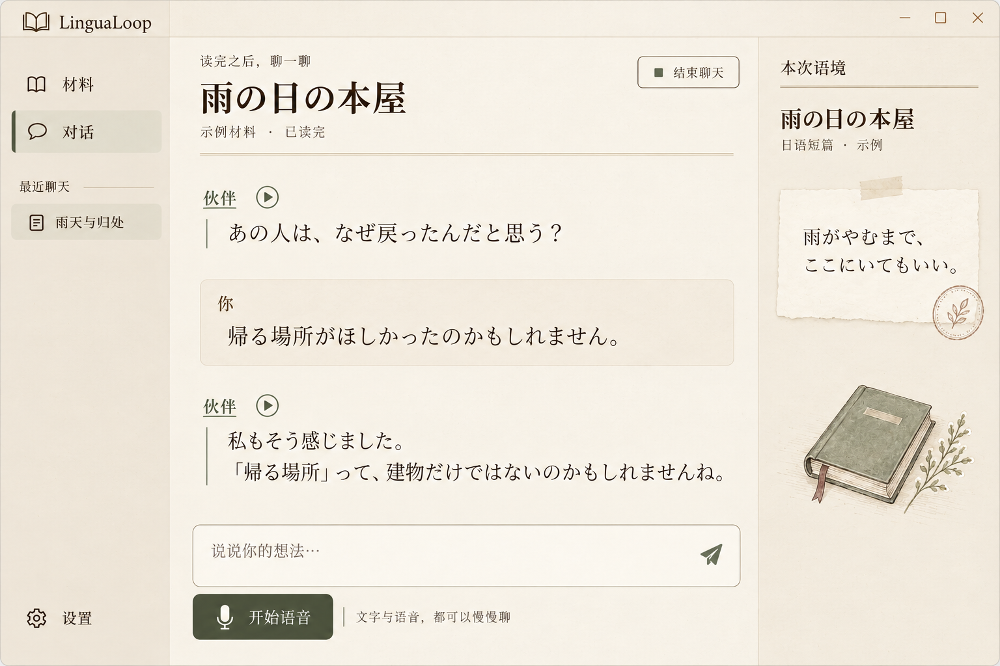
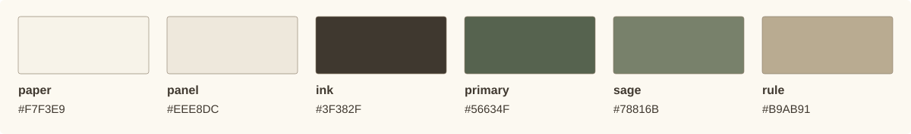

# 视觉风格设计：暖纸与墨迹（暂定）

更新日期：2026-10-29。风格标识：`warm-paper-ink/v1`，仅用于设计与资产版本记录，不是应用配置项。

**状态：用户暂定采用的视觉方向。** [总体布局与逐页 UI 稿](./UI_LAYOUT_DESIGN.md)已形成首轮提案，首批 QML 组件已迁移，最终视觉与完整实机验收尚未完成，见[工作区指南](../desktop/WORKSPACE.md)。本文固定风格描述、参考图、基础配色与资产生成语言，不把概念图中的布局当作已确认的产品方案。

## 1. 使用范围与依据

用户先认可“浅色旧书页”方案较舒适，再要求去掉紫色、吸收“复古手账”的元素；随后指定以最新融合稿暂定风格，先写设计文档，具体 UI 留待后续专门讨论。

因此，本风格以**浅暖纸、深褐墨迹、少量灰绿、克制的手账细节**为基线。保留第一版的清淡与留白，借用第二版的纸条、书签、淡印章及布面书插画；不采用整屏牛皮纸和密集涂鸦。

文档职责分开维护：

- [PROJECT_BRIEF](./PROJECT_BRIEF.md) 定义产品主旨：沉浸提供语境，LinguaLoop 帮你练输出。
- 本文定义视觉气质、色彩和资产风格，是后续视觉设计的统一入口。
- [读后对照聊天功能设计](./CONVERSATION_WORKSPACE_DESIGN.md) 定义已认可的功能与交互；视觉稿不覆盖其中的选择、范围和会话语义。
- [UI_SURFACE_PLAN](./UI_SURFACE_PLAN.md) 保留现有 MD3 实现与历史页面方案。当前 QML 已采用本暂定方向，具体覆盖与验证见工作区指南。
- [Decision 0021](../decisions/TECH_DECISIONS.md#decision-0021) 记录本次暂定选择及未决项。

## 2. 当前视觉基准图



上图为用户本次指定的最新融合稿，作为**视觉气质基准**。图片中的材料与聊天为虚构示例，不来自用户学习历史。

| 项目 | 记录 |
| --- | --- |
| 生成方式 | 内置 imagegen；以旧书页稿为底稿、复古手账稿为局部风格参考 |
| 生成日期 | 2026-10-28 |
| 尺寸 | 1536 × 1024 px |
| 文件 | `assets/visual-style/warm-paper-ink-reference-v1.png` |
| SHA-256 | `e1faf2dbe5daa91bbe89f71bd8a06b800b69dd669cddc99105546332874ba55b` |
| 生成与配色记录 | [warm-paper-ink-v1.json](./assets/visual-style/warm-paper-ink-v1.json) |

参考图不固定三栏、导航宽度、语境栏常驻、消息呈现形式、书插画位置、按钮文案或窗口尺寸。尤其不能据此推导“聊天时必须常驻右侧语境卡”；对照功能仍按交互规格设计。图中的植物印章只是装饰，不表示新增收藏、认证或批注功能。

## 3. 可直接引用的风格描述

### 3.1 中文描述

一个安静、温润、具有书籍气息的读后交流空间。背景像保存良好的浅色书页，而不是泛黄、破旧的羊皮纸；文字像深褐色墨迹，清楚而稳定。以宋体／明朝体的排版建立书香感，让正文、话语和留白成为主体。灰绿只在少量操作、选中标记、书签和插画中出现，帮助辨认层级，而不铺满大面积界面。

复古手账气质来自少数有意义的细节：一张浅奶油色引文纸条、一小段半透明纸胶带、一枚很淡的植物印章、一幅带书签的布面书插画。它们像读完后留下的私人札记，带一点人的痕迹；装饰集中于辅助位置，不穿插在每一条聊天消息之间。整体有复古温度，同时保持当代软件的清晰、规整与轻便。

### 3.2 English style reference

```text
A quiet, literary post-reading conversation space. Very pale warm ivory paper,
deep walnut ink, generous whitespace and refined Chinese Song / Japanese Mincho
typography. Use muted sage and olive sparingly for actions, selection marks and
small illustration accents. Paper grain is almost invisible behind reading text.
Borrow only a few personal reading-journal details: a pale cream quote slip,
a tiny translucent beige tape strip, a faded sepia botanical stamp, and a small
cloth-bound book with a ribbon bookmark drawn in fine ink and soft color wash.
Keep decoration in secondary areas. The overall feeling is calm, mature, warm,
human and elegant, with clear contemporary software affordances.
No purple, lavender, pink-purple, heavy parchment, brown kraft-paper coverage,
coffee stains, dense collage, childish doodles, thick marker lines or glossy 3D.
```

这一段用于描述整体方向；独立图标需要使用第 7 节的专用模板，避免模型顺带生成整张纸底或完整界面。

### 3.3 已暂定与设计默认值

| 内容 | 当前状态 |
| --- | --- |
| 以最新融合图为风格参考，保留第 1 版的清淡感 | 用户暂定 |
| 去掉紫色，吸收第 2 版的少量手账元素 | 用户明确要求 |
| 浅暖纸、褐色墨迹、克制装饰和灰绿点缀 | 对当前参考图的归纳 |
| 下文 HEX、候选字体、线宽和生成尺寸 | 可复用的设计默认值，后续可校准 |
| 信息架构、页面布局、面板位置、全部状态与深色主题 | 尚未在本轮讨论 |

## 4. 配色基准

以下 HEX 是从已选方向整理的**建议设计色值**，供后续建立统一 tokens 使用。生成图包含纸纹、水彩和明暗变化，不存在每个区域都严格相同的纯色；这些数值不是对整张图逐像素抽样的承诺，也尚未写入 `AppTheme.qml`。本表只定义浅色方向。



### 4.1 六个基础色

| 设计 token | HEX | 色彩描述 | 主要角色 |
| --- | --- | --- | --- |
| `paper` | `#F7F3E9` | 浅暖象牙纸 | 主阅读／聊天背景，最大面积 |
| `panel` | `#EEE8DC` | 浅亚麻纸 | 次级区域，与主区形成轻微分层 |
| `ink` | `#3F382F` | 深胡桃墨 | 标题、正文、主要图标 |
| `primary` | `#56634F` | 深橄榄灰绿 | 主要操作、焦点、明确的交互标记 |
| `sage` | `#78816B` | 鼠尾草灰绿 | 插画填色、装饰线、较大辅助图形 |
| `rule` | `#B9AB91` | 浅旧金／暖纸线 | 装饰细线、非关键分隔 |

### 4.2 支撑色与边界

| 设计 token | HEX | 用途与限制 |
| --- | --- | --- |
| `note` | `#FCF9F1` | 引文纸条及小面积提亮；不使用刺眼的整屏纯白 |
| `user_surface` | `#EFE7D9` | 需要区分说话人时的浅燕麦底，不强制采用气泡布局 |
| `ink_secondary` | `#6B6257` | 时间、来源等辅助文字；不能再通过大幅降低透明度使其失读 |
| `selected` | `#E2E4D7` | 非文本选区的浅灰绿选中底，与墨色标记配合；正文划选另议 |
| `outline` | `#887A67` | 必须辨识的控件轮廓、输入边界；比装饰分隔线更明确 |
| `stamp` | `#9C775E` | 淡赭褐印章、书签等少量装饰；不是错误／危险状态色 |
| `on_primary` | `#FFFCF5` | 深灰绿实底上的文字与图标 |

大面积以 `paper` 与 `panel` 为主，灰绿负责少量重点。不能把侧栏、消息、按钮和引文全部染绿；也不把浅旧金当成金属高光。紫、薰衣草、粉紫不再进入这套风格的默认色板。

`rule` 适合装饰，不单独承担输入框、焦点或状态区分；`sage` 不用作普通小字号正文。错误、警告、禁用、录音、等待、选中文本和成功状态需在总 UI 设计中补齐，不能直接把灰绿解释成所有状态。

### 4.3 基础纯色对比检查

按上述 sRGB 纯色色值计算，相对亮度对比结果如下。它们用于校验默认值，不代表已经测试过真实字体、纹理叠加或运行中的控件。

| 前景／背景 | 对比度 |
| --- | --- |
| `ink` / `paper` | 10.42:1 |
| `ink_secondary` / `paper` | 5.40:1 |
| `ink_secondary` / `panel` | 4.90:1 |
| `on_primary` / `primary` | 6.22:1 |
| `primary` / `selected` | 4.95:1 |

普通文字继续遵守项目至少 4.5:1 的目标。图标、状态、焦点和真实背景组合须在后续界面验证中逐项检查；不以“复古墨迹”作为淡化正文或功能控件的理由。

## 5. 字体与排版气质

生成图不能证明使用了某个真实字体文件。下面是实现候选与分工，不是已选定或已打包的字体；字体下载、字重、子集、许可与分发在实施时确认。

| 角色 | 候选方向 | 风格约束 |
| --- | --- | --- |
| 材料名、页面标题、少量引用 | Noto Serif SC / Noto Serif JP | 书籍排版的骨架；保留清晰笔画，不用超细字重制造优雅 |
| 日语讨论正文、较长引用 | 优先比较 Noto Serif JP，必要时与 Noto Sans JP 实测 | 长文清楚、有呼吸感；不照抄概念图的超大字号 |
| 中文正文及混排说明 | Noto Serif SC，按阅读测试选择 | 宋体气质与正文清晰度兼顾，不频繁切换字体 |
| 少量札记、短标记 | LXGW WenKai／霞鹜文楷 | 只承担短注记，不把整个应用写成手写日记 |
| 按钮、设置、小字、数字与工具说明 | Noto Sans SC / Noto Sans JP 或清楚的系统无衬线 | 功能信息易扫读，与衬线标题有明确分工 |
| 拉丁字母品牌文字 | 与中日文协调的克制衬线体 | 当前字标仅为风格示意，品牌字标另议 |

中日文使用相应语言字形，不仅凭“字符没有缺字”判断混排正确。日语假名、标点、引号、数字、中文长标题及不同缩放比例都需要实际检查。候选家族资料见 [Noto 官方使用说明](https://notofonts.github.io/noto-docs/website/use/) 与 [霞鹜文楷项目](https://github.com/lxgw/LxgwWenKai)。

排版应有纸页般舒展的行距和适度的行长。标题、正文、辅助文字各自稳定，不靠同时混用图中全部字体来建立层级。字号、行高、内容宽度及断点由总 UI 设计与实际窗口测试决定。

### 5.1 界面文案：直接、克制

2026-10-29 用户明确：不要用大量抒情短句制造人文感。书香气质由字体、配色、留白、纸感和图标承担，日常界面不为装饰而加文字。

- 默认保留实际内容、操作与必要状态；导航已能说明位置时，主区不再重复页面标题，也不显示 `xxx / xxx` 面包屑。
- 删除“每份材料，留住它自己的对话”“一页浅纸，一点墨色”“把表达，留到下次更自然”等装饰性句子。
- 使用“材料库”“新对话”“本次复盘”“导入材料”等直接命名，不把按钮与功能标题写成散文。
- 已读边界、失败恢复、密钥只读等信息用控件状态、标签或上下文反馈表达。候选服务的切换规则等低频说明按需访问，不各自常驻一行。
- 空状态说明下一步，错误说明发生了什么和如何恢复；不反复欢迎、鼓励或解释显而易见的控件。
- 原型状态与实现限制放在设计说明或评审外壳中，不作为产品页面的装饰文案。

### 5.2 空间使用：内容优先

2026-10-29 用户进一步明确：页面空间宝贵，不能用大标题区、重复说明和过大的装饰来消耗内容面积。

- 常规页面直接进入操作与内容，不设重复的标题行、眉题、副标题和面包屑；材料本身的名称、原文的真实章名属于内容身份，不作为装饰标题放大。
- 对话由侧栏的材料层级与选中态说明归属；侧栏收起或窗口较窄时，只补一个必要的上下文名称。顶部保留常用操作，不重复拼接材料名、对话名和多组状态。
- 侧栏底部不常驻“材料与历史保存在本机”等重复说明；“本轮信息”等低频内容放入按需菜单。
- 材料库优先可扫读的列表，小封面或图标只帮助识别；不为三份材料铺开大幅封面陈列。
- 设置以清楚的分类、设置行和必要的分组间距组织，不依靠大外边距或大边框卡片。
- 原文默认直接呈现正文；目录、定位、搜索按需打开浮层，关闭后不保留筛选器、空搜索框或“仅在已读范围内查找”等说明。浮层不挤压正文高度。
- 导入、内容编辑与已读范围使用主区页面；范围核对让原文与操作同处一页，末句与进度输入按需出现，不使用遮罩填表。
- 逐行检查独立文字：它是否是实际内容、可执行操作或当前必要状态？若只是解释相邻控件、陈述实现过程或重复已知信息，应删除或移入按需帮助。
- 正文行高、可读行长和操作命中范围仍需保留；压缩的是重复层级、装饰和固定占位，不是把所有文字缩小。
- 少量消息或材料带来的自然空白可以存在，不用标语、插画或无关内容填满。

### 5.3 输入流程与间距

2026-10-29 用户要求取消拥挤的弹窗填表，并先查阅外部设计。参考依据见[输入与流程调研](./UI_DESIGN_REFERENCES.md)；普通导入和编辑采用页面内完成，原文核对采用正文与旁侧操作。

- 删除重复层级后，给实际控件留空间：输入高度约 40–44px，字段间约 20–24px，分组约 28–32px，具体字体缩放仍需实测。
- 避免在小容器中叠放单选、标签页、文本输入、说明和确认；先按任务分页面，再按当前选择展示相关输入。
- 文件中已知的名称先带入，非必要信息允许留空；真正需要填写的字段保留简短、可见标签，不用长占位句代替名称。
- 返回与方式切换保留未提交输入；范围只有明确保存才提交，不用额外弹窗询问每次可逆导航。
- 系统文件选择器仍可用于选取本地文件；导航菜单与查找浮层不承担多步表单，也不遮住整个工作区。

## 6. 纸张、线条与装饰

### 6.1 纸张

- 基底是浅、干净、保养良好的纸。纹理接近细纤维，只在留白中若隐若现；正文区域尽量平静。
- 不使用大面积黄色暗角、污点、咖啡渍、烧边、折痕、强颗粒或牛皮纸棕底。
- 纹理不能决定文本对比、控件边界或分区；移除纹理后界面仍应完整可用。
- 后续实现若使用纹理资源，应避免平铺接缝、缩放噪点和文字上的颗粒干扰；本轮不选定资源实现方式。

### 6.2 线条与形状

- 以细、稳定的墨线和暖色分隔建立秩序。装饰线可以带一点手画痕迹，交互控件轮廓仍须清楚。
- 形状偏小圆角或近直角的纸片，不以大胶囊和大圆角彩色卡片作为默认视觉语言。具体圆角与点击尺寸后续确定。
- 局部可以使用双细线、短下划线、书签式标记；不要为所有面板加古典花角或整屏厚边框。
- 阴影只帮助理解纸条层次，范围小、颜色暖、存在感弱，不使用悬浮仪表盘式阴影。

### 6.3 手账细节

可借用的元素是浅奶油引文纸、一小段米色半透明胶带、淡赭褐植物印章、布面书和织物书签。它们只作为少数辅助视觉；同一个局部通常选择一组即可，不把每条消息都变成贴纸。

装饰不压正文、不跨过输入区、不伪装按钮；在窄窗口或内容拥挤时允许收起。图中的植物、胶带和印章不构成后续每个页面必须出现的组件清单。

## 7. 图标与插画的生成规范

### 7.1 两种资产密度

| 资产 | 目标 | 视觉语言 |
| --- | --- | --- |
| 功能小图标 | 在约 20 / 24 / 32 个逻辑像素下仍能辨认 | 单个明确轮廓、少量内部结构、深褐单色为主；非常轻微的人手笔触，不加纸纹与植物细节 |
| 辅助插画 | 适合较大留白或空状态，最终位置待定 | 细墨线加低饱和水彩／铅笔薄填色，可出现布面书、书签、细小枝叶；物体数量少、轮廓完整 |

“像同一位作者画的”比每张都增加新装饰更重要。核心轮廓、线宽、视觉重量、画面留白、墨色与填色方式必须统一。功能图标不照搬大幅书插画缩小；图标母版需要在实际显示尺寸检查。

同一图标不能同时反复承担品牌、材料库、每份材料、表格每行和原文入口的识别。优先以缩进、展开标记、分隔和选中态表达结构；生成图标供有明确语义的入口使用，不给每条文字机械配图。

AI 可以生成这套新视觉资产。生成后仍应整理透明边界、统一视觉尺寸；必要时对小图标做矢量重绘或轮廓校正。不能把概念图中粘连的像素、阴影或不一致细节直接作为产品图标。

### 7.2 参考图的使用方式

每次需要以图匹配风格时，提供第 2 节的基准 PNG，并明确：**这张图只是风格参考，不是编辑目标；只提取纸墨气质、颜色与笔触，不复制整张界面或文字。**

生成图标时请单独指定真正透明背景；整体纸色属于应用背景，不要烘焙进图标。没有输入图片的生成器可使用下列完整文字模板。颜色与细节冲突时，按本文的资产类型、配色角色与透明要求校准。

### 7.3 可复用功能图标模板

替换 `{SUBJECT}` 后可直接使用。`{SUBJECT}` 只描述对象与关键轮廓，不附加整页 UI、边框或文字。

```text
Use case: illustration-story.
Asset type: one standalone functional UI icon for LinguaLoop.
Subject: {SUBJECT}.

Visual style: quiet literary ink drawing from the same coherent icon family.
Mature, warm and restrained. A clear simplified silhouette, fine stable pen
outlines, rounded joins, and only a very slight handmade irregularity. Preserve
balanced geometry and recognizability at 20, 24 and 32 logical pixels.
Primary ink color: deep walnut #3F382F. Prefer a monochrome outline; if a fill is
essential, use a small flat muted sage #78816B area only. Functional details
must stay dark and readable. No texture inside the linework.

Composition: one icon centered on a square canvas, complete contour, no crop,
approximately 15% clear margin on each side, consistent optical weight with
the reference family. Think of a roughly 1.5–2 px stroke at a 24 px final size;
do not add tiny hatch marks, fibers or details that disappear at that size.

Background: truly transparent alpha, including all empty interior spaces.
Output: one clean high-resolution PNG master, preferably 1024 by 1024.
Do not draw paper, a colored tile, a sticker border or a fake checkerboard.
No words, letters, numbers, watermark, logo, shadows, 3D, glossy effects,
gradients, purple, lavender, thick cartoon marker lines or decorative plants.
If an interface reference image is supplied, use it for style only; do not
reproduce its layout, text or background.
```

1024 px 是生成母版建议，不是最终 UI 显示尺寸；生成器不支持精确尺寸时，优先保留比例、透明和轮廓。透明参数也应在生成工具中开启，不能只写进提示词。

### 7.4 对象描述片段

以下是后续可能需要的语义示例，不锁定页面入口、图标数量或最终图形。复制到上面模板的 `{SUBJECT}` 即可。

| 语义 | `{SUBJECT}` 英文描述 |
| --- | --- |
| 材料 | `A simple open book, two clean pages, one short ribbon bookmark, no readable page text.` |
| 对话 | `Two simple overlapping speech balloons with empty interiors and clearly separated contours.` |
| 开始语音 | `An upright microphone capsule on a short U-shaped stand, with one simple base, no sound waves.` |
| 回放 | `A small solid right-pointing play triangle centered inside a thin circle.` |
| 发送 | `A simple paper airplane with one clear central fold, pointing diagonally upward to the right.` |
| 历史 | `A small clock with two clear hands and one restrained backward-turning arrow.` |
| 复盘 | `A small note sheet with two short abstract ink lines and one simple check mark, no letters.` |
| 导入 | `A single document sheet with one small downward arrow entering its center.` |
| 设置 | `A simple balanced six-tooth gear with one circular opening, no extra decorative parts.` |
| 关闭／收起 | `Two clean diagonal ink strokes forming a balanced X, with generous empty space.` |

例如生成麦克风时，完整提示词由 7.3 模板加上“开始语音”这一行组成；无需附上 UI 中“开始语音”四个字。麦克风、暂停、结束等关键语义不能为了书香味改成难以理解的羽毛笔或印章。

### 7.5 可复用辅助插画模板

```text
Use case: illustration-story.
Asset type: one small literary UI illustration for LinguaLoop.
Subject: {SUBJECT}.

Style: a refined reading-journal illustration, fine deep walnut pen linework
#3F382F with sparse soft pencil and watercolor washes. Muted sage #78816B,
olive-gray #56634F, pale oatmeal #EEE8DC and a tiny warm sepia #9C775E accent.
Quiet, mature, delicate, human and elegant; restrained detail and ample air.
Slightly natural contours, not rigid clip art, not a thick-outline cartoon.
At most one main object and one very small supporting botanical or bookmark
detail. Keep the subject legible as a small UI illustration.

Composition: isolated, complete object with generous clear margins; a modest
three-quarter view is acceptable for a book. No surrounding room or desk.
Background: truly transparent alpha; no paper rectangle or full-page texture.
Texture belongs to the object and soft pigment only, never the empty canvas.
Output: one high-resolution PNG master, preferably 1024 by 1024.
No text, readable page writing, labels, letters, watermark, decorative caption,
heavy shadow, photographic realism, glossy 3D, purple, neon, coffee stains,
dense collage or cropped objects.
If a UI image is supplied, extract its visual language only.
```

与基准图相近的书插画可直接使用这个对象描述：

```text
A small closed sage cloth-bound book with visible cream page edges and one
warm brown ribbon bookmark; one delicate botanical sprig beside the book.
The book is the focal object, the sprig remains much smaller and secondary.
```

贴在纸上的引文、胶带或印章如果将来需要单独生成，应拆成独立资产并沿用同一配色；不要把正文、按钮或来源标签烘焙进插画。图片中那枚装饰印章不要求逐像素重现，也不生成仿真的机构印章。

### 7.6 生成与整理检查

1. 先做一小组母版，检查同一套墨色、线条、留白与造型是否成立，再扩展其他对象；每个对象独立输出，避免难以拆分的拼图。
2. 确认 PNG 有真实 alpha。把它分别放在 `paper`、`panel` 和深色测试底上检查白边；深色底检查不等于深色主题已经设计完成。
3. 以 20 / 24 / 32 px 检查功能图标，剔除糊线、细节粘连、重心偏移和靠背景颜色才能看懂的轮廓。点击热区与图形尺寸分开设计。
4. 状态变化主要通过统一颜色、底色或标记表达，不为悬停／按下重新生成一幅不同的图，以免轮廓跳动。具体状态方案留给 UI 设计。
5. 保留源 PNG、生成提示词、所用参考图版本及整理后的产物；文件名标记语义与版本，不覆盖已认可的母版。
6. 本轮没有交付独立图标、字体包或生产纹理。正式进入应用的资产再补齐来源／许可记录、可访问名称与安装包资源检查。

## 8. 后续总 UI 设计的输入与未决项

后续可以直接继承本稿的暖纸底色、墨色阅读层级、低饱和灰绿和少量手账细节；不要重新回到默认紫色 MD3 外观。继续复用 PySide6/QML 与现有工程边界，视觉方向变化不自动意味着更换技术栈。

以下事项留待单独讨论：

- 材料页、对话页、复盘与设置的信息组织，以及历史入口如何呈现。
- 默认聊天与按需对照原文的布局、面板位置、宽度、断点及窄窗口策略。
- 文字、连续语音、回放、等待、错误和恢复时的具体控件、状态与动效。
- 最终字体、字重、字号、行距、圆角、图标库、纹理强度与装饰位置。
- 深色／跟随系统主题如何延续相同气质；不通过简单反色生成深色规范。
- 对比度、键盘焦点、减少动效、中日长文、高 DPI 与实际窗口交互验证。

本轮选择只替代“后续视觉必须继续采用紫色 MD3 外观”的默认方向，不替代已认可的功能交互，也不把整张概念图变成组件／像素规格。当前运行中的应用、环境配置、数据和历史均不因本次文档记录而变动。

## 9. 视觉评审要点

- 第一眼是安静的纸页和清楚的对话，其次才注意到装饰。
- 暖而清淡，不脏、不黄、不像满屏牛皮纸；灰绿面积小，紫色已移除。
- 文字与功能标记清楚，复古感不依赖低对比度和超细字。
- 少量手账元素形成同一套气质，不成为贴纸合集。
- 缩小或收起插画后，界面仍完整；功能小图标与插画保持相同墨色但不同细节密度。
- 视觉提案能与 [读后对照聊天规格](./CONVERSATION_WORKSPACE_DESIGN.md) 并存，不擅自新增阅读前置步骤、批注系统或固定侧栏。

本次验证限于文档、图片完整性、链接和建议色值的纯色对比检查；不代表 QML 渲染、真人语音、字体分发或安装包验收通过。
