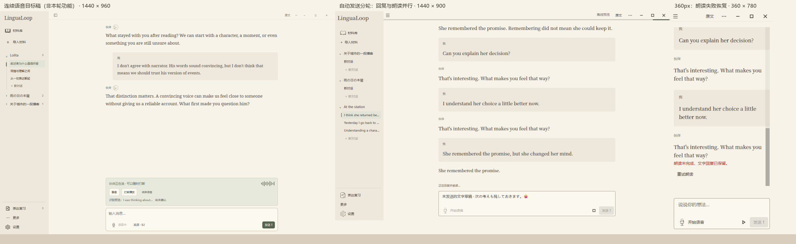

# QML 自动发送分轮语音验收

日期：2026-10-30。实现基线为 `1b1d6e0`，工作树当时干净。本次保留暖纸界面和原材料/线程/原文契约，接入已有 Python 语音服务；不新增模型、下载、云服务或数据库 schema。

## 交付行为

- 结束录音（含 60 秒自动停止）后识别并自动提交，不设常规转写确认步骤。取消不提交，空/格式错误音频不调用对话模型。
- 用户消息在确认事务后立刻出现；可见文字流与分句 TTS 分开运行。默认每轮朗读，可在音频设置关闭，文字草稿独立保留。
- 三段/24 MiB 有界主线程播放队列，独立文件与播放代际；EndOfMedia 推进。停止朗读清队列和后续合成，文字仍可完成。
- STT/回复/合成与设备失败分别恢复。按请求 ID 防重；回复重试绑定原 turn 和来源，音频重试不调用 LLM，完整缓存重播。
- 重启不自动请求模型；未完成 turn 与有效租约有可恢复提示。旧历史正常显示，不补造 turn 或来源。
- worker 增加带身份的完成/取消通道；旧业务完成回调保持兼容。文案经 Qt 翻译入口提取，共 406 条，新增音频偏好与学习母语/显示语言独立。

## 回归与包

实施前相关离线基线 37 passed。新增与更新测试覆盖三轮 QML 自动发送、停止后文字继续、队列背压、STT-only、空识别、草稿/来源隔离、逐轮三类恢复、设备失败、重启、窄屏开关与翻译、worker 完成身份和原生播放队列行为。普通回归显式 `RUN_REAL_AI_TESTS=0`；真实 AI/本地模型/RTC opt-in 测试保持跳过。

最终全量离线回归：**379 passed / 10 skipped，302.03 秒**；Ruff 与 `git diff --check` 通过。wheel 隔离加载、窗口控件及 **75 项 QML/图标/字体/许可证资源**检查通过。产物为 ignored `build/voice-qml/package/lingualoop-0.1.0-py3-none-any.whl`，SHA256：`45130ba2884ad0a21f289fb2a39c7098ab4b74f13895911724e9142b62cf5729`。

## 可见窗口和视觉对照

验证器通过可见 Windows QML 窗口导入自写 Markdown，并用 QML 输入、录音按钮与合成设备产生真实工作流记录；没有向数据库注入历史。测试 SQLite、QSettings、模型缓存均在独立临时目录，不读取个人 `.env`，不下载模型、不调用真实服务。录音/播放为合成设备，不能称为真人麦克风或扬声器验收。



对照结论：保留目标稿的纸色、褐墨、灰绿、字体层级、紧凑侧栏和输入框。实际交付使用一行状态与停止朗读操作，不呈现目标稿尚未实现的模拟波形、静音或自然插话。识别错误留在输入区域，回复/朗读错误附属对应轮次；窄屏保留字段与可点击入口。

首轮可见检查发现最新一轮的朗读重试落在视口外；按内容高度变化重新定位滚动，并保留用户主动回看历史时的滚动位置后，窄屏复验通过。依据：[Qt 6.11 ScrollView sizing](https://doc.qt.io/qt-6.11/qml-qtquick-controls-scrollview.html)、[Flickable contentHeight/contentY](https://doc.qt.io/qt-6.11/qml-qtquick-flickable.html)。播放器推进依据 [QMediaPlayer EndOfMedia](https://doc.qt.io/qt-6.11/qmediaplayer.html#MediaStatus-enum)。

缩放使用独立进程的 `QT_SCALE_FACTOR=1/1.25/1.5`，未改动用户 Windows 显示设置；不等于跨屏/跨 DPI 的物理移动验收。100% 和 125% 各完成 107 个可见 QML 视图，覆盖 360/600/800/1180/1440px、六种语音/错误状态与已有页面。相同宽度下录音、识别、回复并朗读、识别错误、回复错误和朗读错误的录音/发送按钮 y 坐标一致：360/600px 为 720，800/1180/1440px 为 840。报告位于 ignored `build/voice-qml/visible-100-final`、`visible-125-final`；八组整体布局对照位于 `build/voice-qml/comparison`。唯一常规 Qt 日志为 FFmpeg 版本说明。

150% 原生窗口初次复查在读取坐标时仍得到大窗口布局，但失败截图渲染后已呈现正确窄布局。进一步确认是验收器在延迟的 layout polish 前测量：要求自有窗口恢复正常可见、等待 exposed，并先取得实际渲染帧后再量坐标；未修改生产窗口结构。最终 150% 同样通过 107 个视图和按钮位置断言，三档共 321 个视图。依据：[Qt Layout polish](https://doc.qt.io/qt-6.11/qquickitem.html#ensurePolished)。失败记录仍在本次工具记录与 ignored 输出中保留。

计时分别区分识别完成、UI 首字/全文、provider 首字/全文、首段可用/交付与播放器启动。150% 报告 `synthetic_voice_timings` 保留各宽度本轮安全计时；识别/播放器/UI 从录音结束计起，协调器分段和 provider 指标保留各自调用起点，不能混加。合成设备与刻意暂停的 Mock 用于检查时序，不能外推真实延迟；播放器启动也不是物理出声。未作真实 STT 精度、听感或一秒达标声明。

## 后续边界

连续采集、端点/VAD、AEC、自然插话、LiveKit 桌面接线、自动重连和真人三语质量继续独立推进；VOICEVOX/独立 Melo 英文的 GUI 安装选择入口不在本增量内。深色保留基础兼容，本轮视觉定稿仍仅承诺浅色。

## 复现

```powershell
$env:RUN_REAL_AI_TESTS='0'
uv run --locked ruff check src tests scripts
.venv\Scripts\python.exe -m pytest -q
$env:QT_QPA_PLATFORM='windows'
$env:QT_SCALE_FACTOR='1.5'
.venv\Scripts\python.exe scripts/validate_ui_workspace.py --visible --voice-states --review-fixture --output build/voice-qml/visible-150-final
uv build --wheel --out-dir build/voice-qml/package
.venv\Scripts\python.exe scripts/check_wheel_resources.py build/voice-qml/package/lingualoop-0.1.0-py3-none-any.whl
```

另外两档以 `QT_SCALE_FACTOR=1` 和 `1.25` 各自启动验证进程，输出分别使用 `visible-100-final` 和 `visible-125-final`。截图与性能日志包含合成资料，真实学习库和个人配置不在验证范围。
